# Monuments of India

[](https://monuments-of-india-nu.vercel.app)
[](LICENSE)
[](https://threejs.org/)
[](https://monuments-of-india-nu.vercel.app)

**Live site: https://monuments-of-india-nu.vercel.app**

201 Indian landmarks across 35 states and union territories, modelled in interactive 3D with
[three.js](https://threejs.org/). Every model is built in code at roughly real-world proportions,
from simple shapes, carved detail and sculpted figures: there are no model files or scans to
download.

| 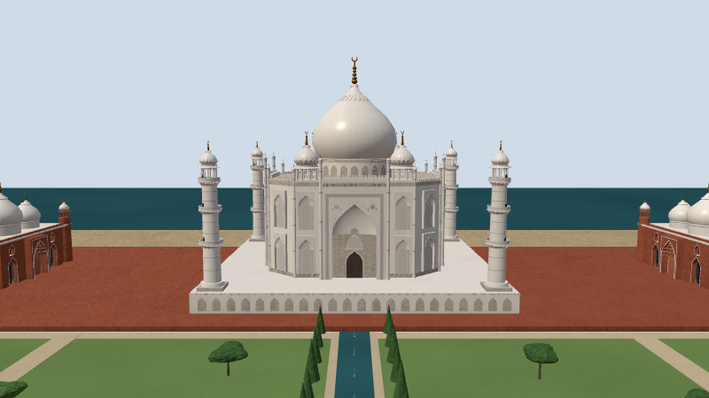 | 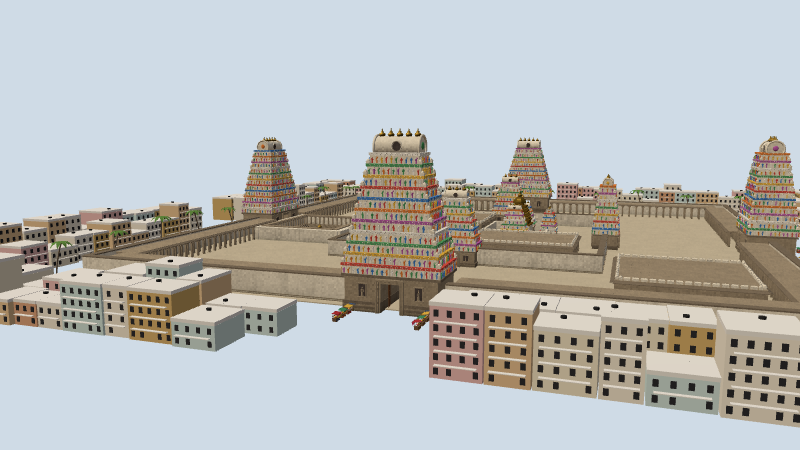 | 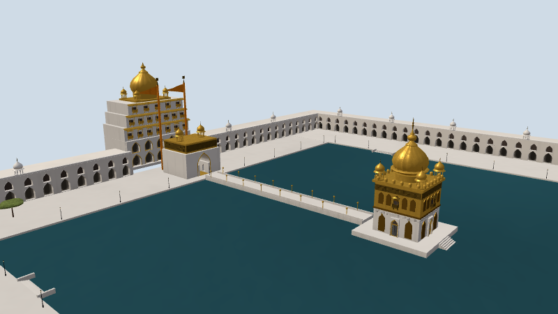 |
| :---: | :---: | :---: |
| [Taj Mahal](https://monuments-of-india-nu.vercel.app/#taj-mahal) | [Meenakshi Temple](https://monuments-of-india-nu.vercel.app/#meenakshi-temple) | [Golden Temple](https://monuments-of-india-nu.vercel.app/#golden-temple) |

All 201, state by state, with a picture of each: **[States and monuments](monuments.md)**.

## Contents

- [Features](#features)
- [Using the site](#using-the-site)
- [Historical Atlas of India](#historical-atlas-of-india)
- [Technology](#technology)
- [Project structure](#project-structure)
- [Documentation](#documentation)
- [Components at a glance](#components-at-a-glance)
- [Run locally](#run-locally)
- [Checks](#checks)
- [Video](#video)
- [Deploy](#deploy)
- [Credits](#credits)
- [License](#license)

## Features

- **201 monuments in 3D**, across 35 states and union territories: temples, gurdwaras, churches,
  mosques, synagogues, Harappan cities, forts and palaces, tombs and memorials, bridges, railway stations, airports and civic buildings, each at roughly its real proportions.
- **Built in code.** Every model is assembled from shared parts (domes, kiosks, pillars, arches,
  temple towers) and sculpted figures. There are no model files or scans to download.
- **A map of India to start from**, with a pin for every monument, a list by state, a search box,
  and filters by architectural style and by main material.
- **Each monument in its setting:** the trees of its region, water that reflects it, towns, boats,
  flags, lamps and animals, on land that runs out to the horizon.
- **Day and night.** At night floodlights and festival lights come on and stars fill the sky.
- **Stone that looks like stone:** masonry joints, marble veining, weathering, carved friezes and
  pierced screens are drawn by the surface shader, over photo textures of real stone.
- **A plaque for every monument:** place, dates, style, material and a few facts.
- **Works on phones.** Lighter models and a layout that folds the list and the plaque round the
  3D view.
- **Direct links.** Every monument has its own address, such as
  [`#taj-mahal`](https://monuments-of-india-nu.vercel.app/#taj-mahal).

## Using the site

- **Map:** the site opens on a map of India with a pin for every monument, coloured by kind
  (temples and shrines, forts and palaces, tombs and memorials, civic and engineering). Numbered pins
  group monuments that sit close together and zoom in when selected.
- **List and search:** the sidebar lists every monument by state, with a search box. On a phone it
  becomes a strip you swipe along under the model.
- **Filters:** chips under the search box narrow the list and the map's pins by architectural style
  and by main material; the two combine, with the search too. Every monument belongs to at least
  one group of each, and some to more than one (Amber Fort is Rajput and Indo-Islamic; the Taj
  Mahal is marble and sandstone). Hover over a chip to see how many monuments it holds. The groups
  are defined in `js/filters.js`:
  - **Style:** Dravidian & Vesara, Nagara (with its regional forms: Chandela, Kalinga, Bhumija,
    Maru-Gurjara and Jain), Buddhist, Indo-Islamic, Rajput, Indo-Saracenic, Colonial & European,
    Modern, and Regional & mixed (Sikh, the Himalayan pagoda, Keladi, Gommateshwara, the brick
    temples of Bengal, Ahom Assam, Ladakh, the Karkota temples of Kashmir, the Maratha wada, the
    Bundela palaces, the Harappan cities, the Parsi fire temple, Meitei Manipur, the Khasi root
    bridges, Elephanta and the buildings that mix traditions).
  - **Material:** sandstone, marble, granite, basalt, laterite, brick & lime, other stone
    (khondalite, soapstone, limestone and local stone), timber, and steel & concrete.
- **3D view:** drag to orbit, scroll or pinch to zoom, and use ← → to move between monuments. The
  plaque gives the place, dates, style and a few facts; on a phone it folds into a bar under the model.
- **Day and night:** the scene follows your device's dark mode until you press the Night button, then
  remembers your choice. At night, floodlights and festival lights come on and stars fill the sky.
- **Links:** open any monument directly with its hash, for example
  [`#taj-mahal`](https://monuments-of-india-nu.vercel.app/#taj-mahal).

## Historical Atlas of India

The eras on a map now have a site of their own: the [Historical Atlas of India](https://historical-atlas-of-india.vercel.app)
([repository](https://github.com/amananandrai/historical-atlas-of-india)), a map of the subcontinent
with a year slider from the Indus cities to the Republic. Each monument's plaque here links to its
year there, and the atlas pins every monument, linking back to its 3D model. The atlas reads each
monument's `year` from `js/data.js`.

## Technology

- **[three.js](https://threejs.org/) 0.160**, loaded from a CDN, with its post-processing passes
  (ambient occlusion, bloom, SMAA antialiasing).
- **A static site with no build step:** `index.html`, `css/style.css` and ES modules in `js/`.
- **One file per monument** in `js/monuments/`, and one for its finer detail and setting in
  `js/details/`, both named after the monument's id in `js/data.js`. A monument's code is fetched
  only when it is opened.
- **Shared parts** in `js/helpers.js` and `js/parts/`: see [Architecture](docs/architecture.md)
  and [The setting](docs/setting.md).
- **Procedural surfaces** in `js/surface.js`, generated in the shader from world position, with
  CC0 photo textures and their normal and roughness maps over them (`js/textures.js`).
- **Sculpted figures:** statues and temple animals are grown from signed distance fields and
  meshed in the browser (`js/sdf.js`), from the 182 m Statue of Unity to the
  Adiyogi bust and Ramanuja of the Statue of Equality.
- **Triangle budgets** for each monument (`js/detail.js`): 800,000 on desktops, 1,000,000 for the
  twelve with large sculpted figures, and 300,000 on phones. Trees and ground cover are planted
  only up to 650,000, so the rest goes to the architecture and the statues. Repeated parts are
  instanced.
- **Headless checks** in `tools/`, run with Node and Playwright.
- **Hosting:** Vercel. **Video:** a [HyperFrames](https://hyperframes.heygen.com) project in `video/`.

How surfaces, water, landscape, lighting and the camera work is in
[How it is drawn](docs/how-it-is-drawn.md).

## Project structure

```text
index.html, css/style.css   the page and its styling
js/main.js                  the app: scene, loading, camera, list, plaque
js/data.js                  the 201 monuments: facts, and how to load each
js/helpers.js, js/parts/    the shared kit every monument is built from
js/monuments/<id>.js        one file per monument: the masses
js/details/<id>.js          one file per monument: finer architecture and the setting
js/surface.js, sdf.js, …    drawn surfaces, sculpting, and the passes run on a built model
assets/views, textures      a picture of each monument; CC0 photo textures
docs/                       the guides, with a picture of every shared part in docs/img
monuments.md                all 201 monuments by state (generated)
tools/                      headless checks and picture tools
video/                      the film
```

Every file, how the code is layered and how to add a monument:
[Project structure](docs/project-structure.md).

## Documentation

| Page | What it covers |
| --- | --- |
| [States and monuments](monuments.md) | All 201 monuments by state: place, dates, style, material, a link to the 3D view and a picture of each |
| [Project structure](docs/project-structure.md) | Every file and folder, how the code is layered, a monument's entry in `js/data.js`, how to add a monument, conventions and automation |
| [Components](docs/components.md) | Every shared part and every statue in pictures, on one page |
| [Architecture](docs/architecture.md) | The parts the buildings are made of: domes, kiosks, pillars, arches, walls, roofs, ornament and surfaces, then by tradition: temples, Mughal, forts, churches and colonial buildings, Tibetan monasteries, gurdwaras, and the early and regional styles. What each takes and where it lives |
| [The setting](docs/setting.md) | What stands round them: the 21 kinds of tree, shrubs, lamps, flags, boats, stalls, towns and cities, traffic, trains, aircraft, animals, hills and mountains |
| [How it is drawn](docs/how-it-is-drawn.md) | What happens when a monument is opened; surfaces, water, landscape, sculpture, lighting, the camera, budgets, and what differs on phones |
| [Model checks](tools/README.md) | The headless checks and picture tools in `tools/` |
| [Video](video/README.md) | Rendering the film, which covers the first 101 monuments |

## Components at a glance

A few of the shared parts. All 155 pictures, statues included, are in [Components](docs/components.md).

|  | 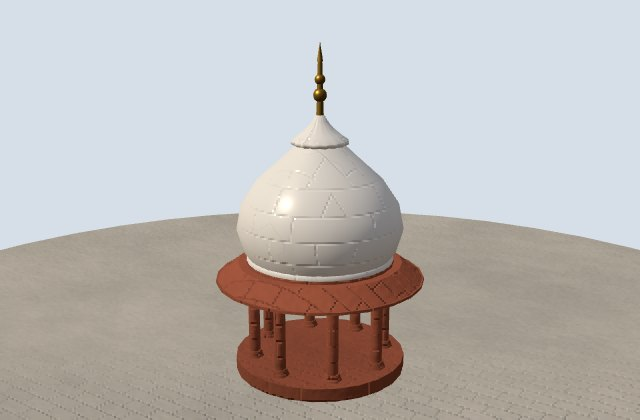 | 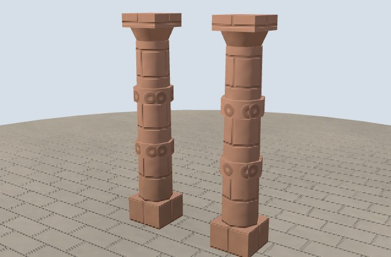 |
| :---: | :---: | :---: |
| [Domes](docs/architecture.md#domes) | [Kiosks](docs/architecture.md#kiosks-and-turrets) | [Pillars](docs/architecture.md#pillars-and-columns) |
| 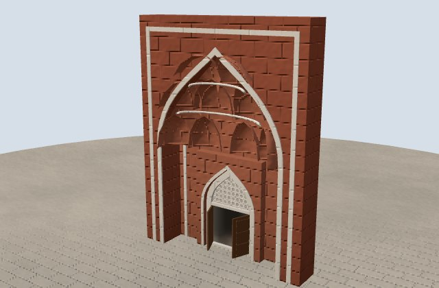 |  |  |
| [Mughal](docs/architecture.md#mughal-and-indo-islamic) | [Temples](docs/architecture.md#temples) | [Forts](docs/architecture.md#forts) |
| 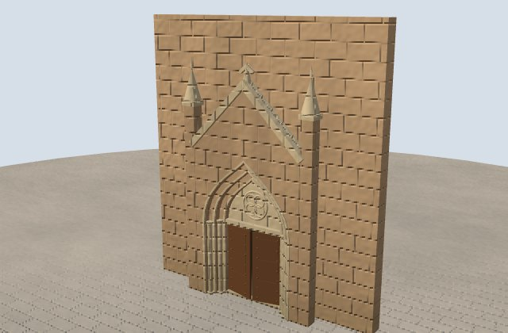 | 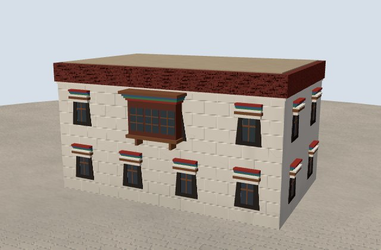 | 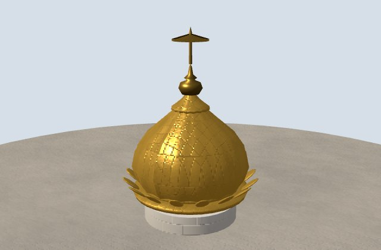 |
| [Churches and colonial](docs/architecture.md#churches-and-colonial-buildings) | [Monasteries](docs/architecture.md#tibetan-monasteries) | [Gurdwaras](docs/architecture.md#gurdwaras) |
| 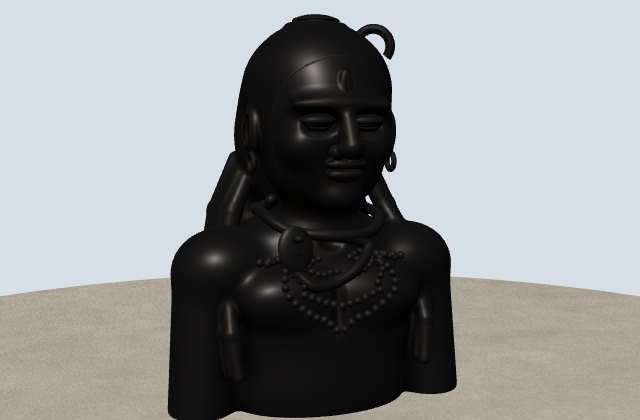 | 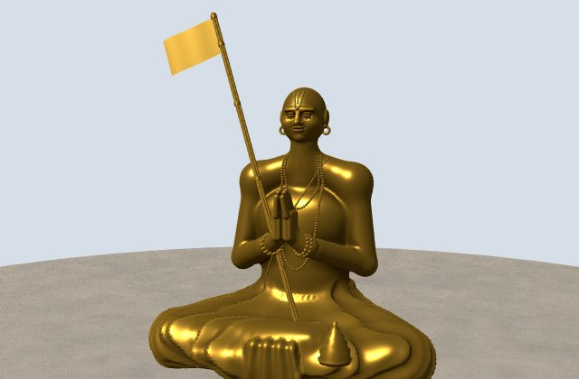 | 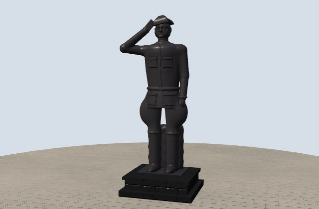 |
| [Adiyogi](docs/components.md#statues) | [Ramanuja, Statue of Equality](docs/components.md#statues) | [Netaji, India Gate](docs/components.md#statues) |
| 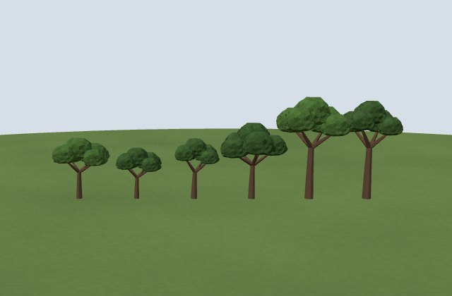 | 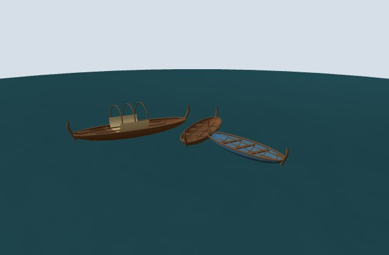 | 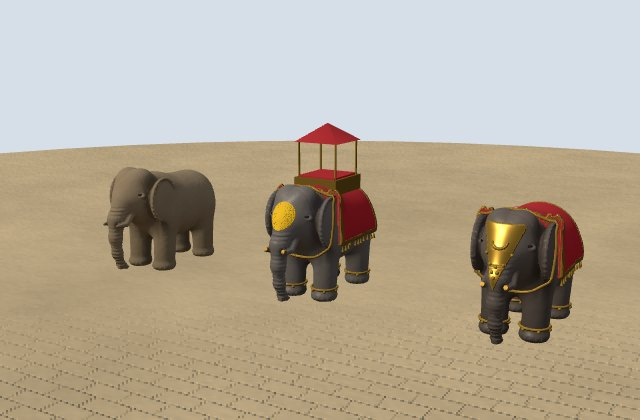 |
| [Trees](docs/setting.md#trees) | [Boats](docs/setting.md#boats) | [Animals](docs/setting.md#animals) |

## Run locally

It's a static site with no build step: `index.html`, `css/style.css` and ES modules in `js/`, one file
per monument in `js/monuments/` and one for its setting and finer detail in `js/details/`, with
three.js 0.160 loaded from a CDN. Serve the folder with any static server:

```bash
npx serve .
```

## Checks

`tools/` holds headless checks that build every model in Chromium as the site does: triangle
budgets, flicker, heights against `refs`, the filter groups, that the lists of monuments agree, and
renders of the home views and of the shared parts.

```bash
cd tools
npm install
npm run check          # registry, filters, heights, budgets and flicker, over all 201
```

See [`tools/README.md`](tools/README.md).

## Video

`video/` holds a [HyperFrames](https://hyperframes.heygen.com) project that renders an hour-long
documentary journey across India at 1920×1080, using the site's own models; it covers the first
101 monuments. For each monument it
plays a 3D map flight to its location, a drone orbit and close-ups of its domes, spires and pillars.
A narrator voiced by [Sarvam AI](https://www.sarvam.ai/) text-to-speech tells the story. See
[`video/README.md`](video/README.md) to render it.

## Deploy

Hosted on Vercel at https://monuments-of-india-nu.vercel.app as a static site. Every push to `main`
deploys to production.

## Credits

- **Photo textures** in `assets/textures` are from [Poly Haven](https://polyhaven.com) (CC0):
  marble_01, red_sandstone_wall, sandstone_blocks_08, plastered_stone_wall, plastered_wall_02,
  granite_wall, rock_face_03, coral_fort_wall_03, stone_brick_wall_001, rough_block_wall,
  concrete_wall_008 and weathered_brown_planks. `tools/pack-textures.py` fetches them and packs
  each one's normal and roughness maps into `<name>_nr.jpg`.
- **Map data:** state boundaries and India's outline come from
  [Natural Earth](https://www.naturalearthdata.com) (public domain), using its India point-of-view
  boundaries, simplified into `js/india-map.js`.
- **Narration voice:** [Sarvam AI](https://www.sarvam.ai/) Bulbul text-to-speech.
- **Fonts:** Rozha One and Hind on the site; the video adds Noto faces for each Indian script (all
  SIL Open Font License).

## License

The code is [MIT](LICENSE). Textures, map data and fonts keep the licenses named under Credits, above.
