# Monuments of India

[](https://monuments-of-india-nu.vercel.app)
[](LICENSE)
[](https://threejs.org/)
[](https://monuments-of-india-nu.vercel.app)

**Live site: https://monuments-of-india-nu.vercel.app**

101 Indian landmarks across 26 states and union territories, modelled in interactive 3D with
[three.js](https://threejs.org/). Every model is built in code at roughly real-world proportions,
from simple shapes, carved detail and sculpted figures: there are no model files or scans to
download.

| 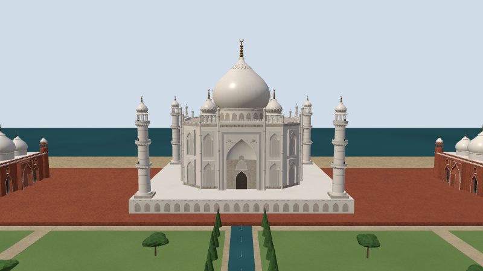 | 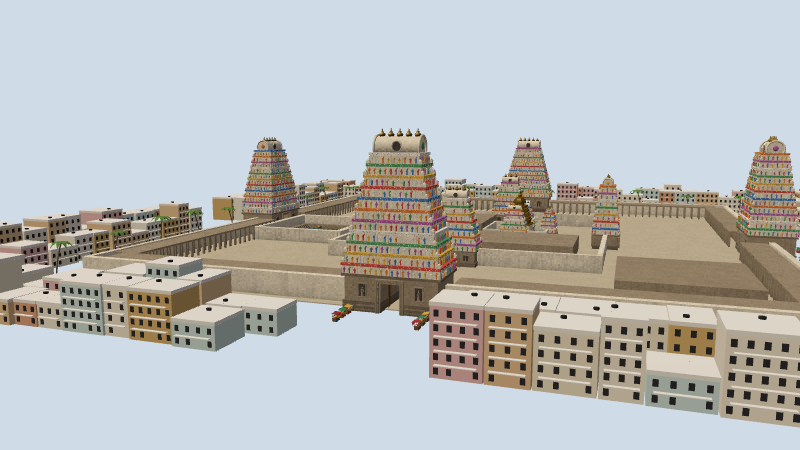 | 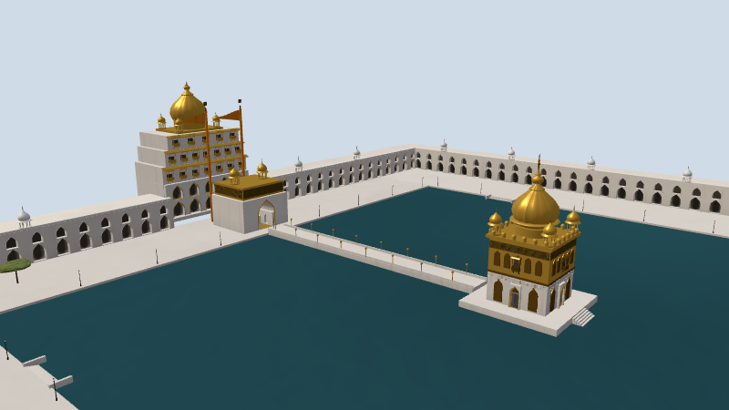 |
| :---: | :---: | :---: |
| [Taj Mahal](https://monuments-of-india-nu.vercel.app/#taj-mahal) | [Meenakshi Temple](https://monuments-of-india-nu.vercel.app/#meenakshi-temple) | [Golden Temple](https://monuments-of-india-nu.vercel.app/#golden-temple) |

All 101, state by state, with a picture of each: **[States and monuments](monuments.md)**.

## Contents

- [Features](#features)
- [Using the site](#using-the-site)
- [Technology](#technology)
- [Documentation](#documentation)
- [Components at a glance](#components-at-a-glance)
- [Run locally](#run-locally)
- [Checks](#checks)
- [Video](#video)
- [Deploy](#deploy)
- [Credits](#credits)
- [License](#license)

## Features

- **101 monuments in 3D**, across 26 states and union territories: temples, forts and palaces,
  tombs and memorials, bridges and civic buildings, each at roughly its real proportions.
- **Built in code.** Every model is assembled from shared parts (domes, kiosks, pillars, arches,
  temple towers) and sculpted figures. There are no model files or scans to download.
- **A map of India to start from**, with a pin for every monument, a list by state, a search box,
  and filters by architectural style and by main material.
- **Each monument in its setting:** the trees of its region, water that reflects it, towns, boats,
  flags, lamps and animals, on land that runs out to the horizon.
- **Day and night.** At night floodlights and festival lights come on and stars fill the sky.
- **Stone that looks like stone:** masonry joints, marble veining, weathering, carved friezes and
  pierced screens are drawn by the surface shader, over photo textures of real stone.
- **A plaque for every monument:** place, dates, style, material and a few facts.
- **Works on phones.** Lighter models and a layout that folds the list and the plaque round the
  3D view.
- **Direct links.** Every monument has its own address, such as
  [`#taj-mahal`](https://monuments-of-india-nu.vercel.app/#taj-mahal).

## Using the site

- **Map:** the site opens on a map of India with a pin for every monument, coloured by kind
  (temples and shrines, forts and palaces, tombs and memorials, civic and engineering). Numbered pins
  group monuments that sit close together and zoom in when selected.
- **List and search:** the sidebar lists every monument by state, with a search box. On a phone it
  becomes a strip you swipe along under the model.
- **Filters:** chips under the search box narrow the list and the map's pins by architectural style
  and by main material; the two combine, with the search too. Every monument belongs to at least
  one group of each, and some to more than one (Amber Fort is Rajput and Indo-Islamic; the Taj
  Mahal is marble and sandstone). Hover over a chip to see how many monuments it holds. The groups
  are defined in `js/filters.js`:
  - **Style:** Dravidian & Vesara, Nagara (with its regional forms: Chandela, Kalinga, Bhumija,
    Maru-Gurjara and Jain), Buddhist, Indo-Islamic, Rajput, Indo-Saracenic, Colonial & European,
    Modern, and Regional & mixed (Sikh, the Himalayan pagoda, Keladi, Gommateshwara and the
    buildings that mix traditions).
  - **Material:** sandstone, marble, granite, basalt, laterite, brick & lime, other stone
    (khondalite, soapstone, limestone and local stone), timber, and steel & concrete.
- **3D view:** drag to orbit, scroll or pinch to zoom, and use ← → to move between monuments. The
  plaque gives the place, dates, style and a few facts; on a phone it folds into a bar under the model.
- **Day and night:** the scene follows your device's dark mode until you press the Night button, then
  remembers your choice. At night, floodlights and festival lights come on and stars fill the sky.
- **Links:** open any monument directly with its hash, for example
  [`#taj-mahal`](https://monuments-of-india-nu.vercel.app/#taj-mahal).

## Technology

- **[three.js](https://threejs.org/) 0.160**, loaded from a CDN, with its post-processing passes
  (ambient occlusion, bloom, SMAA antialiasing).
- **A static site with no build step:** `index.html`, `css/style.css` and ES modules in `js/`.
- **One file per monument** in `js/monuments/`, and one for its finer detail and setting in
  `js/details/`. A monument's code is fetched only when it is opened.
- **Shared parts** in `js/helpers.js` and `js/details/`: see [Architecture](architecture.md)
  and [The setting](realism.md).
- **Procedural surfaces** in `js/surface.js`, generated in the shader from world position, with
  CC0 photo textures and their normal and roughness maps over them (`js/textures.js`).
- **Sculpted figures:** statues and temple animals are grown from signed distance fields and
  meshed in the browser (`js/sdf.js`).
- **Triangle budgets:** 650,000 on desktops and 300,000 on phones for each monument
  (`js/detail.js`); repeated parts are instanced.
- **Headless checks** in `tools/`, run with Node and Playwright.
- **Hosting:** Vercel. **Video:** a [HyperFrames](https://hyperframes.heygen.com) project in `video/`.

How surfaces, water, landscape, lighting and the camera work is in
[How it is drawn](how-it-is-drawn.md).

## Documentation

| Page | What it covers |
| --- | --- |
| [States and monuments](monuments.md) | All 101 monuments by state: place, dates, style, material, a link to the 3D view and a picture of each |
| [Components](components.md) | Every shared part in pictures, on one page |
| [Architecture](architecture.md) | The parts the buildings are made of: domes, kiosks, pillars, arches, doors and windows, eaves, temple towers, fort gates. What each takes and where it lives |
| [The setting](realism.md) | What stands round them: the 21 kinds of tree, shrubs, lamps, flags, boats, stalls, towns, traffic and animals |
| [How it is drawn](how-it-is-drawn.md) | Surfaces, landscape, water, sculpture, lighting, the camera, and what differs on phones |
| [Model checks](tools/README.md) | The headless checks and picture tools in `tools/` |
| [Video](video/README.md) | Rendering the film of all 101 monuments |

## Components at a glance

A few of the shared parts. All of them are in [Components](components.md).

| 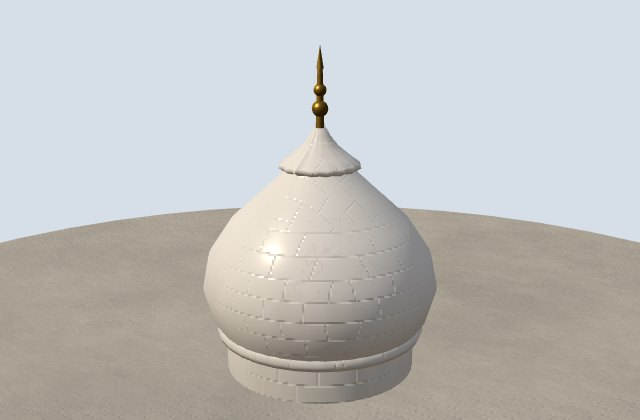 | 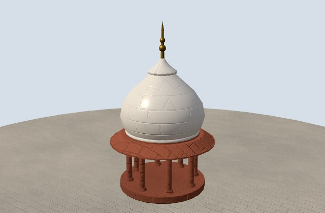 | 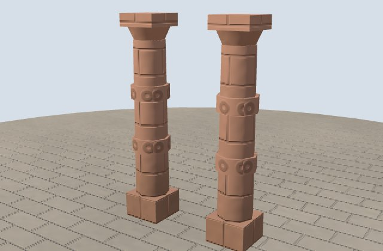 |
| :---: | :---: | :---: |
| [Dome](architecture.md#domes) | [Chhatri](architecture.md#kiosks-and-turrets) | [Pillars](architecture.md#pillars-and-columns) |
| 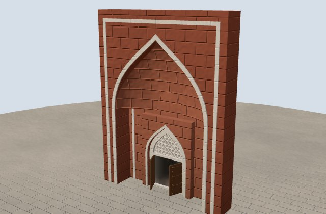 | 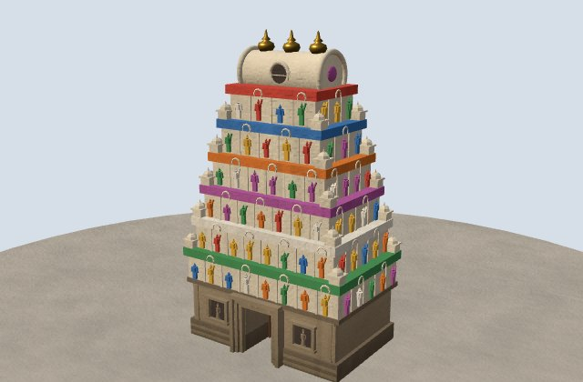 | 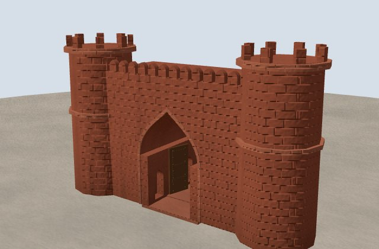 |
| [Arches and doors](architecture.md#arches-doors-and-windows) | [Temple towers](architecture.md#temples-jsdetailstemplesjs) | [Forts](architecture.md#forts-jsdetailsfortsjs) |
| 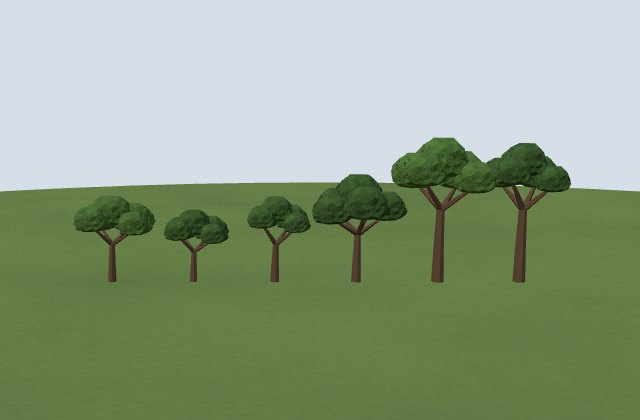 | 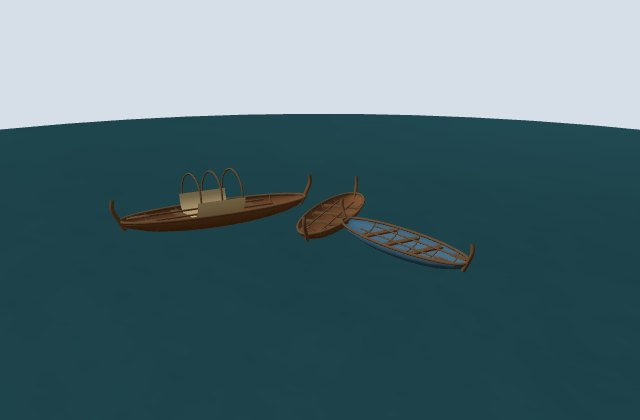 | 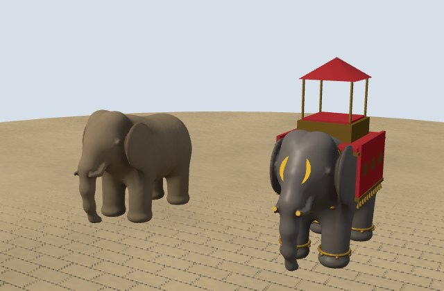 |
| [Trees](realism.md#trees) | [Boats](realism.md#boats) | [Animals](realism.md#animals) |

## Run locally

It's a static site with no build step: `index.html`, `css/style.css` and ES modules in `js/`, one file
per monument in `js/monuments/` and one for its setting and finer detail in `js/details/`, with
three.js 0.160 loaded from a CDN. Serve the folder with any static server:

```bash
npx serve .
```

## Checks

`tools/` holds headless checks that build every model in Chromium as the site does: triangle
budgets, flicker, heights against `refs`, the filter groups, and renders of the home views. See
[`tools/README.md`](tools/README.md).

## Video

`video/` holds a [HyperFrames](https://hyperframes.heygen.com) project that renders an hour-long
documentary journey across India at 1920×1080, using the site's own models. For each monument it
plays a 3D map flight to its location, a drone orbit and close-ups of its domes, spires and pillars.
A narrator voiced by [Sarvam AI](https://www.sarvam.ai/) text-to-speech tells the story. See
[`video/README.md`](video/README.md) to render it.

## Deploy

Hosted on Vercel at https://monuments-of-india-nu.vercel.app as a static site. Every push to `main`
deploys to production.

## Credits

- **Photo textures** in `assets/textures` are from [Poly Haven](https://polyhaven.com) (CC0):
  marble_01, red_sandstone_wall, sandstone_blocks_08, plastered_stone_wall, plastered_wall_02,
  granite_wall, rock_face_03, coral_fort_wall_03, stone_brick_wall_001, rough_block_wall,
  concrete_wall_008 and weathered_brown_planks. `tools/pack-textures.py` fetches them and packs
  each one's normal and roughness maps into `<name>_nr.jpg`.
- **Map data:** state boundaries and India's outline come from
  [Natural Earth](https://www.naturalearthdata.com) (public domain), using its India point-of-view
  boundaries, simplified into `js/india-map.js`.
- **Narration voice:** [Sarvam AI](https://www.sarvam.ai/) Bulbul text-to-speech.
- **Fonts:** Rozha One and Hind on the site; the video adds Noto faces for each Indian script (all
  SIL Open Font License).

## License

The code is [MIT](LICENSE). Textures, map data and fonts keep the licenses named under Credits, above.
