# Architecture: the parts the buildings are made of

Every monument is built in code from shared parts. This page lists them: what each one is, what you
pass it, and which file it lives in.

For what stands round the buildings (trees, boats, flags) see [realism.md](realism.md). Every
picture on this page is on one page in [components.md](components.md).

[Back to the README](README.md) · [States and monuments](monuments.md) · [How it is drawn](how-it-is-drawn.md)

## How a monument is put together

Each monument has two files:

- `js/monuments/<name>.js` builds the masses: plinth, walls, towers, roofs.
- `js/details/<name>.js` adds the finer architecture and the setting, from `addDetails(f, g)`.

Both are named after the monument's id in `js/data.js`. The shared parts they are built from are in
`js/helpers.js` (primitives, stones, domes) and `js/parts/` (one file per family: `components`, `sikh`,
`temples`, `mughal`, `forts`, `colonial`, `doorways`, `tibetan`, `terrain`, `sculpture`, `figures`,
`animals`, `realism` and `transport`). The tables below name each part's file.

The builder returns `{ group, focus, view, zoom }`. `focus` is the group the home view frames;
`group` is the whole site.

A few rules hold for every part:

- **Metres, y up.** A part stands on y = 0 and faces +z unless it says otherwise.
- **Materials are passed in.** A part takes the stone it is built of (`m`) and often a second for
  trim. The shared stones are in `M` in `js/helpers.js` (`M.marble`, `M.red`, `M.granite`…); make
  a monument's own with `mat('#hex', roughness)`.
- **Merge when done.** A part made of many small meshes is wrapped in `mergeByMaterial(group)`,
  which leaves one mesh per material.
- **Two faces never share a plane.** Lift an overlay 2 to 5 cm off its wall, or the two flicker.
  `node check-flicker.mjs <id>` from `tools/` finds the ones that do.

### Placing parts

| Helper | File | What it does |
| --- | --- | --- |
| `at(part, x, y, z)` | helpers | Move a part |
| `onFace(part, angle, dist, lat)` | helpers | Put a part on a wall face: `angle` 0 is the +z face, `dist` how far out, `lat` along the face. `FACES` is the four angles |
| `alongFace(angle, dist, len, n, y)` | components | `n` places along a face, for a row of brackets |
| `aroundCircle(r, n, y)` | components | `n` places round a circle, each turned outward |
| `aroundRect(w, d, step)` | helpers | Places round a rectangle: a colonnade |
| `placeAll(geometry, places, m)` | components | One geometry at every place |
| `inst(geometry, list, m)` | helpers | The same, instanced: each entry is `[x, y, z, sx, sy, sz, turn]`. Use with `unitBox()` and `unitCyl()` for hundreds of columns or merlons |

```js
// A window on each of a building's four faces, 11 m out from its centre.
for (const a of FACES) d.add(onFace(at(windowFrame(2, 4.2, M.cream, { shape: 'flat' }), 0, 13.6, 0), a, 11.01));
```

## Primitives (`js/helpers.js`)

| Part | What it is |
| --- | --- |
| `box(w, h, d, m, x, y, z)` | A block standing on `y` |
| `cyl(rTop, rBottom, h, m, x, y, z, sides)` | A cylinder, drum or tapering shaft |
| `lathe(points, m)` | A turned shape from a profile of `[radius, height]` points |
| `sheet(w, d, m, x, y, z)` | A flat sheet of water or ground |
| `ring(r, h, m, y)` | An open-ended tube: a well's rim, a gallery wall |
| `strut(a, b, thickness, m)` | A bar between two points: trusses, cables |
| `hipRoof(w, d, h, m)` | A hipped roof over a rectangle |
| `planPrism(points, y, h, m)`, `starPrism(n, rOuter, rInner, h, m)` | A block on any plan; a star-shaped block (the Hoysala plan) |

## Domes

|  | 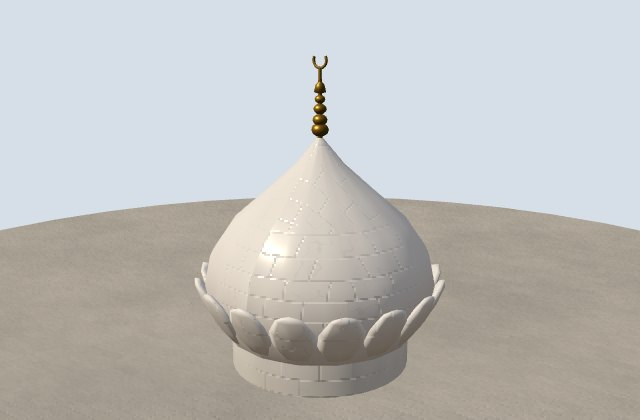 |   |
| :---: | :---: | :---: |
| Onion dome with its neck, lotus crown and finial | Lotus dome: ribs, a cup of petals, a crescent |   |

| 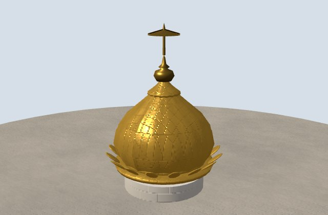 | 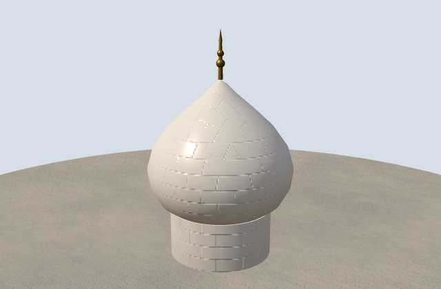 |    |
| :---: | :---: | :---: |
| Gurdwara dome: lotus cup, ribbed gilt onion, kalash and umbrella | Pear-shaped dome (Sheikh Chilli’s Tomb) |    |

| Part | File | What it is |
| --- | --- | --- |
| `onionDome(r, m)` | helpers | The bulbous dome. From 1.5 m radius up it has a moulded neck and an inverted lotus at its crown |
| `lotusDome(r, m, { ribs, petals })` | components | An onion dome with shallow ribs, sitting in a cup of lotus petals |
| `hemi(r, m)` | helpers | A plain hemisphere |
| `persianDome(r, m)` | helpers | A pointed, double-curved dome |
| `ribbed(dome, n, amount)` | helpers | Presses `n` ribs into any turned shape |
| `petalRing(r, n, len, w, tilt, m)` | components | A ring of petals: the lotus under a dome or over its crown |
| `finial(h, m)`, `kalash(size, m)`, `crescentFinial(h, m)` | helpers, components | What crowns a dome: a Mughal spike with its balls, a temple's pot, a crescent |
| `sikhDome(r, m, { finialM, petals, ribs })` | sikh | A gurdwara’s dome: a cup of lotus petals, the ribbed onion, a kalash and a gilt umbrella (chhatra) on a rod |
| `pearDome(r, m)` | mughal | The pear-shaped dome, swelling past its drum to a slender neck, about 2r high; a finial goes on top |

## Kiosks and turrets

| 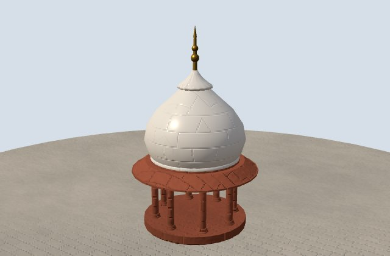 | 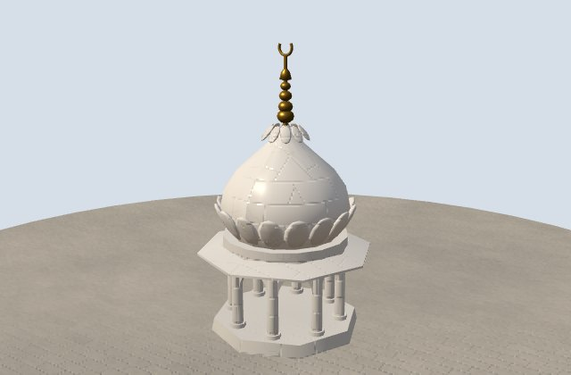 | 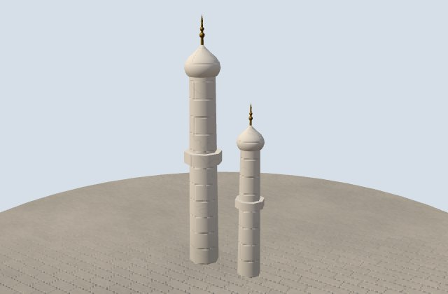 |
| :---: | :---: | :---: |
| Chhatri | Mughal chhatri | Guldastas |
| 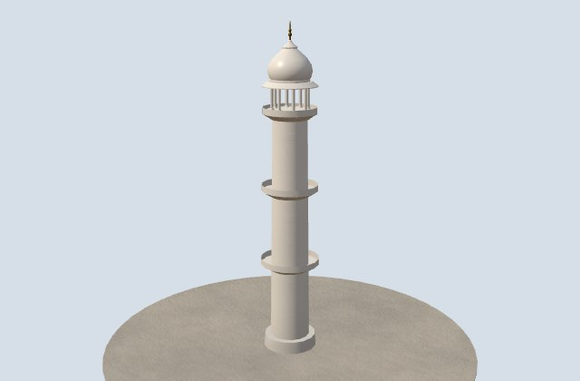 | 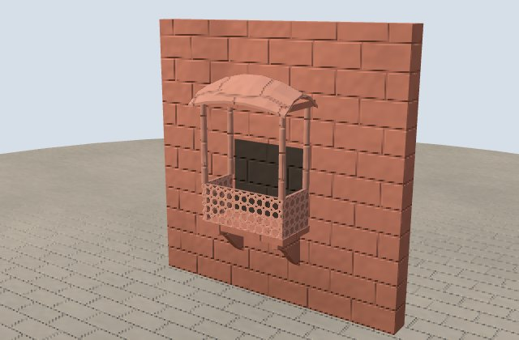 | 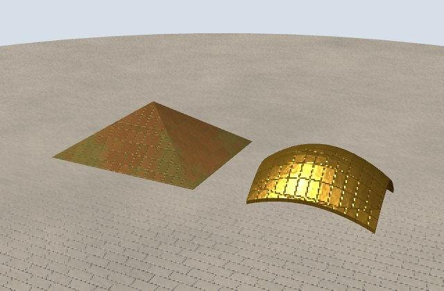 |
| Minaret | Jharokha | Copper and gilded-copper roofs |
| 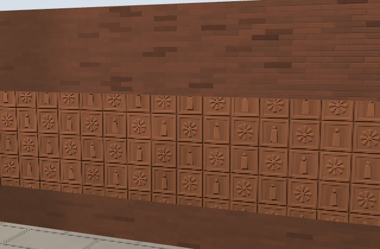 | 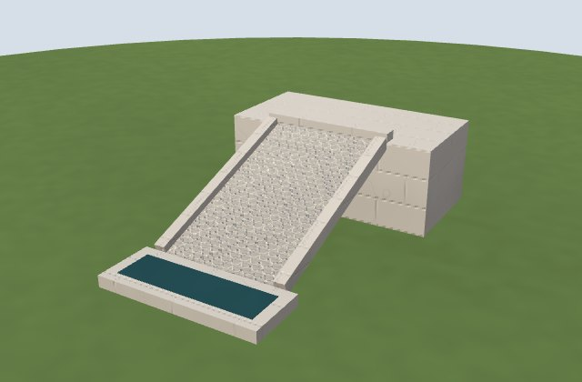 |   |
| Terracotta brick and plaques | Chadar (water cascade) |   |

| 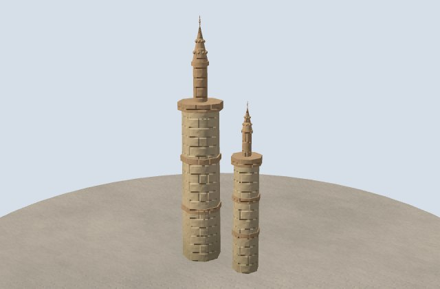 | 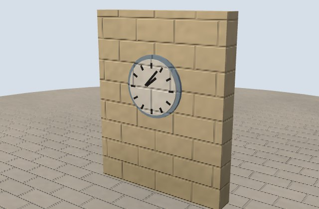 |    |
| :---: | :---: | :---: |
| Gothic turrets | Tower clock |    |

| Part | File | What it is |
| --- | --- | --- |
| `chhatri(r, h, m, domeM)` | helpers | The domed kiosk on eight columns that stands on Mughal and Rajput roofs |
| `mughalChhatri(r, h, m, { domeM, arches, crescent })` | components | A richer chhatri: arches between the columns, a sloping eave, a ribbed lotus dome |
| `guldasta(h, r, m)` | helpers | The slender roof turret of Lucknow: a shaft, a tiny onion dome and a spike |
| `minaret(h, r, m, { balconies, cap })` | helpers | A tapering minaret with balconies, capped by a chhatri |
| `jharokha(w, h, m, { roof })` | components | An oriel window on brackets, screened on three sides, under a curved (`'bangla'`), domed or flat roof |
| `banglaRoof(w, d, rise, m, { droop })` | components | The curved roof of Bengal, as on jharokhas and pavilions: curved both ways, its ridge and eaves drooping to the corners |
| `gothicTurret(r, h, m, trim, spire)` | colonial | An octagonal Gothic turret: string courses every third of its height, a moulded cap and a crocketed pinnacle (St Paul’s, Kolkata) |
| `towerClock(d, { ring, dial, hand })` | colonial | A plain tower clock d across: a white dial in a ring, twelve marks and two hands (Paradesi Synagogue); `clockFace` in components is the brass-bezelled one |

## Pillars and columns

| 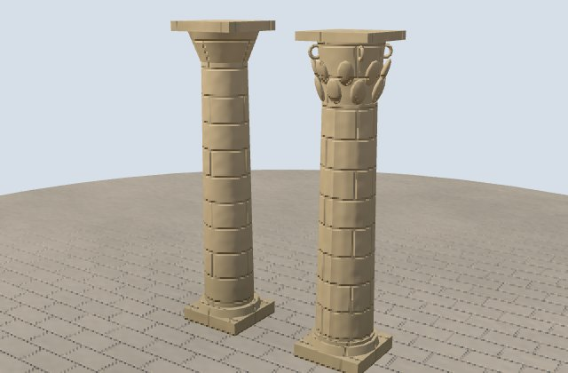 | 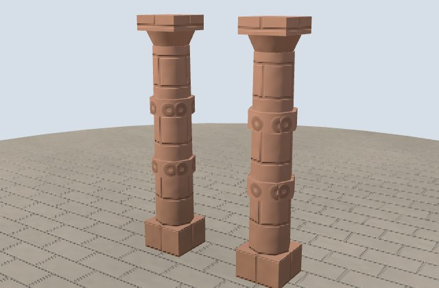 | 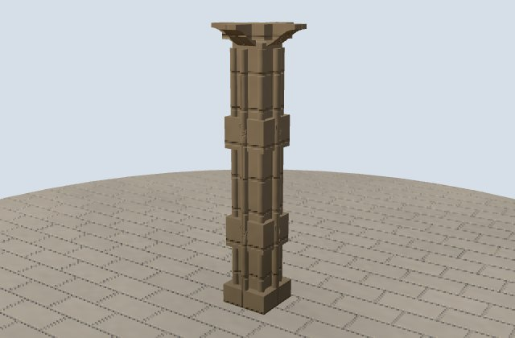 |
| :---: | :---: | :---: |
| Classical columns, plain and Corinthian | Carved temple pillars | Cluster pillar |
| 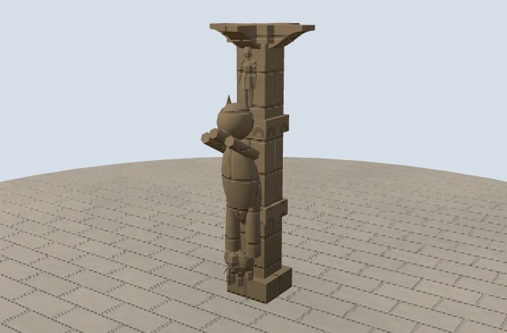 | 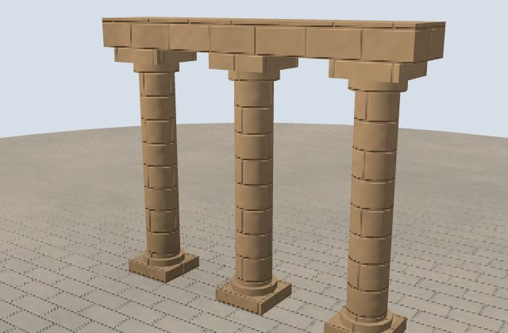 |   |
| Yali pillar | Column trim on bare shafts |   |

| 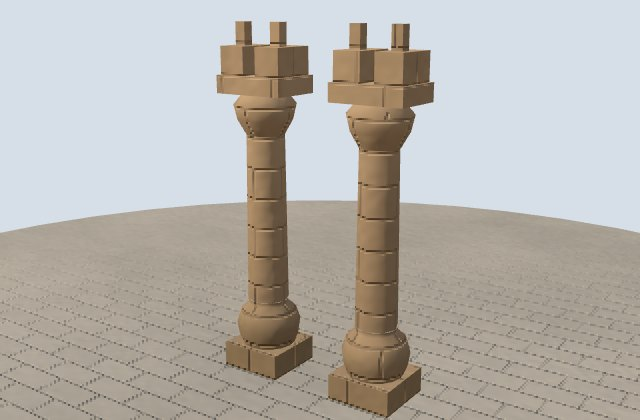 | 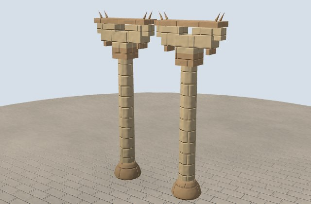 |    |
| :---: | :---: | :---: |
| Elephant-capital pillars (Karla) | Persepolitan bull columns |    |

| Part | File | What it is |
| --- | --- | --- |
| `column(r, h, m, { order })` | colonial | A classical column: plinth, base, tapering shaft, capital. `order: 'corinthian'` adds flutes and acanthus |
| `carvedPillar(h, m)` | temples | A temple pillar: square base, octagonal shaft with two carved bands, cushion and capital |
| `clusterPillar(h, m, { figures })` | sculpture | The Vijayanagara pillar: a shaft ringed by slender colonnettes |
| `yaliPillar(h, m)` | sculpture | A pillar carved with a rearing yali and its rider |
| `columnTrim(list, m, { capM })` | components | Bases and capitals for a colonnade built as bare instanced shafts |
| `pilasters(len, n, w, h, proud, m)` | components | Flat pilasters along a wall |
| `entablature(len, h, m)`, `corinthianCapital(r, m)` | sculpture | What a classical colonnade carries |
| `elephantPillar(h, m)` | sculpture | The pillar of a Satavahana chaitya hall, as at Karla: a stepped base with a pot, an octagonal shaft, a bell capital and kneeling elephants with riders on the abacus (left off on phones) |
| `bullColumn(h, m, trim)` | sculpture | A Persepolitan column: a bell base, a fluted shaft, a scrolled block and a capital of two bulls back to back, as on Bombay’s Parsi fire temples |

## Arches, doors and windows

| 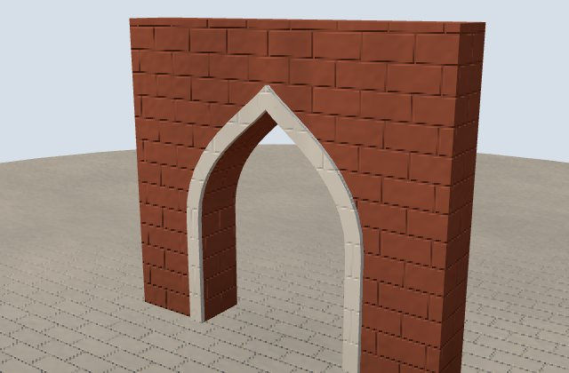 | 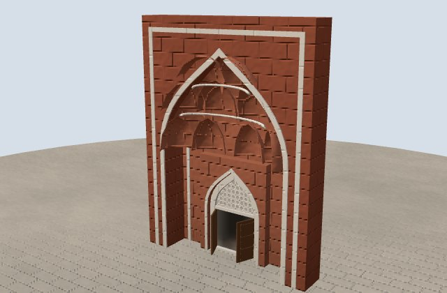 | 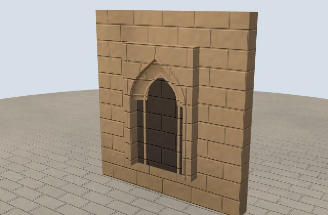 |
| :---: | :---: | :---: |
| Arch wall with its ring | Iwan | Niche |
| 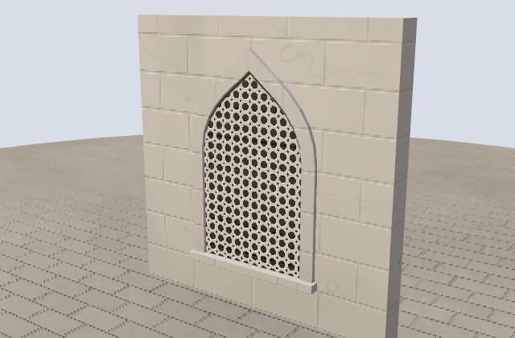 | 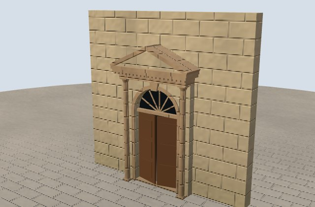 | 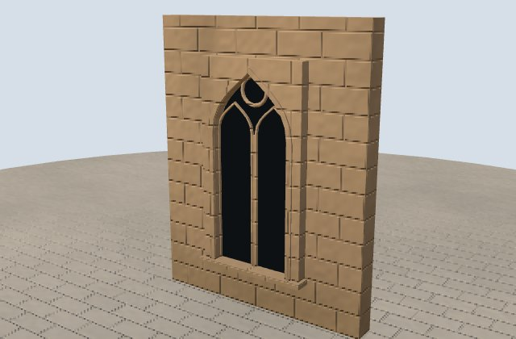 |
| Window with a jali screen | Classical door | Gothic window |
| 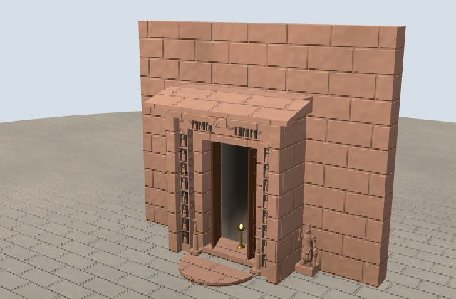 | 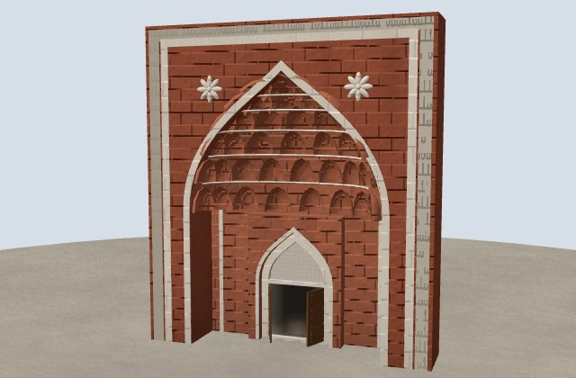 | 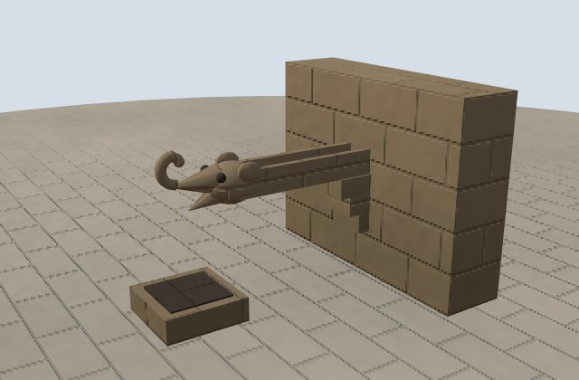 |
| Temple doorway with carved jambs | Iwan with muqarnas and an inscription band | Water spout (pranala) |
| 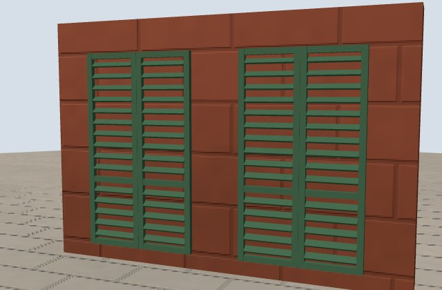 |   |   |
| Louvred shutters |   |   |

| 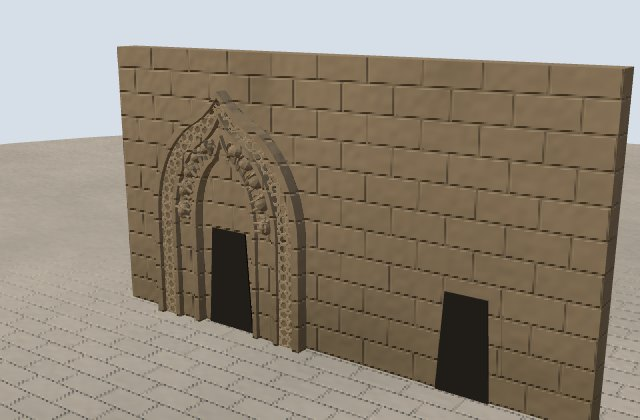 | 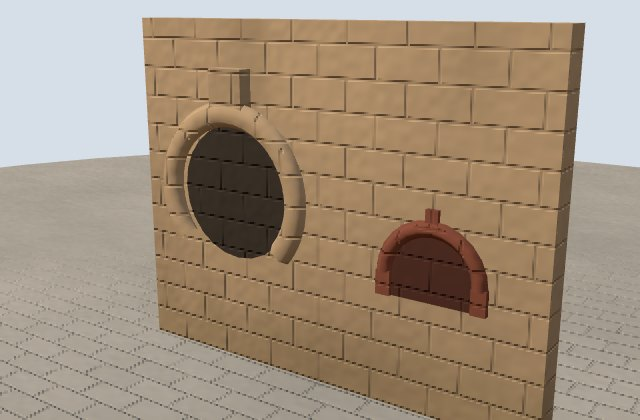 | 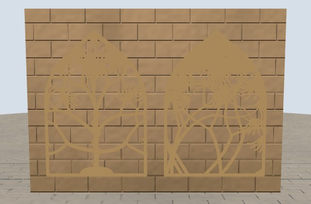 |
| :---: | :---: | :---: |
| Rock-cut doorways: Lomas Rishi and a plain Mauryan door | Chandrashala in stone, gavaksha in brick | Tree of Life and branch jalis |
| 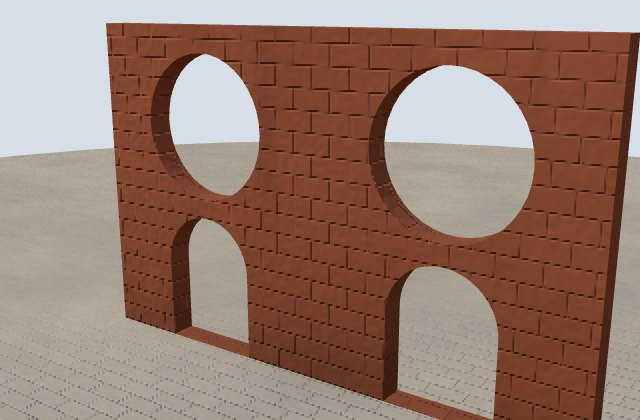 |    |    |
| Wall pierced with circles and arches |    |    |

| Part | File | What it is |
| --- | --- | --- |
| `archWall(w, h, d, archW, archH, pointed, m)` | helpers | A wall with an arch cut through it |
| `archPanel(archW, archH, pointed, m)`, `archSlab(…)` | helpers, components | A blind arch: a thin arch-shaped slab, usually dark, on a wall |
| `archRing(archW, archH, pointed, band, depth, m)` | components | The moulded ring round an arch's opening |
| `niche(archW, archH, pointed, depth, m)` | components | An arched niche with a half-dome hood |
| `barrelVault(radius, length, m)` | helpers | The underside of a barrel vault |
| `iwan(w, h, { m, trim, depth, cells, script, rosettes })` | mughal | The great arched recess of a Mughal gate or tomb front, with its door; muqarnas in its half-dome on desktops (`cells`, on from 5 m wide), an inscription band round its frame (`script`) |
| `muqarnas(w, h, depth, { m, trim, tiers })` | mughal | Tiers of small faceted cells lining the half-dome of a pointed arch, staggered, with fine ledges between the tiers |
| `scriptFrame(W, yt, bw)` | mughal | An inscription band of black letters inlaid in white marble round a pishtaq |
| `mughalDoorway(w, h, { m })` | mughal | A pointed doorway onto a dim room |
| `arcadeSkin(len, h, cells, depth, m)` | mughal | A wall face cut into a row of arched cells, each a door, a screen, a room, or a window closed by louvred shutters (`'shutters'`) |
| `louvredShutter(w, h, m)` | components | Two closed leaves of angled slats in a frame of stiles and rails, green by default |
| `windowFrame(w, h, m, { shape, screen })` | components | A window in a stone surround; `screen: jali(m)` fills it with a pierced screen |
| `classicalDoor(w, h, { shape, fill, top })` | colonial | A classical door or sash window, with a pediment if asked |
| `gothicDoor(w, h, …)`, `gothicWindow(w, h, …)`, `oculus(R, …)` | colonial | Gothic portal, two-light window and round window |
| `porch(w, d, h, …)`, `pediment(w, h, depth, m)` | colonial | A columned porch; a triangular pediment |
| `templeDoorway(w, h, { m, shakha })` | doorways | A temple door: stepped frame, hood, open leaves, a lamp in the sanctum behind, guardians; on desktops its carved jambs (`shakhas`) |
| `shakhas(w, h, bands, bw, d0, depth, m)` | doorways | The carved jambs of a dvarashakha: columns of little figures in niches up the carved bands, nine across the lintel, Ganga and Yamuna at the foot |
| `pranala(len, m, { drop, size })` | doorways | The water spout draining a sanctum: a channelled trough on a corbel ending in a makara head with a curled trunk, over a stone basin |
| `doorFrame(w, h, { bands })` | doorways | The nested, carved bands round a post-and-lintel door |
| `doorLeaves(w, h, { open, studs, spikes })` | doorways | Timber leaves, standing open; `spikes` against war elephants |
| `interior(w, h)` | doorways | The dim room seen through an open door |
| `chaityaDoorway(m, { dark })` | doorways | The Lomas Rishi doorway at Barabar, the earliest chaitya arch: sloping jambs in a carved hut gable with an ogee crown, a lattice band and elephants walking to a stupa |
| `mauryanDoor(wb, h, m, { dark })` | doorways | A plain Mauryan rock-cut doorway: a trapezoid with sloping jambs in a slight frame, onto darkness |
| `chandrashala(r, m, depth, recess)` | temples | The horseshoe arch-window carved on a temple wall or tower: a ring open at the foot over a dark recess, with a finial block |
| `gavaksha(w, m, hollow)` | temples | The same window moulded in brick (Sirpur): a round-headed recess in a ring on two jambs |
| `treeJali(aw, ah, kind, { color })` | components | A pierced lattice in a pointed arch, drawn on a canvas and cut out by its alpha: `'tree'` (the Tree of Life of Sidi Saiyyed), `'branches'` or `'lattice'` |
| `piercedWall(w, h, t, holes, m)` | components | A wall pierced by great circles `[x, y, r]` and round-headed arches `['arch', x, y0, r, spring]`, as in Louis Kahn’s brick screens at IIM Ahmedabad |

## Walls, eaves and parapets

| 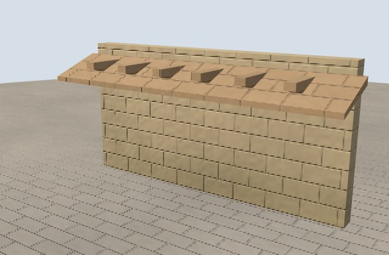 | 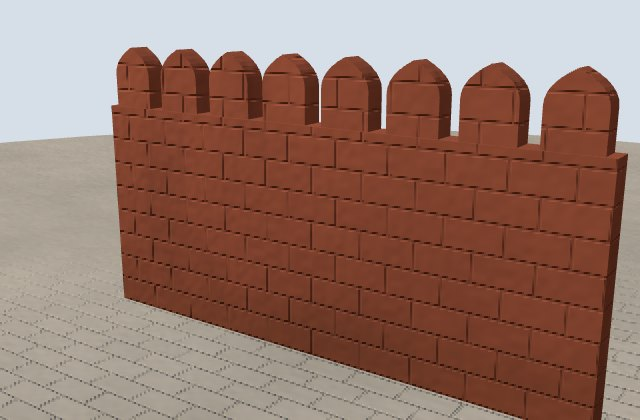 | 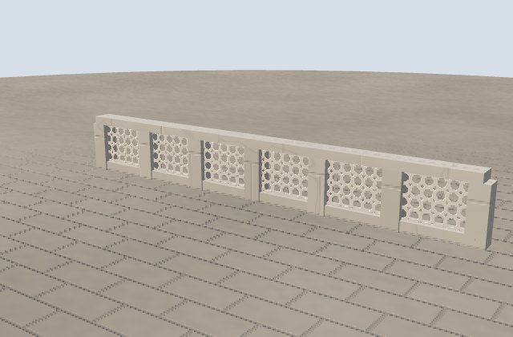 |
| :---: | :---: | :---: |
| Chhajja on brackets | Merlons | Railing |

| 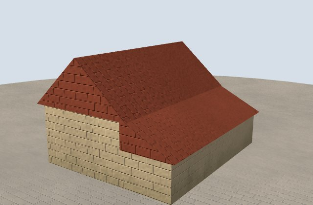 | 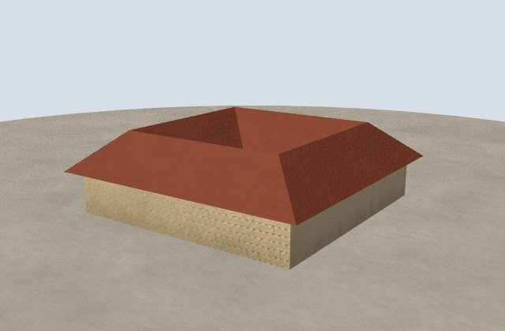 | 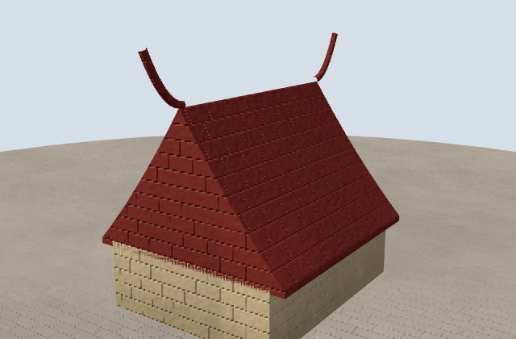 |
| :---: | :---: | :---: |
| Gable and lean-to roofs | Ring roof round a courtyard (Kerala) | Meitei roof |
| 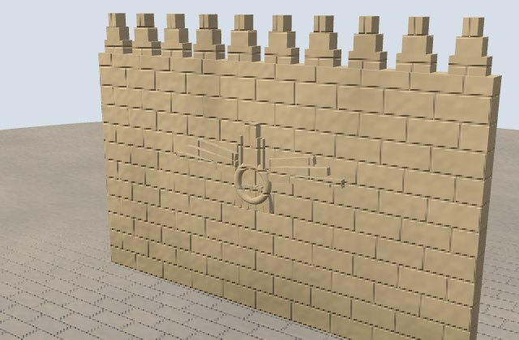 | 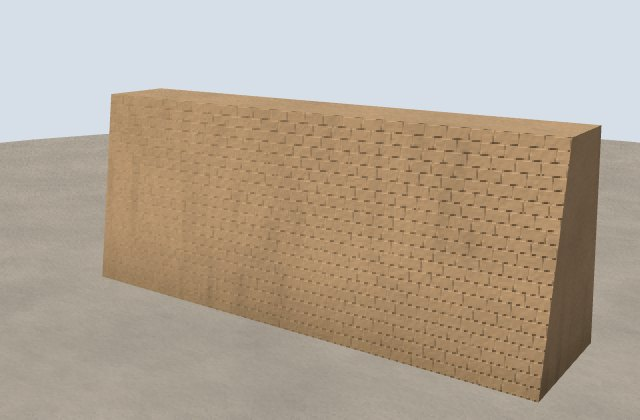 |    |
| Faravahar and stepped merlons | Battered wall (Tughlaqabad) |    |

| Part | File | What it is |
| --- | --- | --- |
| `chhajja(len, depth, drop, thickness, m)` | components | The deep sloping eave of Indian buildings; `chhajjaRing` for a round one |
| `bracketGeo(h, d, w)` | components | The bracket that carries an eave or a balcony |
| `merlons(len, w, h, depth, m)` | components | A row of pointed battlements |
| `rampart(segments, m, …)`, `bastionCrowns(list, m, …)` | forts | Battlements for a long curtain wall and for round bastions: parapet, merlons, string course, arrow slits |
| `railing(len, h, t, m)`, `railingRing(r, h, m)` | components | A railing of posts with pierced screens between |
| `balustrade(len, h, m)` | colonial | A classical balustrade |
| `beltCourse(w, d, y, h, proud, m)` | components | A band running round a rectangular building |
| `mouldings(w, d, courses, m)` | components | A stack of moulded courses: a plinth, a cornice |
| `dentils(len, w, h, d, m)` | components | The row of small blocks under a cornice |
| `panel(w, h, band, m, field)` | components | A sunk panel in a frame, its field carved or inlaid |
| `wallWithGaps(axis, len, h, t, m, gaps)` | temples | A compound wall with openings left for its gates |
| `curvedBand(points, a, b, y0, y1, m)`, `ellipseWall(…)` | helpers | A wall that follows a curve |
| `gableRoof(w, d, h, m, { axis })` | components | A gable roof w across its eaves, d long and h to the ridge, which runs along z (or x with `axis: 'x'`); pass `doubleSided(m)` for one seen from beneath |
| `leanTo(w, d, h, m, side)` | components | A half-gable over an aisle, sloping from h at its wall down to the eaves on `side` |
| `ringRoof(W, D, wd, ov, h, m)` | temples | A tiled roof running round a courtyard, as on a Kerala nalukettu or a temple cloister: up from the outer eaves to a ridge over each wing and down to the inner eaves, hipped at the corners |
| `meiteiRoof(w, d, h, m, horn)` | components | The roof of Manipur: a steep gable with sagging sides, its ridge sweeping up into horns at both ends |
| `steppedMerlons(len, w, h, m, depth)` | components | Persepolitan merlons along a parapet, each stepped back three times |
| `faravahar(w, m)` | components | The winged Faravahar of the Zoroastrians in relief: a ring, the half-figure, three tiers of wings and a tail |
| `batteredGeo(top)` | forts | A unit length of wall whose faces lean in to `top` of its thickness, for `inst()`: the sloping walls of the Tughlaqs |

## Surface ornament (`js/parts/components.js`)

These cost almost no triangles: the pattern is drawn by the surface shader (`js/surface.js`).

| Part | What it is |
| --- | --- |
| `jali(m)` | A pierced stone screen: octagons and diamonds, cut right through up close |
| `frieze(m)` | A carved band of rosettes |
| `carved(m, kind)` | Any other surface: `'script'` (incised names), `'calligraphy'`, `'pietra'` (inlay), `'reliefs'` (sculpture panels), `'tiles'` |
| `rosette(R, m)`, `medallion(R, m)`, `sunburst(R, m)` | Carved roundels |
| `inlayBorder(w, h, band, base, inlay)` | A frame of marble strips set with inlaid lozenges and corner stars, round a panel or an arch on a Mughal gate |
| `lettering(text, size, depth, m)` | Raised letters |
| `photo(material, key)` (in `js/helpers.js`) | Gives a stone a photo texture set: `'laterite'`, `'blocks'`, `'rubble'`, `'concrete'`, `'timber'` and others (`js/textures.js`) |

## Temples (`js/parts/temples.js`)

| 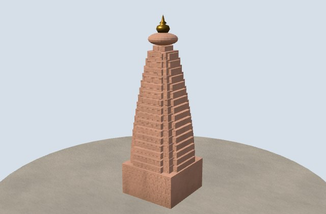 | 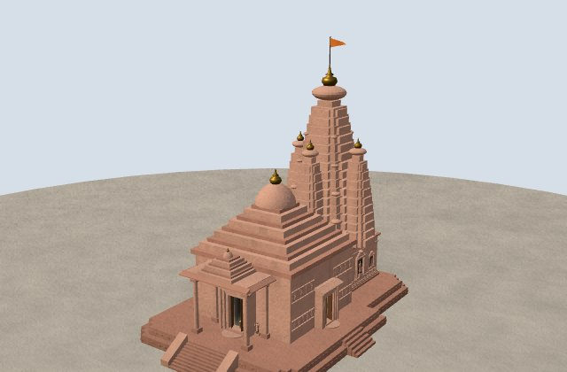 | 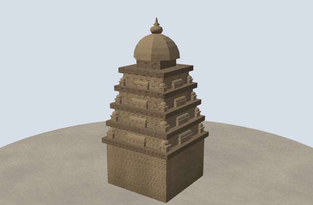 |
| :---: | :---: | :---: |
| Shikhara | Nagara temple | Dravida vimana |
|  | 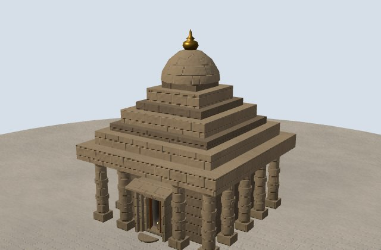 | 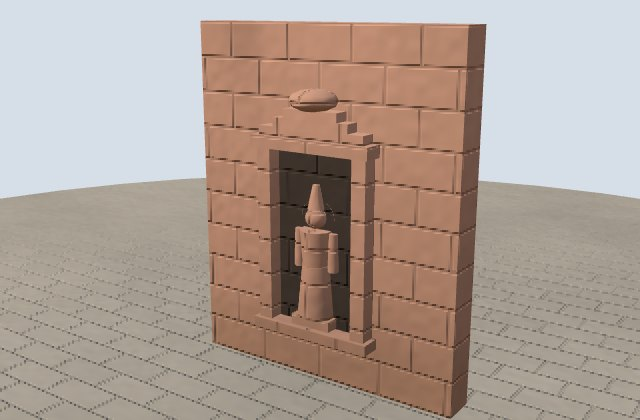 |
| Gopuram | Mandap | Temple niche with an image |
| 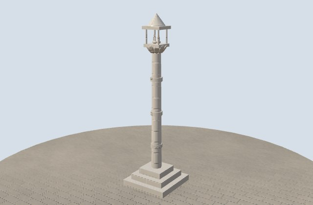 | 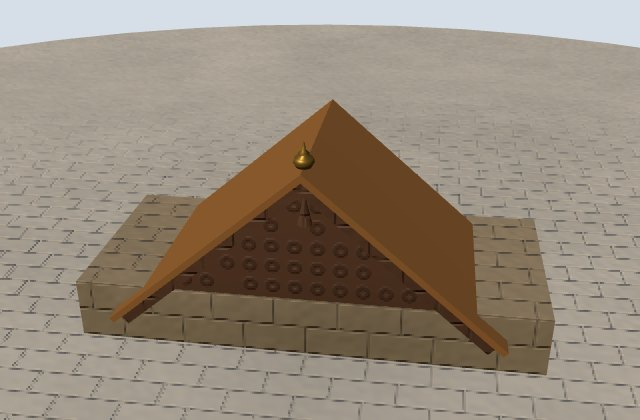 | 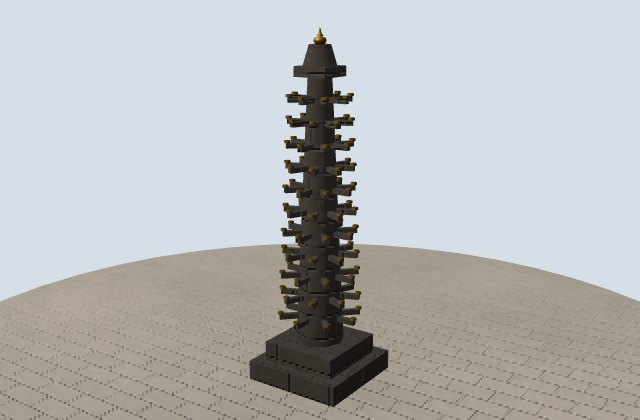 |
| Manastambha | Kerala gable | Deepmala |
|  |  |   |
| Nandi mandapa | Dravida hall dress |   |

|  |  |  |
| :---: | :---: | :---: |
| Kerala gopuram | Wagon-vault (shala) roof | Spire with its timber canopy |
|  |  |  |
| Broken and whole spires | Apsidal plan | Kakatiya Kala Thoranam |

| Part | What it is |
| --- | --- |
| `nagaraTemple({ w, h, m, halls, … })` | A whole North Indian temple: sanctum, curved spire and halls stepping out in front |
| `shikhara(baseW, h, m, profile)` (helpers) | The curved Nagara spire alone; `nagaraProfile` and `kalingaProfile` are two tapers |
| `bhumijaRows(w, h, profile)` | Rows of miniature spires between the bands of a Bhumija spire |
| `dravidaVimana(w, tiers, tierH, m)` | The stepped tower over a South Indian sanctum, with its parapets of miniature shrines |
| `gopuram(w, d, h, tiers, seed)` | A South Indian gate tower, tier on tier of painted stucco figures |
| `mandap(w, h, roofTiers, m, shade)` | A pillared hall under a stepped roof |
| `storeyedHall(w, roofs, m, shade, { floors })` | A hall of several storeys of pillared galleries |
| `pidaRoof(w0, w1, count, step, m)` (helpers) | The stepped pyramid roof of slabs |
| `templeNiche(w, h, m, { figure })` | A niche on a temple wall holding an image |
| `templePorch(w, d, h, m)` (doorways) | A small open porch before a door |
| `trabeateGate(w, h, d, passW, passH, …)` | A post-and-lintel gatehouse, with guardians or carved beasts |
| `dwajasthambha(x, z, h)` | The gold flagstaff before the sanctum |
| `manastambha(h, m, { images })` | The Jain pillar of honour: a stepped base, a banded shaft, a lotus capital and a small pavilion, with four seated images in it if `images` |
| `keralaGable(w, h, d, roofM, wood)` | The carved timber gable (mukhappu) of a Kerala roof, as a dormer to set into a hip roof |
| `deepmala(h, m)` | The lamp tower of Maharashtra's temples: a tapering shaft with rings of stone arms, a brass lamp on each, lit at night |
| `nandiMandapa(w, h, m, trim, { nandiM })` | An open pavilion of eight carved pillars on the temple's axis, the Nandi lying in it facing the sanctum |
| `dravidaDress(w, d, h, m, { eaveM, haraM })` | The dress of a plain South Indian hall or shrine block: moulded base, pilasters, a kapota eave and a parapet of miniature shrines |
| `kuta(s, m)`, `shala(w, d, m)`, `haraRow(len, s, m)` (sculpture) | The miniature shrines along the edge of each storey of a vimana |
| `keralaGopuram(w, d, { base, wood, roof, brass })` | A Kerala temple gateway: a laterite storey with its passage, a latticed timber storey, three tiers of tiled roof with carved gables and brass finials (Vadakkunnathan) |
| `wagonRoof(len, d, m)` | The barrel-vault roof of a Dravidian shala: the vault, a ridge of finials and a great horseshoe arch at each gable end (Bhima Ratha) |
| `spireCanopy(w, m, wood)` | The timber canopy over a Himalayan spire’s top stone: a post, a pyramid roof with a thin eave and a kalasha (Jageshwar) |
| `brokenSpire(w, h, keep, m, { n, rubble, amalakaM })` | A Nagara spire in courses of which only the lower `keep` fraction stands, its top ragged; whole, it ends in a ribbed amalaka (Masrur) |
| `apsePlan(w, z0, z1, n)` | An apsidal plan for `planPrism`: straight in front, a half circle behind (Durga temple, Aihole) |
| `kakatiyaThorana(m, shade)` | The Kakatiya Kala Thoranam of Warangal: two frames of carved pillars with angled brackets, a lintel and a crest with a medallion and makara horns |

## Forts (`js/parts/forts.js`)

|  |  |  |
| :---: | :---: | :---: |
| Fort gate | Rampart and a crowned bastion | Machicolation |

|  |  |    |
| :---: | :---: | :---: |
| Arrowhead bastions | Battered wall |    |

| Part | What it is |
| --- | --- |
| `fortGate(w, h, d, archW, archH, { towers, iwan, box })` | A gatehouse with a real passage through it, guard niches and spiked leaves; `box` hangs a machicolation over the arch |
| `towerDetail(rBottom, rTop, h, m)` | String courses and arrow slits for a round tower |
| `slitRow(len, n, y, w, h)` | A row of arrow slits along a wall |
| `rampart(…, { loopholes, boxes })`, `bastionCrowns(…)` | Battlements, as above: merlons pierced with gun-loops, and a machicolation every `boxes`th length of wall |
| `machicolations(list, m, trim)` | Box drop-chutes hung from a wall's head on corbels, with a slot in the floor and a gun-loop in front; instanced |
| `arrowBastion(pts, i, { flank, shoulder, point })` | The plan of an arrowhead bastion of a European trace at corner `i` of a curtain: flanks, shoulders and a salient; five points for `planPrism` (Moti Daman) |
| `batteredGeo(top)` | A unit length of battered wall for `inst()`, its faces leaning in to `top` of its thickness (Tughlaqabad) |

## Tibetan monasteries (`js/parts/tibetan.js`)

|  |  |  |
| :---: | :---: | :---: |
| Monks' houses | Dharma wheel and a victory banner | Assembly hall |
|  |  |   |
| Prayer wheels | Gilded roof |   |

|  |    |    |
| :---: | :---: | :---: |
| Two-tier gilded roof (Namdroling) |    |    |

| Part | What it is |
| --- | --- |
| `tibetanBlock(w, h, d, floors)` (helpers) | A whitewashed block with dark windows under a maroon band (Rumtek) |
| `hall(w, h, d, { floors, wall, cap, door, bay })` | An assembly hall or temple: walls under the penbey band and a white fillet, framed windows with awnings on every face, an earth roof, a door gap, and a timber window bay in the front's top row |
| `hallWindows(spots)` | Windows in black surrounds, with frames, lintels and valances, at any list of spots |
| `rabsel(w, h)` | A projecting timber window bay: three lattice lights on a bracketed sill, under painted lintels and a cornice |
| `maniWheels(len, { h, back })` | A gallery of brass prayer wheels in a recess between maroon posts, under an eave |
| `ganjira(h)` | The gilded lotus-and-vase finial on a roof's peak |
| `roofCorners(w, d)` | Upturned gilt tips and bells at the corners of a gilded roof |
| `quarters(blocks, { cap })` | Dresses a list of plain blocks as monks' houses: windows in black surrounds, doors, beam ends, earth roofs, prayer-flag poles |
| `dharmaWheel(w)` | The gilded wheel between two deer over an assembly hall |
| `gyaltsen(h)` | The victory banner at a roof's corner |
| `shabkhep(w)` | The pleated awning over a window |
| `parapetDiscs(len, pitch, r)` | Gilded discs along a parapet |
| `TIBETAN.maroon` (helpers) | The maroon parapet band, drawn with the `reeds` surface as the cut twig ends of a penbey |
| `tibetanDoor(w, h)`, `tibetanPortico(…)` (doorways) | A painted door; a pillared portico |
| `goldRoof(w, d, { rise, clere, upper, gilt, wall })` | A two-tier gilded roof: a hip roof, a clerestory under a maroon band and an upper hip roof with the ganjira, gilt corner tips and victory banners (Namdroling) |

## Gurdwaras (`js/parts/sikh.js`)

|  |  |  |
| :---: | :---: | :---: |
| Gurdwara dome | Nishan Sahib | Arcaded storeys and a parapet of gilt domes |

| Part | What it is |
| --- | --- |
| `sikhDome(r, m, { finialM, petals, ribs })` | The dome of a gurdwara: a cup of lotus petals, the ribbed onion, a kalash and a gilt umbrella on a rod |
| `nishanSahib(h, { y })` | The Sikh flagpole: a saffron-sheathed pole on a marble plinth, a gilt cap, the pennant and the khanda |
| `arcadeStorey(w, h, n, m, { trim, fill, dp, sill, aw, ah, centre })` | A square storey with an arcaded skin on each face, `n` arches a face, each a door, a room or a screen |
| `rectStorey(w, d, h, pitch, m, { trim, fill, dp, sill, ah, front })` | The same on a rectangle, as many arches a face as fit at `pitch`, `front` filling the middle arch of the front |
| `parapetDomes(w, y, n, m, r)` | A row of small ribbed domes on drums along the four sides of a parapet |
| `GILT`, `SAFFRON` | The gilt copper and the saffron cloth of the gurdwaras |

The five gurdwaras (Hazur Sahib, Patna Sahib, Keshgarh Sahib, Bangla Sahib and Hemkund Sahib) are built from these.

## Stairs (`js/parts/doorways.js`)

|  |   |   |
| :---: | :---: | :---: |
| Grand stair |   |   |

| Part | What it is |
| --- | --- |
| `steps(width, rise, n, m)` | A plain flight |
| `grandStair(rise, width, m, shade, { n, landing })` | A broad stair between side walls, with a landing and guardians |

## Sculpture

|  |  |  |
| :---: | :---: | :---: |
| Figure frieze | Statue, urn and pinnacle | Door guardian |

|  |  |  |
| :---: | :---: | :---: |
| Ashokan pillar with a single lion | Kangla Sha | Trimurti (Elephanta) |
|  |    |    |
| Trishul |    |    |

| Part | File | What it is |
| --- | --- | --- |
| `figure(h, m, pose)` | sculpture | A carved figure, standing or dancing; `'robed'` is a classical allegory in drapery, for the colonial buildings |
| `guardian(h, m)` (figures) | doorways | A door guardian (dvarapala): a fierce face, tall crown, jewellery and a ribbed club; a large one on a desktop gets a finely meshed head |
| `idol(h, m)` | components | A cheap standing image in relief, for rows of niches |
| `guardian(h, m)` | figures | A door guardian |
| `statue(h, m, pose)` | sculpture | A statue on a pedestal |
| `crossLegged(key, opts, m, h)` | figures | A figure seated cross-legged, a sage (bare-chested, long hair, malas) or a goddess (crowned): Adi Shankaracharya at Kedarnath, Gajalakshmi |
| `allegory(key, opts, m, h)` | figures | A woman in classical drapery sculpted as one skin: standing, seated (on a block or a throne, with a mantle, a child, an infant) or winged; her arms in named poses, her head in hair, a veil and crown, or a helmet; her hands sculpted with fingers, closed round what they hold or relaxed by the arm's pose (`hand: { r, l }` chooses `'grip'`, `'relaxed'`, `'open'`, `'cup'` or `'rest'`). Returns the mesh and where its hands are |
| `hold(g, fig, side, kind, m, opts)`, `attribute(kind, m)` | figures | What a figure holds, set at her hand: torch, sword, scales, mirror, book, palette, square, trident, caduceus, ship, plough, cornucopia, sheaf, sickle, wreath, trumpet, sceptre, orb, shield, winged wheel, star, lotus, palm-leaf book, staff |
| `lionCapital(m, s)` | animals | The Lion Capital of Ashoka: four lions back to back on the abacus with its wheels, over the lotus bell |
| `figureFrieze(len, h, m, { kinds })` | sculpture | A band of figures, elephants or horses in relief |
| `urn(h, m)`, `pinnacle(h, m)`, `gothicPinnacle(h, m)` | sculpture | Roofline ornaments |
| `ashokanPillar(m, { shaft, r0, r1 })` | animals | An Ashokan pillar as at Vaishali: a polished plain shaft, a ribbed lotus bell, a square abacus and a single seated lion |
| `kanglaSha({ m, plinth, h })` | animals | The Kangla Sha of Imphal: a Meitei guardian with a lion’s body and a horned dragon’s head, seated with jaws open, sculpted as one skin on a stepped plinth |
| `trimurti(m)` | sculpture | The Trimurti of Elephanta: Sadashiva as a bust of three crowned heads, about 6 m high |
| `trishul(h, m)` | components | Shiva’s trident: a shaft with a collar, curved side prongs, a straight middle blade and a tied damru (Adiyogi) |

Every statue, with a picture and what it shows: [Components: Statues](components.md#statues).

The great statues (Patel, Bahubali, Thiruvalluvar, the Nageshwar Shiva, and Netaji, Shivaji, Adi Shankaracharya at Kedarnath and the boy Shankaracharya of the Statue of Oneness) are sculpted as one
continuous skin in `js/parts/figures.js` and `js/sdf.js`. The tools for working on that skin:

| Tool | File | What it does |
| --- | --- | --- |
| `sculpt(key, build, { h, split, wear })` | sdf | Meshes a field once and keeps it. `split: { region, h, lo, hi }` (or a list of them) meshes the part inside `region` (an ellipsoid round a head, or round the feet) on its own finer grid, the two parts crossing over without a seam; `wear` rubs the ridges pale |
| `snap(f, p, offset)`, `onSkin(f, pts, offset)` | sdf | Moves a point, or every point of a curve, onto the skin or `offset` outside it: creepers, threads, hems and placket in relief |
| `skinMatrix(f, p, dir, offset, scale)` | sdf | A matrix that lays a part flat on the skin, its length along `dir`: leaves and curls, instanced |
| `slab(a, b, w, t, n)` | sdf | A flat rounded slab from a to b, its faces turned towards n: a hand held flat in salute |
| `bakeCavities(geo, f, reach, deep, { wear })` | sdf | Darkens the crevices into vertex colours, and with `wear` lightens the ridges |
| `surface(m, 'plates')` | surface | Bronze cast in plates: staggered joints worked out in space, so they run true over a curved body |
| `surface(m, 'blocks')` | surface | A statue built of granite blocks (Thiruvalluvar): the plates' joints at a smaller size and darker, each block its own shade |
| `surface(m, 'reeds')` | surface | A penbey parapet: the maroon-painted cut ends of tamarisk twigs, in bundled courses |
| `surface(m, 'copper')` | surface | Sheet copper: staggered sheets with standing seams worked out in space, hammer dimples, and verdigris along the seams, in streaks and in weathered patches |
| `surface(m, 'giltsheet')` | surface | The same sheets gilded: seams and dimples, no verdigris |
| `surface(m, 'terracotta')` | surface | Thin fired-clay bricks (32 × 6.5 cm) with fine joints, each brick its own shade, the odd one over-burnt, stained by soot and lichen; fades to an even tone where a brick is under a few pixels, so it never shimmers |
| `surface(m, 'plaques')` | surface | A band of moulded terracotta plaques: bordered tiles with an open lotus or a standing figure in turn |
| `surface(m, 'scallop')` | surface | A chadar's carved bed: staggered rows of fish scales, light lips and dark hollows |
| `surface(m, 'cladding')` | surface | Marble panels in staggered courses with fine joints worked out in space, so they follow a curved shell (the Lotus Temple's petals) |
| `chadar(w, len, drop, m)` | components | A Mughal garden cascade: a sloping marble bed carved in fish scales under a thin sheet of water, between kerbs, with a lip at the top and a pool at the foot |

## Terrain (`js/parts/terrain.js`)

| Part | What it is |
| --- | --- |
| `heightField(w, d, n, fn, { rock, cover, steep })` | Ground shaped by a height function: rock where it is steep, scrub or grass where it is not |
| `mountainRing({ inner, outer, h, snow })` | A ring of mountains round a valley |
| `rough`, `smooth`, `fbm`, `ridged` | Noise helpers for writing a height function |

## Checking a change

From `tools/`:

```bash
node check-budgets.mjs <id>     # triangles, against 800,000 on desktops and 300,000 on phones
node check-flicker.mjs <id>     # faces that share a plane
node check-heights.mjs <id>     # the model's height against the real one
node shoot-views.mjs <id>       # a picture of the home view
node shoot-components.mjs       # the pictures on this page (img/), after a shared part changes
```
