# Architecture: the parts the buildings are made of

Every monument is built in code from shared parts. This page is the reference for them: what each
one is, what you pass it, and which file it lives in. A file name in a table (`helpers`,
`components`, `temples`…) means `js/helpers.js` or `js/parts/<name>.js`.

For what stands round the buildings (trees, boats, towns, hills) see [The setting](setting.md).
Every picture here, and the statues, are on one page in [Components](components.md). How the
repository is laid out, and how to add a monument, is in [Project structure](project-structure.md).

[README](../README.md) · [Project structure](project-structure.md) · [Architecture](architecture.md) · [The setting](setting.md) · [Components](components.md) · [How it is drawn](how-it-is-drawn.md) · [States and monuments](../monuments.md)

## Contents

- [How a monument is put together](#how-a-monument-is-put-together)
- [Primitives](#primitives) · [Domes](#domes) · [Kiosks and turrets](#kiosks-and-turrets) · [Pillars and columns](#pillars-and-columns)
- [Arches, doors and windows](#arches-doors-and-windows) · [Walls, eaves and parapets](#walls-eaves-and-parapets) · [Roofs](#roofs) · [Ornament](#ornament) · [Surfaces](#surfaces)
- By tradition: [Temples](#temples) · [Mughal and Indo-Islamic](#mughal-and-indo-islamic) · [Forts](#forts) · [Churches and colonial buildings](#churches-and-colonial-buildings) · [Tibetan monasteries](#tibetan-monasteries) · [Gurdwaras](#gurdwaras) · [Early and regional styles](#early-and-regional-styles)
- [Stairs](#stairs) · [Sculpture](#sculpture) · [Checking a change](#checking-a-change)

## How a monument is put together

Each monument has two files, both named after its id in `js/data.js`:

- `js/monuments/<id>.js` builds the masses: plinth, walls, towers, roofs. It exports the builder
  that `js/data.js` names in `fn`.
- `js/details/<id>.js` adds the finer architecture and the setting, from `addDetails(f, g)`.

The builder returns `{ group, focus, view, zoom }`. `group` is the whole site; `focus` is the
group the home view frames (the building, without its gardens and town). Optional extras:
`target` (the point the home view looks at), `sun`, `batch: true` for a model of very many parts,
and `minElevation`.

A few rules hold for every part:

- **Metres, y up.** A part stands on y = 0 and faces +z unless it says otherwise.
- **Materials are passed in.** A part takes the stone it is built of (`m`) and often a second for
  trim. The shared stones are in `M` in `js/helpers.js` (`M.marble`, `M.red`, `M.granite`,
  `M.laterite`…); make a monument's own with `mat('#hex', roughness)`, and give it a photo texture
  with `photo(material, key)` or a drawn surface with `surface(material, kind)`.
- **Merge when done.** A part made of many small meshes is wrapped in `mergeByMaterial(group)`,
  which leaves one mesh per material. Hundreds of copies of one shape go through `inst()`.
- **Two faces never share a plane.** Lift an overlay 2 to 5 cm off its wall, or the two flicker.
  `node check-flicker.mjs <id>` from `tools/` finds the ones that do.
- **Phones build lighter.** Heavy carving goes behind `!detail.low` (`js/detail.js`).
- **Share before you copy.** A helper that a second monument needs moves into `js/helpers.js` or
  the `js/parts/` file of its family, gets a row on this page and a picture from
  `tools/shoot-components.mjs`.

### Placing parts

| Helper | File | What it does |
| --- | --- | --- |
| `at(part, x, y, z)` | helpers | Move a part |
| `onFace(part, angle, dist, lat)` | helpers | Put a part on a wall face: `angle` 0 is the +z face, `dist` how far out, `lat` along the face. `FACES` is the four angles |
| `alongFace(angle, dist, len, n, y)` | components | `n` places along a face, for a row of brackets |
| `aroundCircle(r, n, y)` | components | `n` places round a circle, each turned outward |
| `aroundRect(w, d, step)` | helpers | Places round a rectangle: a colonnade |
| `placeAll(geometry, places, m)` | components | One geometry at every place |
| `inst(geometry, list, m)` | helpers | The same, instanced: each entry is `[x, y, z, sx, sy, sz, turn]`. Use with `unitBox()` and `unitCyl()` for hundreds of columns or merlons |
| `rng(seed)` | helpers | A seeded random sequence, so that anything varied (heights, turns, colours) is the same on every visit |
| `unitBox()`, `unitCyl(sides)`, `unitHemi()`, `unitSpire()` | helpers | Unit geometries for `inst()`: a 1 m box, cylinder, hemisphere and small curved spire, each standing on y = 0 |

```js
// A window on each of a building's four faces, 11 m out from its centre.
for (const a of FACES) d.add(onFace(at(windowFrame(2, 4.2, M.cream, { shape: 'flat' }), 0, 13.6, 0), a, 11.01));
```

## Primitives

All in `js/helpers.js`.

| Part | File | What it is |
| --- | --- | --- |
| `box(w, h, d, m, x, y, z)` | helpers | A block standing on `y` |
| `cyl(rTop, rBottom, h, m, x, y, z, sides)` | helpers | A cylinder, drum or tapering shaft |
| `lathe(points, m)` | helpers | A turned shape from a profile of `[radius, height]` points |
| `smoothLathe(points, m)`, `drape(lathe, folds, amp, yFrom, yTo)` | helpers | A turned shape through a smooth spline, and vertical folds pressed into it for hanging cloth |
| `sheet(w, d, m, x, y, z)` | helpers | A flat sheet of water or ground |
| `ring(r, h, m, y)` | helpers | An open-ended tube: a well's rim, a gallery wall |
| `strut(a, b, thickness, m)` | helpers | A bar between two points: trusses, cables |
| `capsule(a, b, r1, m, r2)` | helpers | A tapered capsule between two points: limbs, necks, trunks, tree boughs |
| `hoopArch(a, b, m, tube)` | helpers | A half-ring spanning two points at one height: the hanging arches (toranas) between the pillars of Dilwara |
| `hipRoof(w, d, h, m)` | helpers | A hipped roof over a rectangle |
| `planPrism(points, y, h, m)`, `starPrism(n, rOuter, rInner, h, m)` | helpers | A block on any plan; a star-shaped block (the Hoysala plan) |
| `planSolid(outer, holes, h, topM, sideM)` | helpers | A block on any plan with holes cut through it, its top and its walls as separate meshes: the ground round a stepwell with the well cut out (Adalaj, Agrasen ki Baoli) |
| `steppedPlan(profile, { grow, cut })`, `offsetPlan(pts, d)`, `planBand(pts, y, h, proud, m)` | helpers | A plan that steps in and out along its length (a temple and its halls as one outline), the same plan grown outward, and a moulded course round it |
| `chamferPrism(s, c, h, m)` | helpers | A square block with chamfered corners: the plan of a Mughal tomb |

## Domes

|  | 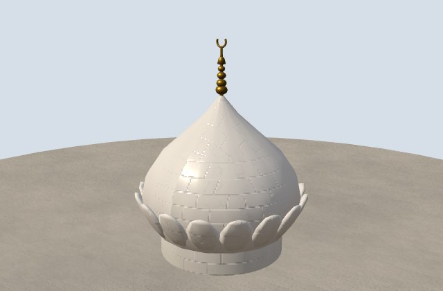 | 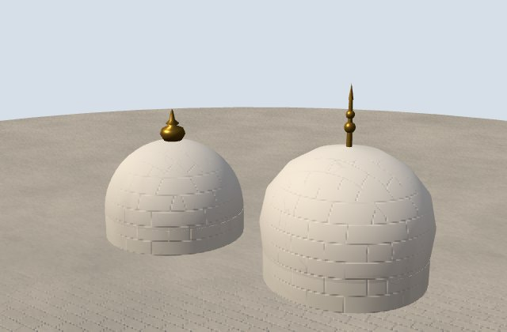 |
| :---: | :---: | :---: |
| Onion dome with its neck, lotus crown and finial | Lotus dome: ribs, a cup of petals, a crescent | A hemisphere under a kalash; a Persian dome under a finial |
| 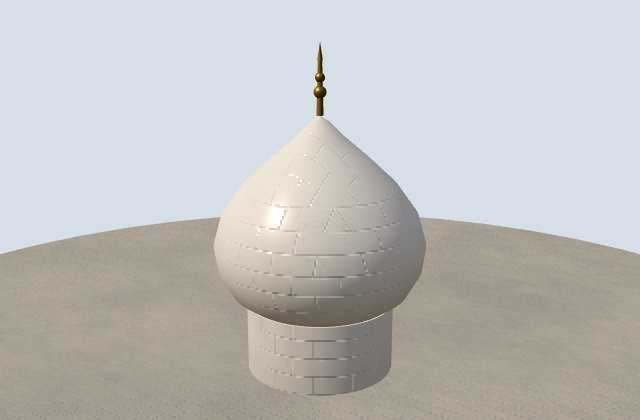 | 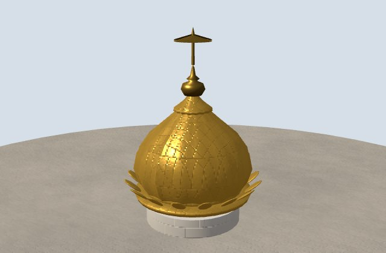 |   |
| Pear-shaped dome (Sheikh Chilli’s Tomb) | Gurdwara dome: lotus cup, ribbed gilt onion, kalash and umbrella |   |

| Part | File | What it is |
| --- | --- | --- |
| `onionDome(r, m)` | helpers | The bulbous dome. From 1.5 m radius up it has a moulded neck and an inverted lotus at its crown |
| `lotusDome(r, m, { ribs, petals })` | components | An onion dome with shallow ribs, sitting in a cup of lotus petals |
| `hemi(r, m)` | helpers | A plain hemisphere |
| `persianDome(r, m)` | helpers | A pointed, double-curved dome |
| `pearDome(r, m)` | mughal | The pear-shaped dome, swelling past its drum to a slender neck, about 2r high; a finial goes on top |
| `sikhDome(r, m, { finialM, petals, ribs })` | sikh | A gurdwara’s dome: a cup of lotus petals, the ribbed onion, a kalash and a gilt umbrella (chhatra) on a rod |
| `ribbed(dome, n, amount)` | helpers | Presses `n` ribs into any turned shape |
| `latheStripes(points, n, frac, m)` | helpers | `n` thin inlay gores up a dome or shaft, following its profile and held clear of it so they never flicker |
| `petalRing(r, n, len, w, tilt, m)` | components | A ring of petals: the lotus under a dome or over its crown |
| `finial(h, m)`, `kalash(size, m)`, `crescentFinial(h, m)` | helpers, components | What crowns a dome: a Mughal spike with its balls, a temple's pot, a crescent |

## Kiosks and turrets

| 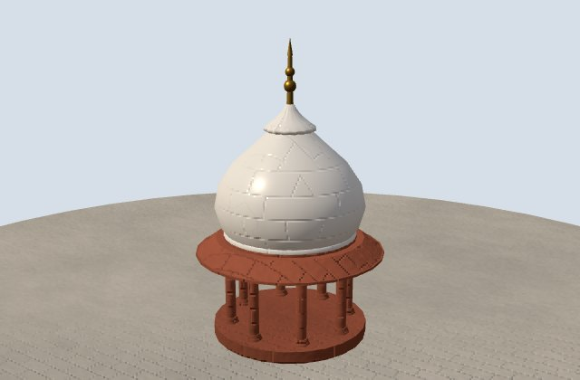 | 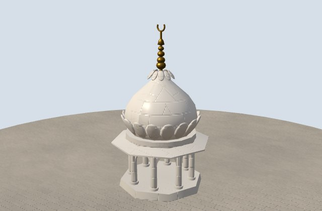 | 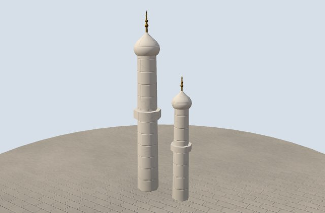 |
| :---: | :---: | :---: |
| Chhatri | Mughal chhatri | Guldastas |
| 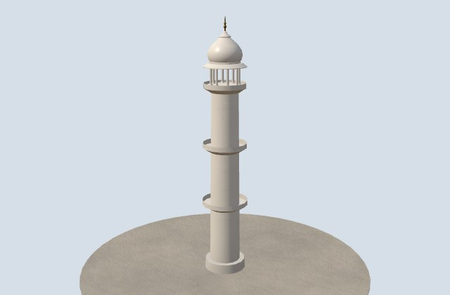 | 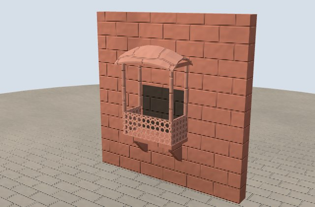 | 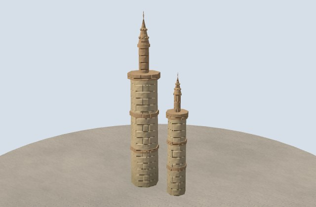 |
| Minaret | Jharokha | Gothic turrets |

| Part | File | What it is |
| --- | --- | --- |
| `chhatri(r, h, m, domeM)` | helpers | The domed kiosk on eight columns that stands on Mughal and Rajput roofs |
| `mughalChhatri(r, h, m, { domeM, arches, crescent })` | components | A richer chhatri: arches between the columns, a sloping eave, a ribbed lotus dome |
| `guldasta(h, r, m)` | helpers | The slender roof turret of Lucknow: a shaft, a tiny onion dome and a spike |
| `minaret(h, r, m, { balconies, cap })` | helpers | A tapering minaret with balconies, capped by a chhatri |
| `jharokha(w, h, m, { roof })` | components | An oriel window on brackets, screened on three sides, under a curved (`'bangla'`), domed or flat roof |
| `gothicTurret(r, h, m, trim, spire)` | colonial | An octagonal Gothic turret: string courses every third of its height, a moulded cap and a crocketed pinnacle (St Paul’s, Kolkata) |

## Pillars and columns

| 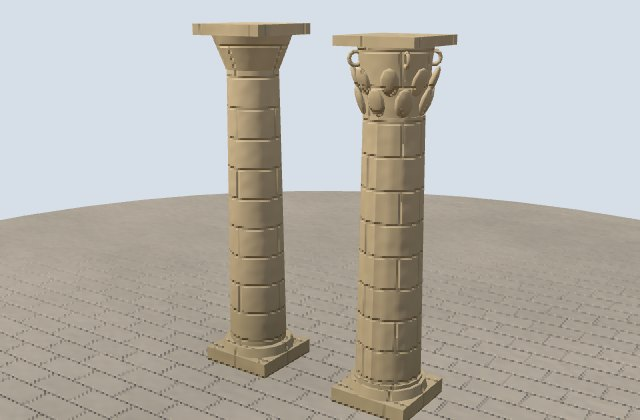 | 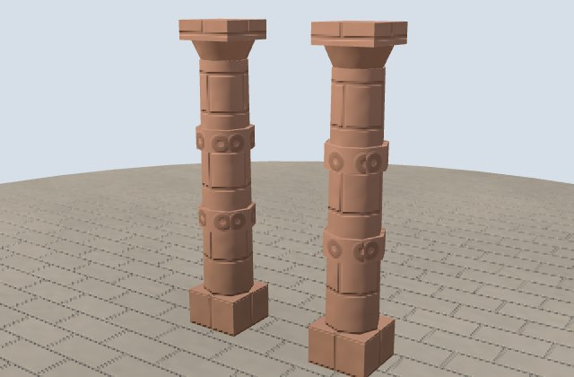 | 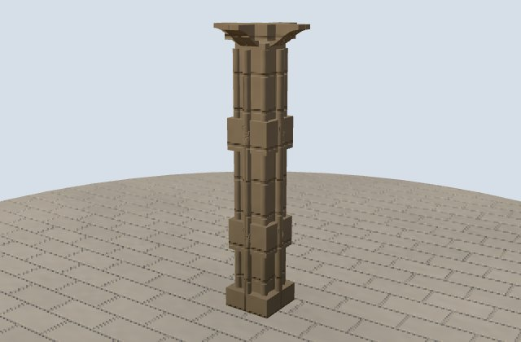 |
| :---: | :---: | :---: |
| Classical columns, plain and Corinthian | Carved temple pillars | Cluster pillar |
| 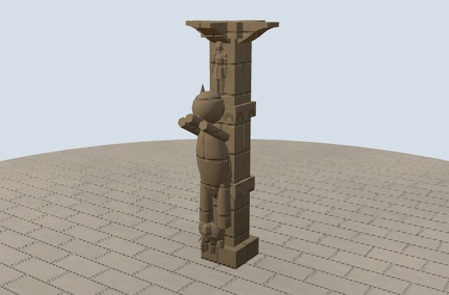 | 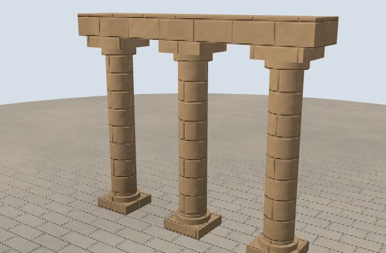 | 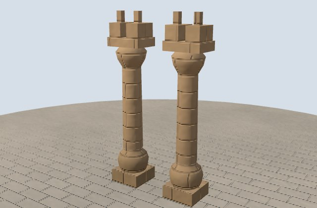 |
| Yali pillar | Column trim on bare shafts | Elephant-capital pillars (Karla) |
| 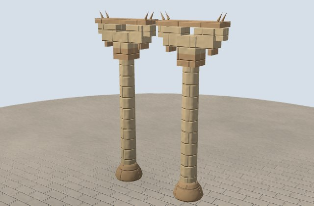 |   |   |
| Persepolitan bull columns |   |   |

| Part | File | What it is |
| --- | --- | --- |
| `column(r, h, m, { order })` | colonial | A classical column: plinth, base, tapering shaft, capital. `order: 'corinthian'` adds flutes and acanthus |
| `carvedPillar(h, m)` | temples | A temple pillar: square base, octagonal shaft with two carved bands, cushion and capital |
| `clusterPillar(h, m, { figures })` | sculpture | The Vijayanagara pillar: a shaft ringed by slender colonnettes |
| `yaliPillar(h, m)` | sculpture | A pillar carved with a rearing yali and its rider |
| `elephantPillar(h, m)` | sculpture | The pillar of a Satavahana chaitya hall, as at Karla: a stepped base with a pot, an octagonal shaft, a bell capital and kneeling elephants with riders on the abacus (left off on phones) |
| `bullColumn(h, m, trim)` | sculpture | A Persepolitan column: a bell base, a fluted shaft, a scrolled block and a capital of two bulls back to back, as on Bombay’s Parsi fire temples |
| `columnTrim(list, m, { capM })` | components | Bases and capitals for a colonnade built as bare instanced shafts |
| `pilasters(len, n, w, h, proud, m)` | components | Flat pilasters along a wall |
| `entablature(len, h, m)`, `corinthianCapital(r, m)` | sculpture | What a classical colonnade carries |

## Arches, doors and windows

The arches and openings every tradition shares. The doorways of each tradition are under [Temples](#temples), [Mughal and Indo-Islamic](#mughal-and-indo-islamic), [Forts](#forts), [Churches and colonial buildings](#churches-and-colonial-buildings) and [Tibetan monasteries](#tibetan-monasteries).

| 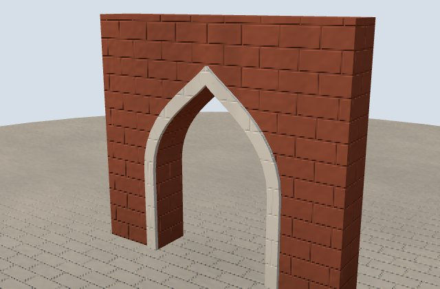 | 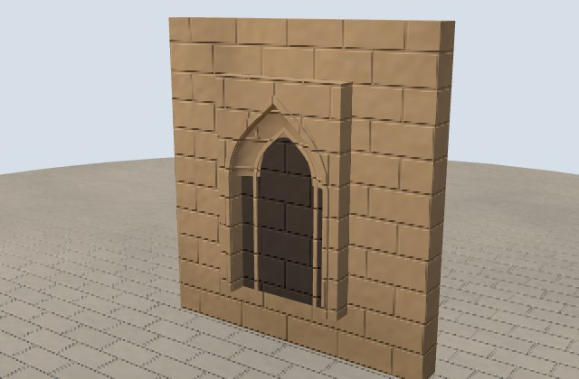 | 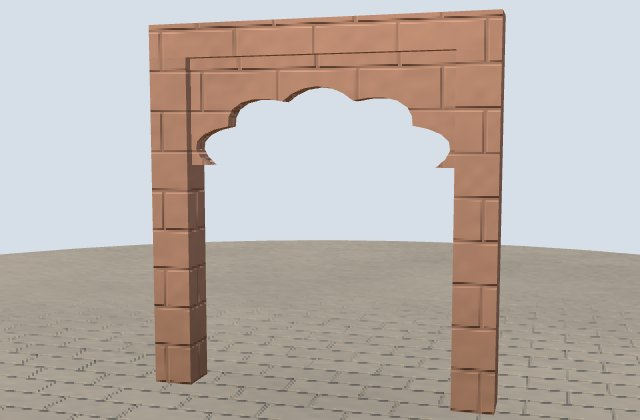 |
| :---: | :---: | :---: |
| Arch wall with its ring | Niche | Cusped arch between pillars |
| 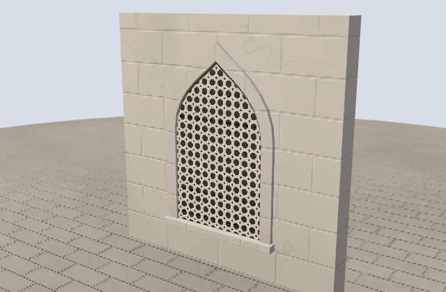 | 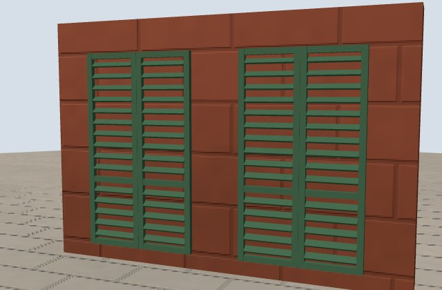 | 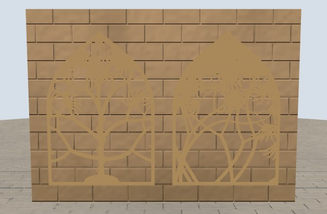 |
| Window with a jali screen | Louvred shutters | Tree of Life and branch jalis |
| 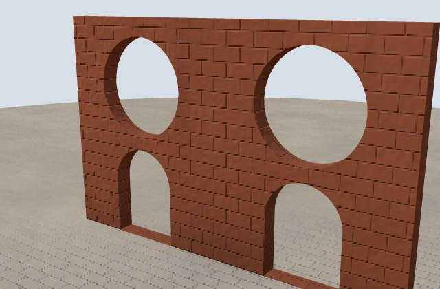 | 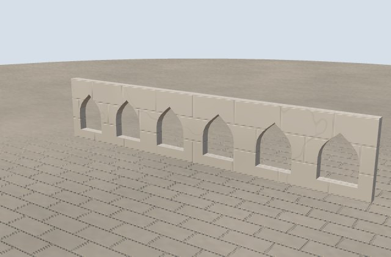 |   |
| Wall pierced with circles and arches | Arcaded screen |   |

| Part | File | What it is |
| --- | --- | --- |
| `archWall(w, h, d, archW, archH, pointed, m)` | helpers | A wall with an arch cut through it |
| `archPanel(archW, archH, pointed, m)`, `archSlab(…)` | helpers, components | A blind arch: a thin arch-shaped slab, usually dark, on a wall |
| `archRing(archW, archH, pointed, band, depth, m)` | components | The moulded ring round an arch's opening |
| `keystone(w, h, depth, m)`, `tympanum(aw, ah, pointed, m)`, `hood(aw, ah, pointed, depth, m)` | components | The wedge at an arch’s crown; the slab that fills an arch’s head (a jali, a carved field); the half-dome over a niche |
| `niche(archW, archH, pointed, depth, m)` | components | An arched niche with a half-dome hood |
| `cuspedArchGeo(aw, h, t)` | components | The five-lobed arch that hangs between two pillars of a temple hall or a Rajput pavilion, as a geometry shared by every bay of one width |
| `barrelVault(radius, length, m)` | helpers | The underside of a barrel vault |
| `windowFrame(w, h, m, { shape, screen })` | components | A window in a stone surround; `screen: jali(m)` fills it with a pierced screen |
| `louvredShutter(w, h, m)` | components | Two closed leaves of angled slats in a frame of stiles and rails, green by default |
| `treeJali(aw, ah, kind, { color })` | components | A pierced lattice in a pointed arch, drawn on a canvas and cut out by its alpha: `'tree'` (the Tree of Life of Sidi Saiyyed), `'branches'` or `'lattice'` |
| `piercedWall(w, h, t, holes, m)` | components | A wall pierced by great circles `[x, y, r]` and round-headed arches `['arch', x, y0, r, spring]`, as in Louis Kahn’s brick screens at IIM Ahmedabad |
| `arcadeScreen(len, h, n, holeW, holeH, depth, m)` | components | A low screen pierced by a row of small arches: the arcaded balustrades of Qutb Shahi and Mughal galleries |
| `doorFrame(w, h, { bands })` | doorways | The nested, carved bands round a post-and-lintel door |
| `doorLeaves(w, h, { open, studs, spikes })` | doorways | Timber leaves, standing open; `spikes` against war elephants |
| `interior(w, h)` | doorways | The dim room seen through an open door |
| `lamp(s)` | doorways | A small brass oil lamp with its flame, as stands in a sanctum |

## Walls, eaves and parapets

| 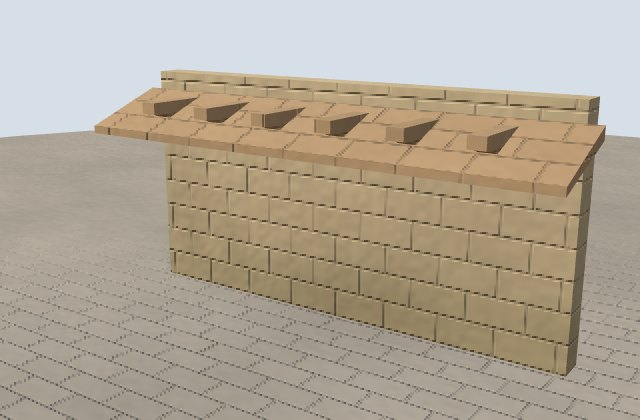 | 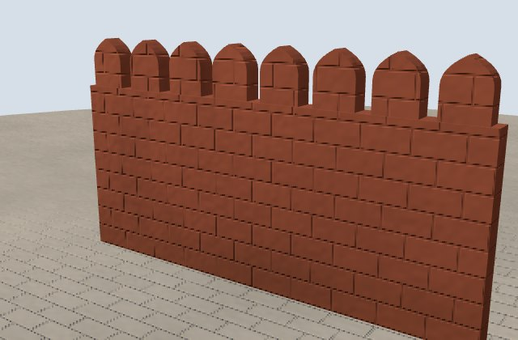 | 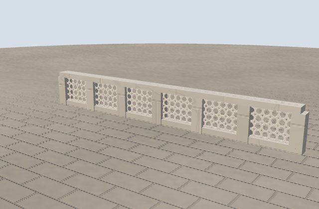 |
| :---: | :---: | :---: |
| Chhajja on brackets | Merlons | Railing |
| 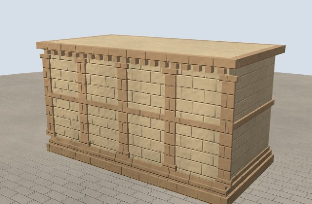 | 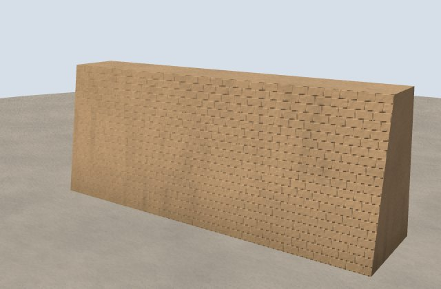 | 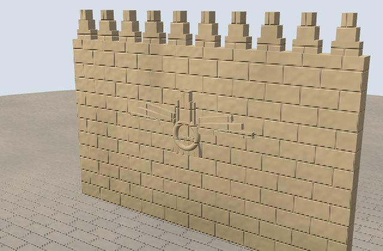 |
| Base mouldings, belt course, pilasters, dentils and cornice | Battered wall (Tughlaqabad) | Faravahar and stepped merlons |

| Part | File | What it is |
| --- | --- | --- |
| `chhajja(len, depth, drop, thickness, m)` | components | The deep sloping eave of Indian buildings; `chhajjaRing` for a round one |
| `bracketGeo(h, d, w)` | components | The bracket that carries an eave or a balcony |
| `merlons(len, w, h, depth, m)` | components | A row of pointed battlements |
| `steppedMerlons(len, w, h, m, depth)` | components | Persepolitan merlons along a parapet, each stepped back three times |
| `railing(len, h, t, m)`, `railingRing(r, h, m)` | components | A railing of posts with pierced screens between |
| `beltCourse(w, d, y, h, proud, m)` | components | A band running round a rectangular building |
| `mouldings(w, d, courses, m)` | components | A stack of moulded courses: a plinth, a cornice |
| `dentils(len, w, h, d, m)` | components | The row of small blocks under a cornice |
| `panel(w, h, band, m, field)` | components | A sunk panel in a frame, its field carved or inlaid |
| `wallWithGaps(axis, len, h, t, m, gaps)` | temples | A compound wall with openings left for its gates |
| `curvedBand(points, a, b, y0, y1, m)`, `ellipseWall(…)` | helpers | A wall that follows a curve |
| `batteredGeo(top)` | forts | A unit length of wall whose faces lean in to `top` of its thickness, for `inst()`: the sloping walls of the Tughlaqs |

## Roofs

| 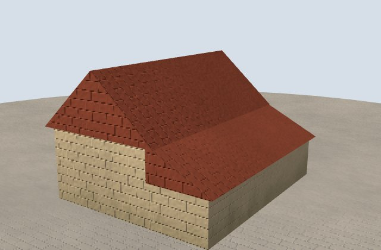 | 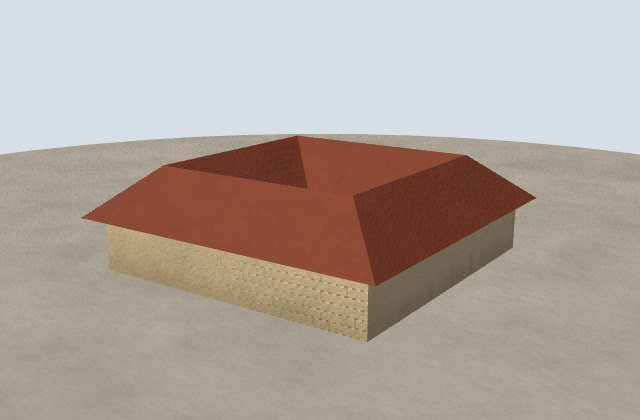 | 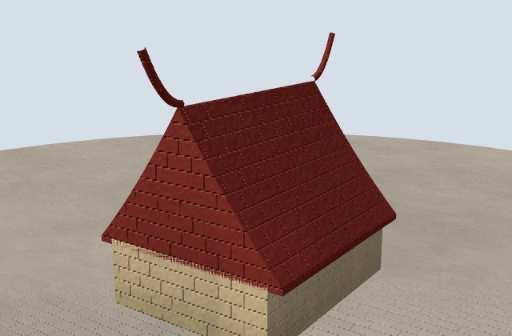 |
| :---: | :---: | :---: |
| Gable and lean-to roofs | Ring roof round a courtyard (Kerala) | Meitei roof |
| 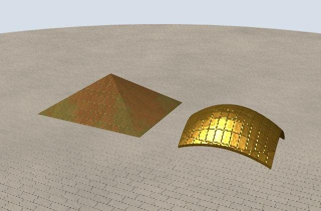 | 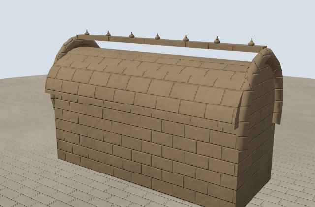 | 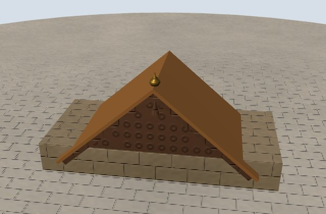 |
| Copper and gilded-copper roofs | Wagon-vault (shala) roof | Kerala gable |

| Part | File | What it is |
| --- | --- | --- |
| `hipRoof(w, d, h, m)` | helpers | A hipped roof over a rectangle |
| `gableRoof(w, d, h, m, { axis })` | components | A gable roof w across its eaves, d long and h to the ridge, which runs along z (or x with `axis: 'x'`); pass `doubleSided(m)` for one seen from beneath |
| `leanTo(w, d, h, m, side)` | components | A half-gable over an aisle, sloping from h at its wall down to the eaves on `side` |
| `ringRoof(W, D, wd, ov, h, m)` | temples | A tiled roof running round a courtyard, as on a Kerala nalukettu or a temple cloister: up from the outer eaves to a ridge over each wing and down to the inner eaves, hipped at the corners |
| `banglaRoof(w, d, rise, m, { droop })` | components | The curved roof of Bengal, as on jharokhas and pavilions: curved both ways, its ridge and eaves drooping to the corners |
| `meiteiRoof(w, d, h, m, horn)` | components | The roof of Manipur: a steep gable with sagging sides, its ridge sweeping up into horns at both ends |
| `wagonRoof(len, d, m)` | temples | The barrel-vault roof of a Dravidian shala: the vault, a ridge of finials and a great horseshoe arch at each gable end (Bhima Ratha) |
| `keralaGable(w, h, d, roofM, wood)` | temples | The carved timber gable (mukhappu) of a Kerala roof, as a dormer to set into a hip roof |
| `pidaRoof(w0, w1, count, step, m)` | helpers | The stepped pyramid roof of slabs |

## Ornament

| 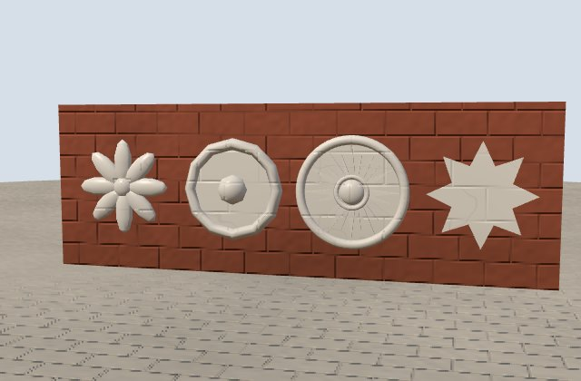 | 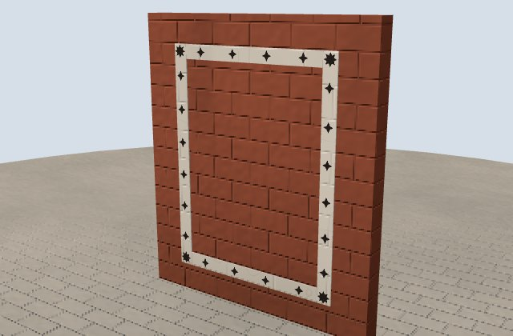 | 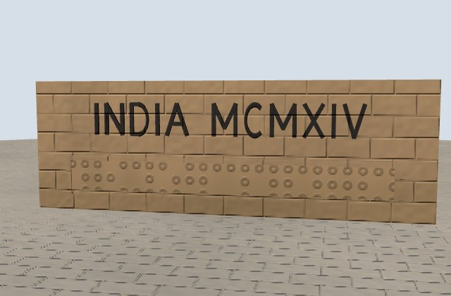 |
| :---: | :---: | :---: |
| Rosette, medallion, sunburst and inlaid star | Inlaid border | Raised lettering over a carved panel |
| 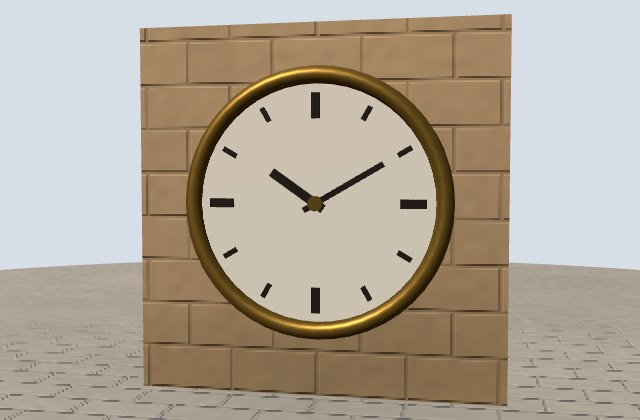 | 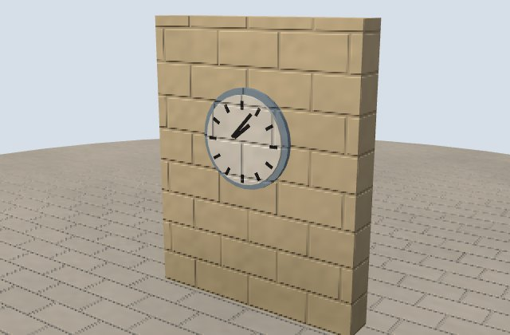 | 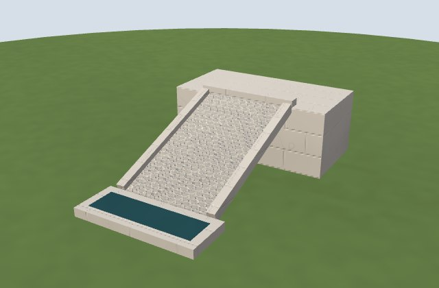 |
| Brass-bezelled clock face | Tower clock | Chadar (water cascade) |

| Part | File | What it is |
| --- | --- | --- |
| `rosette(R, m)`, `medallion(R, m)`, `sunburst(R, m)` | components | Carved roundels |
| `star(n, R, m)` | components | A flat inlaid star of `n` points, as the white marble stars on the red sandstone of Mughal spandrels |
| `fishPair(len, m)` | components | Two fish facing each other: the emblem of the Nawabs of Awadh over the arches of Lucknow |
| `inlayBorder(w, h, band, base, inlay)` | components | A frame of marble strips set with inlaid lozenges and corner stars, round a panel or an arch on a Mughal gate |
| `lettering(text, size, depth, m)` | components | Raised letters |
| `clockFace(R, hour, minute)` | components | A clock dial with a brass bezel, a white face, twelve marks and two hands (Christ Church, the stations); `towerClock` in colonial is the plain one |
| `towerClock(d, { ring, dial, hand })` | colonial | A plain tower clock d across: a white dial in a ring, twelve marks and two hands (Paradesi Synagogue); `clockFace` in components is the brass-bezelled one |
| `faravahar(w, m)` | components | The winged Faravahar of the Zoroastrians in relief: a ring, the half-figure, three tiers of wings and a tail |
| `chadar(w, len, drop, m)` | components | A Mughal garden cascade: a sloping marble bed carved in fish scales under a thin sheet of water, between kerbs, with a lip at the top and a pool at the foot |

`lettering` draws only the capitals its inscriptions need (`A C D E H I M N O S T V X`); add a glyph to `GLYPHS` in `js/parts/components.js` before using another letter. A missing one is left as a space and logged.

## Surfaces

| 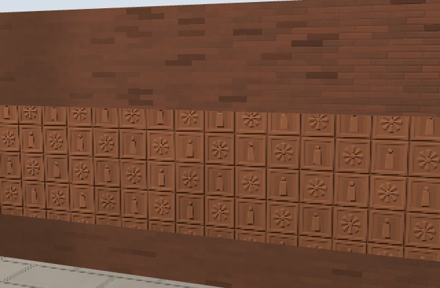 |  |  |
| :---: | :---: | :---: |
| Terracotta brick and plaques | Copper and gilded-copper roofs | Window with a jali screen |

These cost almost no triangles: the pattern is drawn by the surface shader (`js/surface.js`) from
the point's position in space, so a 1 m block is the same size on every model.

| Part | File | What it is |
| --- | --- | --- |
| `jali(m)` | components | A pierced stone screen: octagons and diamonds, cut right through up close |
| `frieze(m)` | components | A carved band of rosettes |
| `carved(m, kind)` | components | Any other surface: `'script'` (incised names), `'calligraphy'`, `'pietra'` (inlay), `'reliefs'` (sculpture panels), `'tiles'` |
| `photo(material, key)` | helpers | Gives a stone a photo texture set: `'laterite'`, `'blocks'`, `'rubble'`, `'concrete'`, `'timber'` and others (`js/textures.js`) |
| `surface(m, kind)` | helpers | Sets the drawn surface of a material. The everyday kinds: `'masonry'`, `'marble'`, `'brick'`, `'rock'`, `'ground'`, `'paving'`, `'tiles'`, `'banded'`, `'facade'`, `'carved'` (jointless), and `'none'` for metal, glass and paint |
| `surface(m, 'plates')` | surface | Bronze cast in plates: staggered joints worked out in space, so they run true over a curved body |
| `surface(m, 'blocks')` | surface | A statue built of granite blocks (Thiruvalluvar): the plates' joints at a smaller size and darker, each block its own shade |
| `surface(m, 'reeds')` | surface | A penbey parapet: the maroon-painted cut ends of tamarisk twigs, in bundled courses |
| `surface(m, 'copper')` | surface | Sheet copper: staggered sheets with standing seams worked out in space, hammer dimples, and verdigris along the seams, in streaks and in weathered patches |
| `surface(m, 'giltsheet')` | surface | The same sheets gilded: seams and dimples, no verdigris |
| `surface(m, 'terracotta')` | surface | Thin fired-clay bricks (32 × 6.5 cm) with fine joints, each brick its own shade, the odd one over-burnt, stained by soot and lichen; fades to an even tone where a brick is under a few pixels, so it never shimmers |
| `surface(m, 'plaques')` | surface | A band of moulded terracotta plaques: bordered tiles with an open lotus or a standing figure in turn |
| `surface(m, 'scallop')` | surface | A chadar's carved bed: staggered rows of fish scales, light lips and dark hollows |
| `surface(m, 'cladding')` | surface | Marble panels in staggered courses with fine joints worked out in space, so they follow a curved shell (the Lotus Temple's petals) |

Photo texture keys for `photo()`: `'marble'`, `'sandstone'`, `'plaster'`, `'granite'`, `'rock'`, `'laterite'`, `'blocks'`, `'rubble'`, `'concrete'` and `'timber'` (`js/textures.js`).

## Temples

Mostly `js/parts/temples.js`, with the doorways in `js/parts/doorways.js`. Nagara (north), Dravida (south), Vesara and Hoysala, Kalinga, Kerala and the Himalayan temples are all built from these.

| 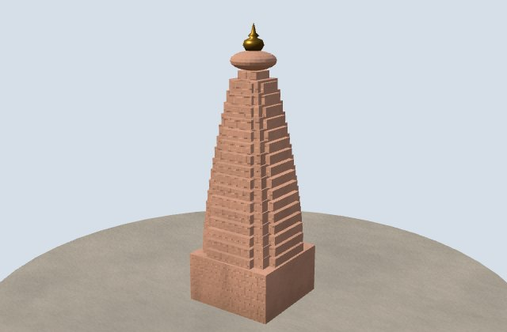 | 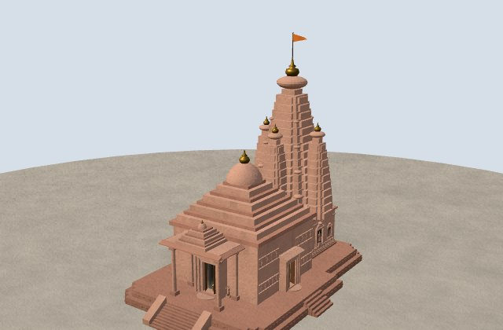 | 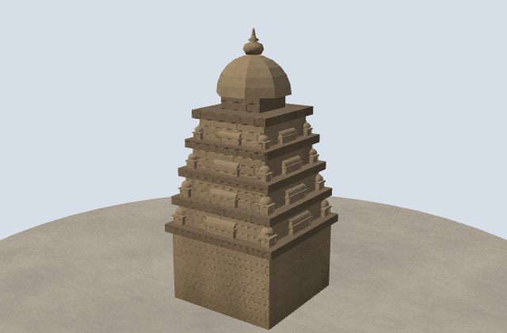 |
| :---: | :---: | :---: |
| Shikhara | Nagara temple | Dravida vimana |
|  | 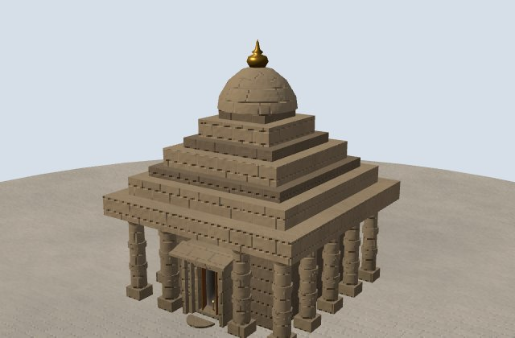 | 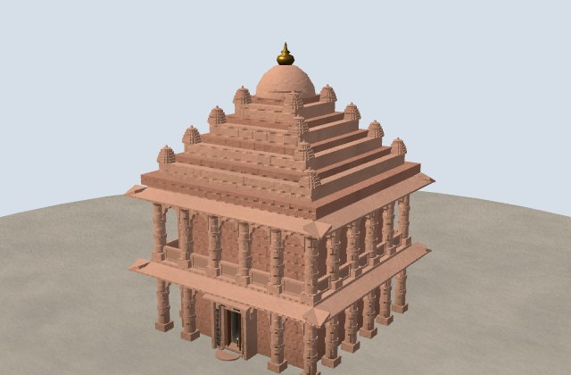 |
| Gopuram | Mandap | Storeyed hall |
| 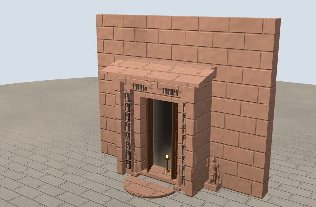 |  |  |
| Temple doorway with carved jambs | Temple porch | Post-and-lintel gate with lions, under a stepped roof |
|  |  |  |
| Temple niche with an image | Kuta, shala and a hara row | Hoysala stellate tower |
|  |  |  |
| Dwajasthambha (gold flagstaff) | Manastambha | Deepmala |
|  |  |  |
| Nandi mandapa | Dravida hall dress | Kerala gopuram |
|  |  |  |
| Spire with its timber canopy | Broken and whole spires | Apsidal plan |
|  |  |  |
| Kakatiya Kala Thoranam | Chandrashala in stone, gavaksha in brick | Water spout (pranala) |

| Part | File | What it is |
| --- | --- | --- |
| `nagaraTemple({ w, h, m, halls, … })` | temples | A whole North Indian temple: sanctum, curved spire and halls stepping out in front |
| `shikhara(baseW, h, m, profile)` | helpers | The curved Nagara spire alone; `nagaraProfile` and `kalingaProfile` are two tapers |
| `bhumijaRows(w, h, profile)` | temples | Rows of miniature spires between the bands of a Bhumija spire |
| `brokenSpire(w, h, keep, m, { n, rubble, amalakaM })` | temples | A Nagara spire in courses of which only the lower `keep` fraction stands, its top ragged; whole, it ends in a ribbed amalaka (Masrur) |
| `spireCanopy(w, m, wood)` | temples | The timber canopy over a Himalayan spire’s top stone: a post, a pyramid roof with a thin eave and a kalasha (Jageshwar) |
| `dravidaVimana(w, tiers, tierH, m)` | temples | The stepped tower over a South Indian sanctum, with its parapets of miniature shrines |
| `kuta(s, m)`, `shala(w, d, m)`, `haraRow(len, s, m)` | sculpture | The miniature shrines along the edge of each storey of a vimana |
| `gopuram(w, d, h, tiers, seed)` | temples | A South Indian gate tower, tier on tier of painted stucco figures |
| `keralaGopuram(w, d, { base, wood, roof, brass })` | temples | A Kerala temple gateway: a laterite storey with its passage, a latticed timber storey, three tiers of tiled roof with carved gables and brass finials (Vadakkunnathan) |
| `mandap(w, h, roofTiers, m, shade)` | temples | A pillared hall under a stepped roof |
| `storeyedHall(w, roofs, m, shade, { floors })` | temples | A hall of several storeys of pillared galleries |
| `tierSpires(w0, w1, n, step, y0)`, `miniSpireGeo()` | temples, sculpture | Small curved spires on the corners of each tier of a `pidaRoof`, for `inst()` |
| `stellateTower(r, h, m, dark, tiers)` | helpers | A Hoysala tower on a sixteen-pointed star plan, stepping in tier by tier to a ribbed cap and kalash |
| `dravidaDress(w, d, h, m, { eaveM, haraM })` | temples | The dress of a plain South Indian hall or shrine block: moulded base, pilasters, a kapota eave and a parapet of miniature shrines |
| `apsePlan(w, z0, z1, n)` | temples | An apsidal plan for `planPrism`: straight in front, a half circle behind (Durga temple, Aihole) |
| `templeDoorway(w, h, { m, shakha })` | doorways | A temple door: stepped frame, hood, open leaves, a lamp in the sanctum behind, guardians; on desktops its carved jambs (`shakhas`) |
| `shakhas(w, h, bands, bw, d0, depth, m)` | doorways | The carved jambs of a dvarashakha: columns of little figures in niches up the carved bands, nine across the lintel, Ganga and Yamuna at the foot |
| `templePorch(w, d, h, m)` | doorways | A small open porch before a door |
| `trabeateGate(w, h, d, passW, passH, …)` | temples | A post-and-lintel gatehouse, with guardians or carved beasts |
| `kakatiyaThorana(m, shade)` | temples | The Kakatiya Kala Thoranam of Warangal: two frames of carved pillars with angled brackets, a lintel and a crest with a medallion and makara horns |
| `templeNiche(w, h, m, { figure })` | temples | A niche on a temple wall holding an image |
| `chandrashala(r, m, depth, recess)` | temples | The horseshoe arch-window carved on a temple wall or tower: a ring open at the foot over a dark recess, with a finial block |
| `gavaksha(w, m, hollow)` | temples | The same window moulded in brick (Sirpur): a round-headed recess in a ring on two jambs |
| `pranala(len, m, { drop, size })` | doorways | The water spout draining a sanctum: a channelled trough on a corbel ending in a makara head with a curled trunk, over a stone basin |
| `dwajasthambha(x, z, h)` | temples | The gold flagstaff before the sanctum |
| `manastambha(h, m, { images })` | temples | The Jain pillar of honour: a stepped base, a banded shaft, a lotus capital and a small pavilion, with four seated images in it if `images` |
| `deepmala(h, m)` | temples | The lamp tower of Maharashtra's temples: a tapering shaft with rings of stone arms, a brass lamp on each, lit at night |
| `nandiMandapa(w, h, m, trim, { nandiM })` | temples | An open pavilion of eight carved pillars on the temple's axis, the Nandi lying in it facing the sanctum |

## Mughal and Indo-Islamic

`js/parts/mughal.js`: the iwans, doorways and arcades of the Sultanate, Mughal, Nawabi, Qutb Shahi and Deccan buildings. Their domes, chhatris, minarets, guldastas, jalis and inlay are in the sections above.

|  |  |  |
| :---: | :---: | :---: |
| Iwan | Iwan with muqarnas and an inscription band | Mughal doorway |
|  |  |  |
| Arcade skin: a door, a room, a jali and shutters | Pear-shaped dome (Sheikh Chilli’s Tomb) | Mughal chhatri |

| Part | File | What it is |
| --- | --- | --- |
| `iwan(w, h, { m, trim, depth, cells, script, rosettes })` | mughal | The great arched recess of a Mughal gate or tomb front, with its door; muqarnas in its half-dome on desktops (`cells`, on from 5 m wide), an inscription band round its frame (`script`) |
| `muqarnas(w, h, depth, { m, trim, tiers })` | mughal | Tiers of small faceted cells lining the half-dome of a pointed arch, staggered, with fine ledges between the tiers |
| `scriptFrame(W, yt, bw)` | mughal | An inscription band of black letters inlaid in white marble round a pishtaq |
| `mughalDoorway(w, h, { m })` | mughal | A pointed doorway onto a dim room |
| `arcadeSkin(len, h, cells, depth, m)` | mughal | A wall face cut into a row of arched cells, each a door, a screen, a room, or a window closed by louvred shutters (`'shutters'`) |
| `cellRow(n, pitch, sill, aw, ah, skip)` | mughal | The cells for `arcadeSkin`: `n` equal arches centred on the face, leaving out any in the `skip` ranges (a gate, a porch) |

## Forts

`js/parts/forts.js`.

|  |  |  |
| :---: | :---: | :---: |
| Fort gate | Rampart and a crowned bastion | Machicolation |
|  |  |   |
| Arrowhead bastions | Battered wall (Tughlaqabad) |   |

| Part | File | What it is |
| --- | --- | --- |
| `fortGate(w, h, d, archW, archH, { towers, iwan, box })` | forts | A gatehouse with a real passage through it, guard niches and spiked leaves; `box` hangs a machicolation over the arch |
| `towerDetail(rBottom, rTop, h, m)` | forts | String courses and arrow slits for a round tower |
| `slitRow(len, n, y, w, h)` | forts | A row of arrow slits along a wall |
| `rampart(segments, m, { loopholes, boxes })`, `bastionCrowns(list, m)` | forts | Battlements for a long curtain wall and for round bastions: parapet, merlons pierced with gun-loops, string course, arrow slits, and a machicolation every `boxes`th length of wall |
| `machicolations(list, m, trim)` | forts | Box drop-chutes hung from a wall's head on corbels, with a slot in the floor and a gun-loop in front; instanced |
| `arrowBastion(pts, i, { flank, shoulder, point })` | forts | The plan of an arrowhead bastion of a European trace at corner `i` of a curtain: flanks, shoulders and a salient; five points for `planPrism` (Moti Daman) |
| `batteredGeo(top)` | forts | A unit length of wall whose faces lean in to `top` of its thickness, for `inst()`: the sloping walls of the Tughlaqs |

## Churches and colonial buildings

`js/parts/colonial.js`, with roofs from `components` and roofline ornament from `sculpture`. An
opening here is never a dark shape stuck on a wall: it is cut through a surround that stands proud
of the wall, framed by a moulded architrave, with leaves, glazing or a screen at the back.

- **Gothic Revival churches** (St Paul's Cathedral in Kolkata, San Thome Basilica, Christ Church
  in Shimla): a nave under a `gableRoof` with `leanTo` aisles, a `gothicDoor` in the west front,
  `gothicWindow`s down the sides, `gothicPinnacle`s on the buttresses and tower, `gothicTurret`s at
  the corners and a clock on the tower.
- **Portuguese Baroque and Mannerist churches** (Se Cathedral, the Basilica of Bom Jesus, the
  Immaculate Conception in Panaji, St Francis in Kochi): fronts in storeys of `classicalDoor`s and
  windows between pilasters, an `oculus` in the gable, a `pediment` or scrolled gable, `balustrade`s
  on the stairs, in whitewash or bare `M.laterite`.
- **The synagogues** (Paradesi in Kochi, Knesseth Eliyahoo in Mumbai) and **Solomon's Temple** in
  Aizawl take the same doors, columns and balustrades, and the Paradesi clock tower its `towerClock`.
- **Civic and palace fronts** (the Raj's stations, Hazarduari, Falaknuma, Cooch Behar, the
  Viceregal Lodge): `porch`es of paired columns under pediments, `entablature`s, urns and statues.

|  |  |  |
| :---: | :---: | :---: |
| Gothic portal | Gothic window | Round window (oculus) |
|  |  |  |
| Gothic pinnacles | Gothic turrets | Tower clock |
|  |  |  |
| Classical door | Corinthian porch under a pediment | Entablature and pediment |
|  |  |  |
| Balustrade | Classical columns, plain and Corinthian | Gable and lean-to roofs |

| Part | File | What it is |
| --- | --- | --- |
| `gothicDoor(w, h, { orders, gable, pinnacles })` | colonial | A Gothic portal: pointed arches stepping out one inside another on colonnettes, a studded door under a carved tympanum, and above it a crocketed gable between two pinnacles |
| `gothicWindow(w, h, { m, trim })` | colonial | A pointed Gothic window in a stone surround: glazing, a mullion dividing it into two lights with their own pointed heads, and a roundel in the head above them |
| `oculus(R, { m, trim })` | colonial | A round window in a moulded frame, glazed, with a cross of bars and a ring of foils round its rim: the rose window of a church front, the bull’s-eye of a Baroque gable |
| `gothicPinnacle(h, m)` | sculpture | A crocketed pinnacle: a slim octagonal shaft, a spirelet with knobs up its edges and a finial, for buttress heads, gables and tower corners |
| `gothicTurret(r, h, m, trim, spire)` | colonial | An octagonal Gothic turret: string courses every third of its height, a moulded cap and a crocketed pinnacle (St Paul’s, Kolkata) |
| `towerClock(d, { ring, dial, hand })` | colonial | A plain tower clock d across: a white dial in a ring, twelve marks and two hands (Paradesi Synagogue); `clockFace` in components is the brass-bezelled one |
| `clockFace(R, hour, minute)` | components | A clock dial with a brass bezel, a white face, twelve marks and two hands (Christ Church, the stations); `towerClock` in colonial is the plain one |
| `gableRoof(w, d, h, m, { axis })` | components | A gable roof w across its eaves, d long and h to the ridge, which runs along z (or x with `axis: 'x'`); pass `doubleSided(m)` for one seen from beneath |
| `leanTo(w, d, h, m, side)` | components | A half-gable over an aisle, sloping from h at its wall down to the eaves on `side` |
| `classicalDoor(w, h, { shape, fill, top, columns })` | colonial | A classical door or sash window in a moulded architrave: round-headed with a fanlight or flat, between columns if asked, under a pediment or a cornice |
| `porch(w, d, h, { cols, paired, order, top, door, stepsDown })` | colonial | A columned porch on a low floor: `cols` columns (in pairs if `paired`, Corinthian if `order` says so), an entablature with a dentilled cornice, and on top a pediment, a balustrade or the cornice alone; `door` sets a door in the wall behind |
| `pediment(w, h, depth, m, trim)` | colonial | A triangular pediment, its tympanum set back behind the raking cornices, over a porch, a door or a whole front |
| `balustrade(len, h, m)` | colonial | A row of turned balusters between a plinth and a handrail |
| `column(r, h, m, { order })` | colonial | A classical column: plinth, base, tapering shaft, capital. `order: 'corinthian'` adds flutes and acanthus |
| `entablature(len, h, m)`, `corinthianCapital(r, m)` | sculpture | What a classical colonnade carries |
| `urn(h, m)`, `pinnacle(h, m)` | sculpture | Roofline ornaments: a classical urn, a plain pinnacle |
| `statue(h, m, pose)` | sculpture | A statue on a pedestal |

## Tibetan monasteries

`js/parts/tibetan.js`, for Key, Thiksey, Tawang, Rumtek, Namdroling and Leh Palace.

|  |  |  |
| :---: | :---: | :---: |
| Monks' houses | Tibetan block | Assembly hall |
|  |  |  |
| Tibetan door in its portico | Rabsel (timber window bay) | Dharma wheel and a victory banner |
|  |  |  |
| Prayer wheels | Gilded roof | Two-tier gilded roof (Namdroling) |
|  |   |   |
| Chortens |   |   |

| Part | File | What it is |
| --- | --- | --- |
| `tibetanBlock(w, h, d, floors)` | helpers | A whitewashed block with dark windows under a maroon band (Rumtek) |
| `hall(w, h, d, { floors, wall, cap, door, bay })` | tibetan | An assembly hall or temple: walls under the penbey band and a white fillet, framed windows with awnings on every face, an earth roof, a door gap, and a timber window bay in the front's top row |
| `hallWindows(spots)` | tibetan | Windows in black surrounds, with frames, lintels and valances, at any list of spots |
| `rabsel(w, h)` | tibetan | A projecting timber window bay: three lattice lights on a bracketed sill, under painted lintels and a cornice |
| `quarters(blocks, { cap })` | tibetan | Dresses a list of plain blocks as monks' houses: windows in black surrounds, doors, beam ends, earth roofs, prayer-flag poles |
| `tibetanDoor(w, h)`, `tibetanPortico(…)` | doorways | A painted door; a pillared portico |
| `maniWheels(len, { h, back })` | tibetan | A gallery of brass prayer wheels in a recess between maroon posts, under an eave |
| `ganjira(h)` | tibetan | The gilded lotus-and-vase finial on a roof's peak |
| `roofCorners(w, d)` | tibetan | Upturned gilt tips and bells at the corners of a gilded roof |
| `goldRoof(w, d, { rise, clere, upper, gilt, wall })` | tibetan | A two-tier gilded roof: a hip roof, a clerestory under a maroon band and an upper hip roof with the ganjira, gilt corner tips and victory banners (Namdroling) |
| `dharmaWheel(w)` | tibetan | The gilded wheel between two deer over an assembly hall |
| `gyaltsen(h)` | tibetan | The victory banner at a roof's corner |
| `shabkhep(w)` | tibetan | The pleated awning over a window |
| `parapetDiscs(len, pitch, r)` | tibetan | Gilded discs along a parapet |
| `chorten(s, m)` | tibetan | A whitewashed chorten about 4.6·`s` high: two square steps, the dome and a gilt spire. They stand in rows below Key, Thiksey and Leh |
| `TIBETAN.maroon` | helpers | The maroon parapet band, drawn with the `reeds` surface as the cut twig ends of a penbey |

## Gurdwaras

`js/parts/sikh.js`.

|  |  |  |
| :---: | :---: | :---: |
| Gurdwara dome: lotus cup, ribbed gilt onion, kalash and umbrella | Nishan Sahib | Arcaded storeys and a parapet of gilt domes |

| Part | File | What it is |
| --- | --- | --- |
| `sikhDome(r, m, { finialM, petals, ribs })` | sikh | A gurdwara’s dome: a cup of lotus petals, the ribbed onion, a kalash and a gilt umbrella (chhatra) on a rod |
| `nishanSahib(h, { y })` | sikh | The Sikh flagpole: a saffron-sheathed pole on a marble plinth, a gilt cap, the pennant and the khanda |
| `arcadeStorey(w, h, n, m, { trim, fill, dp, sill, aw, ah, centre })` | sikh | A square storey with an arcaded skin on each face, `n` arches a face, each a door, a room or a screen |
| `rectStorey(w, d, h, pitch, m, { trim, fill, dp, sill, ah, front })` | sikh | The same on a rectangle, as many arches a face as fit at `pitch`, `front` filling the middle arch of the front |
| `parapetDomes(w, y, n, m, r)` | sikh | A row of small ribbed domes on drums along the four sides of a parapet |
| `GILT`, `SAFFRON` | sikh | The gilt copper and the saffron cloth of the gurdwaras |

The five gurdwaras (Hazur Sahib, Patna Sahib, Keshgarh Sahib, Bangla Sahib and Hemkund Sahib) are built from these; the Golden Temple has its own gilded storeys.

## Early and regional styles

The parts that came in with the monuments outside the great traditions. Each is listed under its
kind above as well; this is the index by style.

| Style | Monuments | Its parts |
| --- | --- | --- |
| Harappan | Dholavira, Lothal | Rubble and mud-brick masses from the primitives, in `'masonry'` and `'terracotta'` surfaces; no ornament |
| Mauryan and early Buddhist | Vaishali's pillar, Barabar, Karla, Sanchi | `ashokanPillar`, `chaityaDoorway`, `mauryanDoor`, `elephantPillar`, `torana` |
| Brick temples of Bengal and Chhattisgarh | Bishnupur, Dakshineswar, Sirpur | `banglaRoof`, `gavaksha`, the `'terracotta'` and `'plaques'` surfaces |
| Ahom Assam | Rang Ghar, Talatal Ghar | `'terracotta'` brick, curved roofs built in the monument's own file |
| Meitei Manipur | Kangla Fort | `meiteiRoof`, `kanglaSha` |
| Parsi | Wadiaji Atash Behram | `bullColumn`, `faravahar`, `steppedMerlons` |
| Kerala and the Konkan | Mattancherry, Vadakkunnathan, Cheraman Juma Masjid, the Goan churches | `ringRoof`, `keralaGable`, `keralaGopuram`, `gableRoof`, `M.laterite` |
| Stepwells | Rani ki Vav, Adalaj, Agrasen ki Baoli, Chand Baori | `planSolid` for the ground with the well cut out, `carvedPillar`, `frieze` |
| Modern | IIM Ahmedabad, the Capitol Complex, the airports and bridges | `piercedWall`, the primitives, `'concrete'` photo texture, the transport kit in [The setting](setting.md#railways-and-aircraft) |

|  |  |  |
| :---: | :---: | :---: |
| Torana (Sanchi) | Ashokan pillar with a single lion | Rock-cut doorways: Lomas Rishi and a plain Mauryan door |
|  |  |  |
| Elephant-capital pillars (Karla) | Terracotta brick and plaques | Meitei roof |
|  |  |  |
| Kangla Sha | Persepolitan bull columns | Faravahar and stepped merlons |
|  |  |  |
| Ring roof round a courtyard (Kerala) | Kerala gable | Wall pierced with circles and arches |

| Part | File | What it is |
| --- | --- | --- |
| `torana(m)` | helpers | The gateway of a stupa’s railing, as at Sanchi: two posts, three architraves with rolled ends and a wheel on top |
| `ashokanPillar(m, { shaft, r0, r1 })` | animals | An Ashokan pillar as at Vaishali: a polished plain shaft, a ribbed lotus bell, a square abacus and a single seated lion |
| `chaityaDoorway(m, { dark })` | doorways | The Lomas Rishi doorway at Barabar, the earliest chaitya arch: sloping jambs in a carved hut gable with an ogee crown, a lattice band and elephants walking to a stupa |
| `mauryanDoor(wb, h, m, { dark })` | doorways | A plain Mauryan rock-cut doorway: a trapezoid with sloping jambs in a slight frame, onto darkness |
| `elephantPillar(h, m)` | sculpture | The pillar of a Satavahana chaitya hall, as at Karla: a stepped base with a pot, an octagonal shaft, a bell capital and kneeling elephants with riders on the abacus (left off on phones) |
| `gavaksha(w, m, hollow)` | temples | The same window moulded in brick (Sirpur): a round-headed recess in a ring on two jambs |
| `banglaRoof(w, d, rise, m, { droop })` | components | The curved roof of Bengal, as on jharokhas and pavilions: curved both ways, its ridge and eaves drooping to the corners |
| `meiteiRoof(w, d, h, m, horn)` | components | The roof of Manipur: a steep gable with sagging sides, its ridge sweeping up into horns at both ends |
| `kanglaSha({ m, plinth, h })` | animals | The Kangla Sha of Imphal: a Meitei guardian with a lion’s body and a horned dragon’s head, seated with jaws open, sculpted as one skin on a stepped plinth |
| `bullColumn(h, m, trim)` | sculpture | A Persepolitan column: a bell base, a fluted shaft, a scrolled block and a capital of two bulls back to back, as on Bombay’s Parsi fire temples |
| `faravahar(w, m)` | components | The winged Faravahar of the Zoroastrians in relief: a ring, the half-figure, three tiers of wings and a tail |
| `steppedMerlons(len, w, h, m, depth)` | components | Persepolitan merlons along a parapet, each stepped back three times |
| `ringRoof(W, D, wd, ov, h, m)` | temples | A tiled roof running round a courtyard, as on a Kerala nalukettu or a temple cloister: up from the outer eaves to a ridge over each wing and down to the inner eaves, hipped at the corners |
| `keralaGable(w, h, d, roofM, wood)` | temples | The carved timber gable (mukhappu) of a Kerala roof, as a dormer to set into a hip roof |
| `M.laterite` | helpers | The red laterite of the Konkan and Malabar coasts, cut in blocks: one shared stone for Goa’s churches and fort and Kerala’s palace and mosque |
| `piercedWall(w, h, t, holes, m)` | components | A wall pierced by great circles `[x, y, r]` and round-headed arches `['arch', x, y0, r, spring]`, as in Louis Kahn’s brick screens at IIM Ahmedabad |
| `planSolid(outer, holes, h, topM, sideM)` | helpers | A block on any plan with holes cut through it, its top and its walls as separate meshes: the ground round a stepwell with the well cut out (Adalaj, Agrasen ki Baoli) |

## Stairs

`js/parts/doorways.js`.

|  |  |   |
| :---: | :---: | :---: |
| Grand stair | Plain flight of steps |   |

| Part | File | What it is |
| --- | --- | --- |
| `steps(width, rise, n, m)` | doorways | A plain flight |
| `grandStair(rise, width, m, shade, { n, landing })` | doorways | A broad stair between side walls, with a landing and guardians |

## Sculpture

|  |  |  |
| :---: | :---: | :---: |
| Figure frieze | Relief idol and carved figures: standing, dancer, seated | Statue, urn and pinnacle |
|  |  |  |
| Door guardian | Ashokan pillar with a single lion | Kangla Sha |
|  |  |   |
| Trimurti (Elephanta) | Trishul |   |

| Part | File | What it is |
| --- | --- | --- |
| `figure(h, m, pose)` | sculpture | A carved figure, standing or dancing; `'robed'` is a classical allegory in drapery, for the colonial buildings |
| `figureGeo(pose)`, `elephantGeo()`, `horseGeo()`, `kutaGeo()`, `kuduGeo()`, `carvedWheelGeo(r)` | sculpture | The same carvings as unit geometries, for instancing hundreds at once: figures, elephants, horses, miniature shrines, horseshoe gables and Konark’s wheel |
| `figureRow(list, m, { poses })` | sculpture | A row of carved figures at the places of an `inst()` list, poses alternating: the figures round a gopuram’s tiers or a temple wall |
| `figureFrieze(len, h, m, { kinds })` | sculpture | A band of figures, elephants or horses in relief |
| `idol(h, m)` | components | A cheap standing image in relief, for rows of niches |
| `guardian(h, m)` | figures | A door guardian (dvarapala): a fierce face, tall crown, jewellery and a ribbed club; a large one on a desktop gets a finely meshed head. Also exported from doorways |
| `statue(h, m, pose)` | sculpture | A statue on a pedestal |
| `urn(h, m)`, `pinnacle(h, m)` | sculpture | Roofline ornaments: a classical urn, a plain pinnacle |
| `gothicPinnacle(h, m)` | sculpture | A crocketed pinnacle: a slim octagonal shaft, a spirelet with knobs up its edges and a finial, for buttress heads, gables and tower corners |
| `trimurti(m)` | sculpture | The Trimurti of Elephanta: Sadashiva as a bust of three crowned heads, about 6 m high |
| `trishul(h, m)` | components | Shiva’s trident: a shaft with a collar, curved side prongs, a straight middle blade and a tied damru (Adiyogi) |
| `ashokanPillar(m, { shaft, r0, r1 })` | animals | An Ashokan pillar as at Vaishali: a polished plain shaft, a ribbed lotus bell, a square abacus and a single seated lion |
| `kanglaSha({ m, plinth, h })` | animals | The Kangla Sha of Imphal: a Meitei guardian with a lion’s body and a horned dragon’s head, seated with jaws open, sculpted as one skin on a stepped plinth |
| `lionCapital(m, s)` | animals | The Lion Capital of Ashoka: four lions back to back on the abacus with its wheels, over the lotus bell |
| `crossLegged(key, opts, m, h)` | figures | A figure seated cross-legged, a sage (bare-chested, long hair, malas) or a goddess (crowned): Adi Shankaracharya at Kedarnath, Gajalakshmi |
| `allegory(key, opts, m, h)` | figures | A woman in classical drapery sculpted as one skin: standing, seated (on a block or a throne, with a mantle, a child, an infant) or winged; her arms in named poses, her head in hair, a veil and crown, or a helmet; her hands sculpted with fingers, closed round what they hold or relaxed by the arm's pose (`hand: { r, l }` chooses `'grip'`, `'relaxed'`, `'open'`, `'cup'` or `'rest'`). Returns the mesh and where its hands are |
| `hold(g, fig, side, kind, m, opts)`, `attribute(kind, m)` | figures | What a figure holds, set at her hand: torch, sword, scales, mirror, book, palette, square, trident, caduceus, ship, plough, cornucopia, sheaf, sickle, wreath, trumpet, sceptre, orb, shield, winged wheel, star, lotus, palm-leaf book, staff |

The animals (Nandi, elephants, horses, lions) are in [The setting](setting.md#animals). Every
free-standing statue, with a picture and what it shows, is in
[Components: Statues](components.md#statues).

### Sculpting tools

The great statues are sculpted as one continuous skin in `js/parts/figures.js` and `js/sdf.js`,
or, where a statue belongs to one monument only (Adiyogi, Ramanuja), in that monument's own file.

| Tool | File | What it does |
| --- | --- | --- |
| `patelBody(m)`, `bahubaliBody(m)`, `thiruvalluvarBody(m)`, `shivaBody(m)`, `netajiBody(m)`, `shivajiBody(m)`, `shankaraBody(m)` | figures | The sculpted bodies of the great statues, each meshed once and kept; the monument's own file sets the face, ornaments and what the figure holds on it (the `…Surface()` exports give the field, for `snap`) |
| `sculpt(key, build, { h, split, wear })` | sdf | Meshes a field once and keeps it. `split: { region, h, lo, hi }` (or a list of them) meshes the part inside `region` (an ellipsoid round a head, or round the feet) on its own finer grid, the two parts crossing over without a seam; `wear` rubs the ridges pale |
| `snap(f, p, offset)`, `onSkin(f, pts, offset)` | sdf | Moves a point, or every point of a curve, onto the skin or `offset` outside it: creepers, threads, hems and placket in relief |
| `skinMatrix(f, p, dir, offset, scale)` | sdf | A matrix that lays a part flat on the skin, its length along `dir`: leaves and curls, instanced |
| `slab(a, b, w, t, n)` | sdf | A flat rounded slab from a to b, its faces turned towards n: a hand held flat in salute |
| `bakeCavities(geo, f, reach, deep, { wear })` | sdf | Darkens the crevices into vertex colours, and with `wear` lightens the ridges |

## Checking a change

From `tools/` (see [Model checks](../tools/README.md)):

```bash
node check-budgets.mjs <id>     # triangles: 800,000 on desktops (1,000,000 with statues), 300,000 on phones
node check-flicker.mjs <id>     # faces that share a plane
node check-heights.mjs <id>     # the model's height against the real one
node shoot-views.mjs <id>       # a picture of the home view
node shoot-components.mjs       # the pictures on this page (docs/img/), after a shared part changes
```
