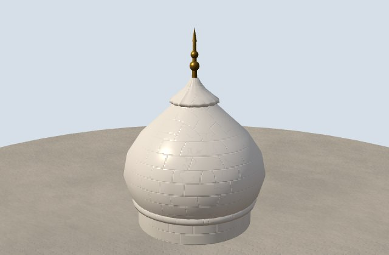
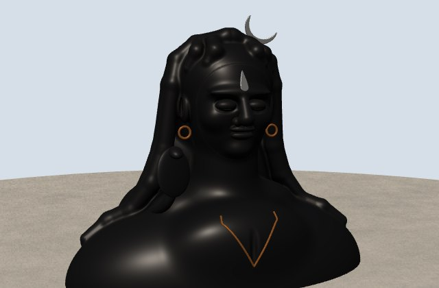
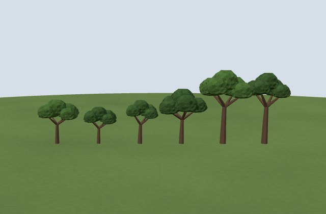
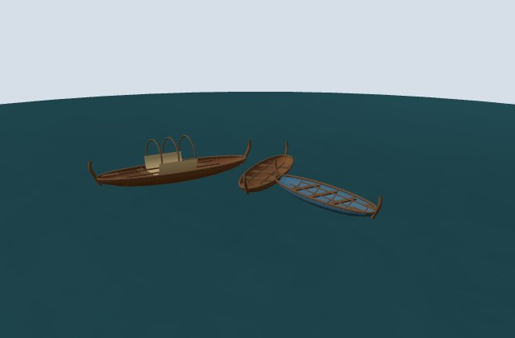

# Monuments of India

201 Indian landmarks across 35 states and union territories, modelled in interactive 3D with
[three.js](https://threejs.org/). Every model is built in code at roughly real-world proportions,
from shared parts, carved detail and sculpted figures: there are no model files or scans.

[Open the live site](https://monuments-of-india-nu.vercel.app){: .btn .btn-primary .mr-2 }
[Start with the project structure](project-structure.md){: .btn }

|  |  |  |
| :---: | :---: | :---: |
| [Domes](architecture.md#domes) | [Temples](architecture.md#temples) | [Forts](architecture.md#forts) |
|  |  |  |
| [Statues](components.md#statues) | [Trees](setting.md#trees) | [Boats](setting.md#boats) |

## Guides

| Guide | What it covers |
| --- | --- |
| [Project structure](project-structure.md) | Every file and folder, how the code is layered, a monument's entry in `js/data.js`, how to add a monument, conventions and automation |
| [Components](components.md) | Every shared part and every statue in pictures, on one page |
| [Architecture](architecture.md) | The parts the buildings are made of: domes, kiosks, pillars, arches, walls, roofs, ornament and surfaces, then by tradition. What each takes and where it lives |
| [The setting](setting.md) | What stands round them: trees, shrubs, lamps, flags, boats, stalls, towns, traffic, trains, aircraft, animals, hills and mountains |
| [How it is drawn](how-it-is-drawn.md) | What happens when a monument is opened; surfaces, water, landscape, sculpture, lighting, the camera, budgets, and what differs on phones |

All 201 monuments, state by state, are listed in
[States and monuments](https://github.com/amananandrai/monuments-of-india/blob/main/monuments.md).

## Quick start

The site is plain ES modules. Serve the repository root with any static server and open it:

```sh
git clone https://github.com/amananandrai/monuments-of-india.git
cd monuments-of-india
npx serve .        # or: python3 -m http.server
```

The headless checks and picture tools are in `tools/`; see
[Model checks](https://github.com/amananandrai/monuments-of-india/blob/main/tools/README.md).

## About these pages

The guides are the Markdown files in the repository's `docs/` folder, and they read the same on
GitHub. The *Docs* workflow (`.github/workflows/pages.yml`) publishes them here on every push to
`main` that changes `docs/` or `img/`.
