# The setting: trees, boats, flags and the rest

Everything that stands round a monument, and is not the monument, comes from one shared kit:
`js/details/realism.js`, with the animals in `js/details/animals.js`. Each monument's own detail
file (`js/details/<monument>.js`) calls the kit from its `addDetails(f, g)`.

For the buildings themselves (domes, kiosks, pillars, arches) see [architecture.md](architecture.md).
Every picture on this page is on one page in [components.md](components.md).

[Back to the README](../README.md) · [States and monuments](monuments.md) · [How it is drawn](how-it-is-drawn.md)

## How the kit works

- **Places.** Most parts take a list of spots, `[x, z]`, in metres on the ground. Some take more:
  `[x, z, size]`, or `[x, z, height, ground]` for a tree on a hill. Boats and stalls take
  `[x, z, turn]`.
- **Instancing.** Every part is drawn as instances of one shape (`copies()`), so fifty trees cost a
  few draw calls. `copies()` also marks its output as *dressing*, which the home view ignores when
  it frames the monument. A new part should go through `copies()` for both reasons.
- **Seeds.** Variation (height, turn, colour) comes from a seeded random sequence, so a monument
  looks the same on every visit. Change `seed` to get a different arrangement.
- **Two groups.** `addDetails(f, g)` receives `f`, the group the home view frames, and `g`, the
  whole site. Scenery that should not pull the camera back (a river, a town) goes on `g`.
- **Phones.** On phones (`detail.low`) trees keep their plain form, the ground has no tufts, and
  towns and traffic are thinned.

### Laying out spots

| Helper | What it returns |
| --- | --- |
| `scatter(n, [x0, x1, z0, z1], { seed, gap, avoid })` | Up to `n` random spots in a rectangle, at least `gap` apart, outside every rectangle in `avoid` |
| `along(n, [x, z], [x, z])` | `n` spots evenly along a line: an avenue, a row of lamps |
| `around(n, r, cx, cz, phase)` | `n` spots on a circle |

```js
// An avenue of twelve jamun down each side of a path, and neem scattered on the lawns.
g.add(trees([...along(12, [-58, 14], [-58, 185]), ...along(12, [58, 14], [58, 185])], { kind: 'jamun', seed: 6 }));
g.add(trees(scatter(26, [-95, 95, -75, 75], { seed: 21, gap: 14, avoid: [[-36, 36, -8, 10]] }), { kind: 'neem', seed: 21 }));
```

## Trees

| 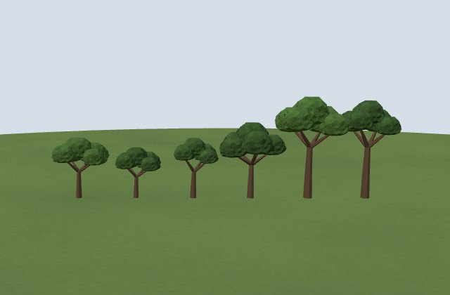 | 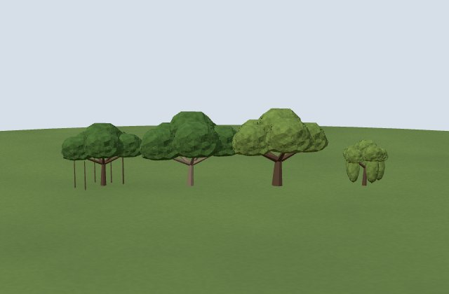 | 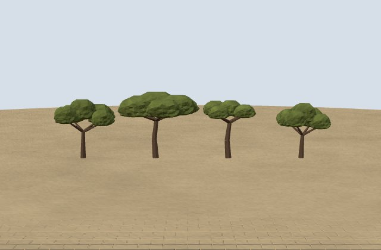 |
| :---: | :---: | :---: |
| Broadleaf: neem, mango, jamun, tamarind, teak, sal | Wide: banyan, peepal, chinar, willow | Dry: ber, babul, khejri, dhok |
| 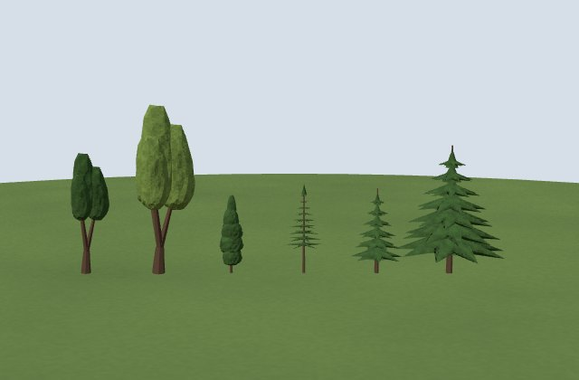 | 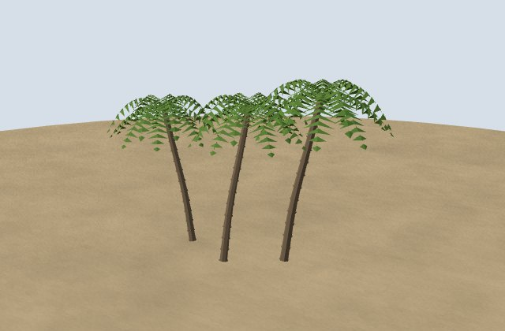 |   |
| Columns and conifers: ashoka, poplar, cypress, casuarina, fir, deodar | Coconut palms |   |

`trees(spots, { kind, seed, y, h })` plants every kind. `h` is the height in metres (each tree
varies by 15% either way); `y` lifts the whole planting onto a terrace.

One table, `KINDS`, holds what differs between kinds: default height, crown shape, leaf colour,
bark. Four silhouettes cover them all.

| Silhouette | Kinds | Where they are planted |
| --- | --- | --- |
| Broadleaf: a trunk into a rounded crown | `neem`, `mango`, `jamun`, `tamarind`, `teak`, `sal` | Gardens and lawns; jamun on Delhi's avenues; teak and sal in the forests; tamarind in the south |
| Wide broadleaf | `banyan` (the only kind with aerial roots), `peepal` (the bodhi tree), `chinar` (pale, thick-trunked), `willow` (drooping) | Banyan on maidans; peepal at Bodh Gaya and Sarnath; chinar in Kashmir; willow in Ladakh |
| Dry umbrella: short, with a low, wide, sparse crown | `ber`, `babul`, `khejri`, `dhok` | Desert, scrub and thorn forest |
| Column | `ashoka`, `poplar` | Avenues; poplar in Ladakh |
| Tiered conifer | `deodar`, `fir`, `cypress`, `casuarina` | Deodar and fir in the Himalaya; cypress in charbaghs; casuarina on the coast |
| Palm | `palm` (coconut) | The coasts and the south |

Each kind has two forms:

- **Plain:** a trunk and one leafy crown. Every tree starts plain, and stays plain on phones.
- **Full:** a leaning trunk, limbs, and separate leaf clumps at their ends (fronds with leaflets
  for the palm, whorls of boughs for the conifers). On desktops `upgradeTrees()` replants a
  monument's trees in the full form, smallest planting first, for as long as the monument stays
  inside its triangle budget. A forest of 160 trees usually stays plain; six specimen trees do not.

Each tree takes one of three forms of its kind, so a row is not a row of clones.

An unknown kind throws an error naming it. To add a kind, add one row to `KINDS`; do not write a
new mesh function.

## Shrubs, hedges and flower beds

| 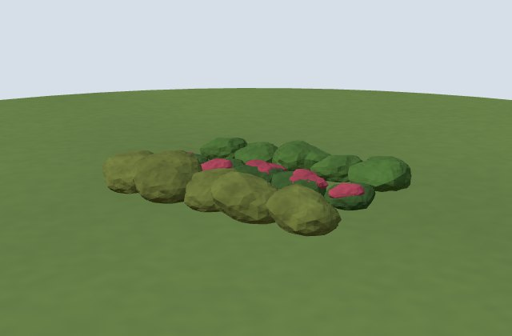 |   |   |
| :---: | :---: | :---: |
| Clipped, flowering and dry shrubs |   |   |

`shrubs(spots, { seed, y, size, dry, flowers })`. Spots are `[x, z, size?, y?]`.

- Plain: clipped green bushes, for hedges and lawn borders.
- `dry: true`: the grey-green scrub of dry hills.
- `flowers: '#d0306f'`: a dark bush with a smaller, muted cap in that colour (bougainvillea,
  marigold, saffron). The bloom is deliberately not the whole bush, which reads as plastic.

## The ground

`scatterGround()` runs on desktops once a monument is built. It drops low grass tufts (under about
0.35 m) and loose stones on open green ground round the monument.

It keeps clear of:

- lawns marked mown with `mown(mesh)` from `js/helpers.js` (the ceremonial lawns: India Gate, the
  Taj, Victoria, the National War Memorial, both Parliaments);
- a 4 m margin round the monument itself;
- any path or pavement lying over the grass.

## Lamps and street furniture

| 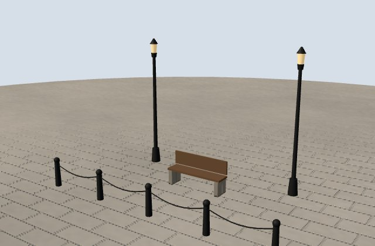 | 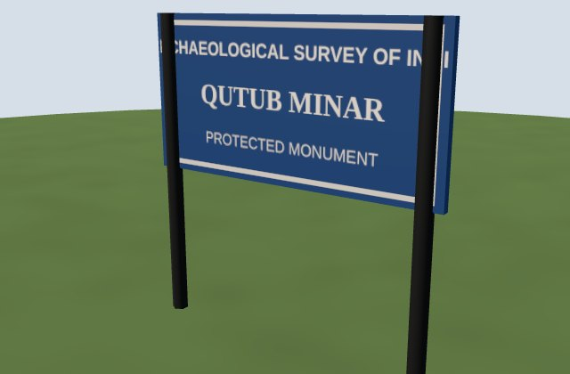 | 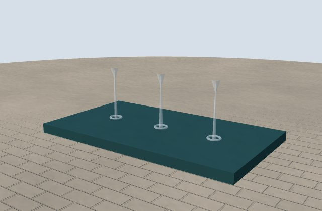 |
| :---: | :---: | :---: |
| Lamp posts, a bench, bollards with a chain | The ASI board | Fountain jets |

| Part | What it is |
| --- | --- |
| `lampPosts(spots, { h, y })` | Heritage lamp posts: a fluted iron post, a scrolled arm and a glass lantern. Lit at night |
| `benches(spots, { y })` | Park benches |
| `bollards(spots, { h, chain, closed })` | Bollards along a line or ring, a chain hanging between neighbours |
| `asiBoard(name, x, z, turn, { line2 })` | The blue board of the Archaeological Survey of India, on two posts |
| `fountains(spots, { y, h })` | Fountain jets: a fine spray rising `h` and falling into a ring of foam |
| `umbrellas(spots)` | Cane and cloth umbrellas on bamboo poles, as the priests of the ghats sit under |

## Flags and garlands

| 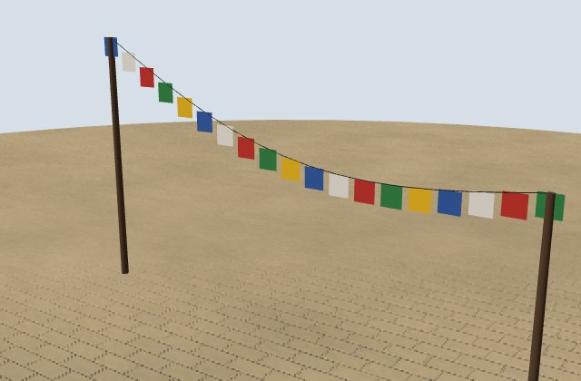 | 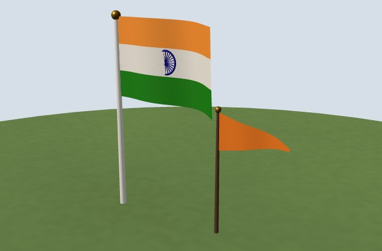 | 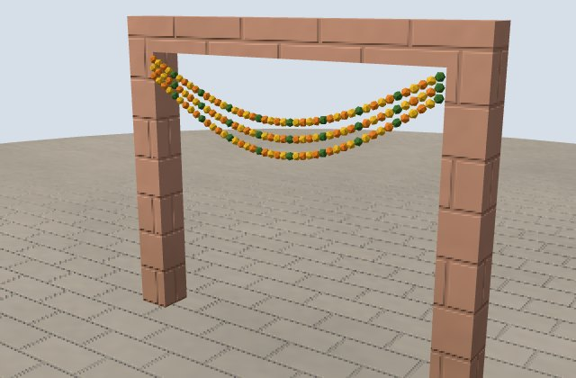 |
| :---: | :---: | :---: |
| Prayer flags | The tricolour and a saffron pennant | Marigold garlands |

| Part | What it is |
| --- | --- |
| `prayerFlags(a, b, { sag, size })` | A string of Tibetan prayer flags in five colours from point `a` to point `b` (`[x, y, z]`) |
| `garland(a, b, { sag, strands })` | Marigold garlands hanging between two points, in orange and yellow |
| `flag(h, material)` (in `js/helpers.js`) | A rippling pennant on a pole: saffron temple flags, the Nishan Sahib |
| `tricolour(h, w)` (in `js/helpers.js`) | The national flag on a mast, with the Ashoka Chakra |

## Boats

| 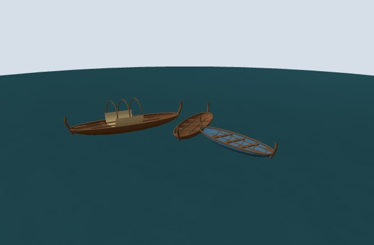 | 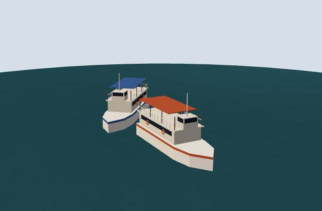 | 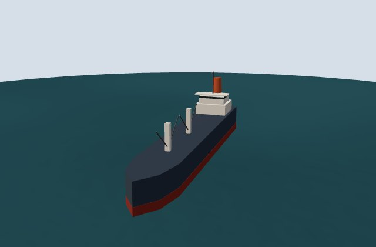 |
| :---: | :---: | :---: |
| Country boats, one with a hood | Ferry launches | A cargo ship |
| 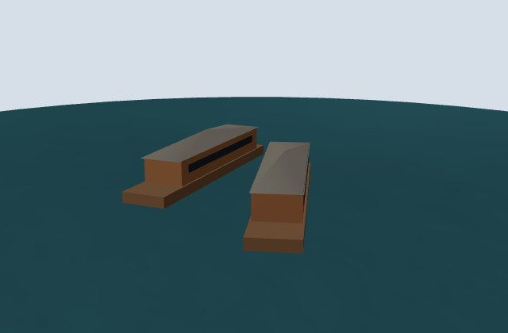 |   |   |
| Houseboats |   |   |

| Part | What it is |
| --- | --- |
| `boats(spots, { y, size, canopy, colours })` | Country boats; `canopy: true` gives them a curved hood |
| `launches(spots, …)` | The ferry launches of Mumbai harbour |
| `ships(spots, …)` | Cargo ships at anchor, with crane posts and a funnel |
| `houseboats(spots)` | The houseboats of Dal Lake |

`y` is the water's height, so a boat floats on its lake and not on the ground.

## Stalls

| 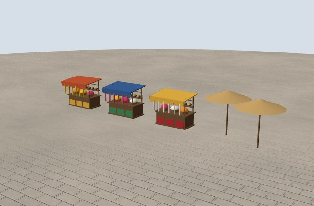 |   |   |
| :---: | :---: | :---: |
| Stalls and umbrellas |   |   |

`stalls(spots, { awnings, goods })`: market stalls under coloured awnings, with heaps of goods.
Spots are `[x, z, turn]`. They stand outside temple gates and in Laad Bazaar at Charminar.

## Towns

| 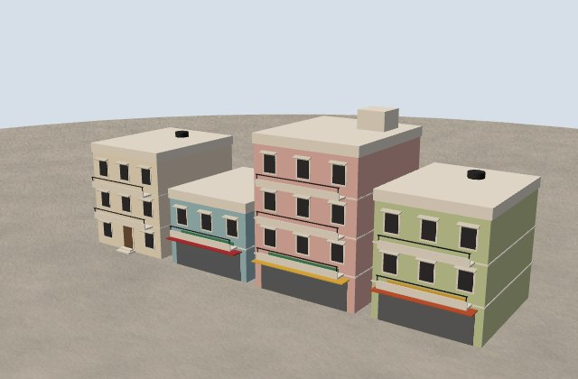 |   |   |
| :---: | :---: | :---: |
| Town houses |   |   |

| Part | What it is |
| --- | --- |
| `townHouses(spots, { paint, roof, tanks, … })` | Houses of two to five storeys with windows, doors and shop signs. `roof: 'pitched'` for hill towns; `tanks` is the share of flat roofs carrying a black water tank (0.7 by default) |
| `houseRow(R, axis, at, a, b, turn, …)` | A row of house plots along a street, for `townHouses` |
| `cityAround([x0, x1, z0, z1], { rows, gap, keep, … })` | Rows of houses lining streets on every side of a rectangle, leaving the rectangles in `keep` (roads, squares) open |

```js
// Two rows of houses round a walled temple, a street's width back, the road to the gate left open.
g.add(cityAround([-72, 72, -88, 108], { rows: 2, gap: 12, storeys: [2, 4], seed: 23, keep: [[-16, 16, 104, 600]] }));
```

## Traffic

| 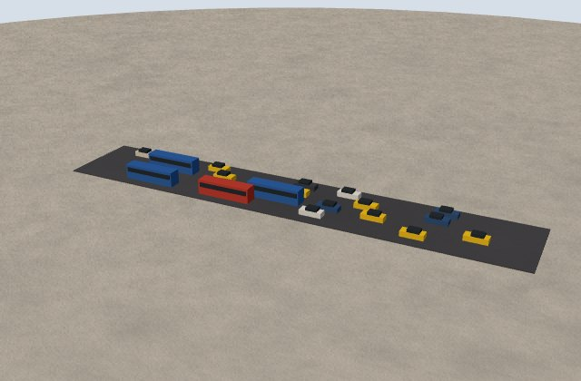 |   |   |
| :---: | :---: | :---: |
| Traffic: cars, taxis and buses |   |   |

`traffic(lanes, x0, x1, { y, gap, taxis, buses })` puts vehicles on a road running along x. Each
lane is `[z, direction]`. Only the Howrah Bridge and the Bandra–Worli Sea Link use it; there are
no motor vehicles anywhere else, and no people at all, so that the monument stays the subject.

## Animals

| 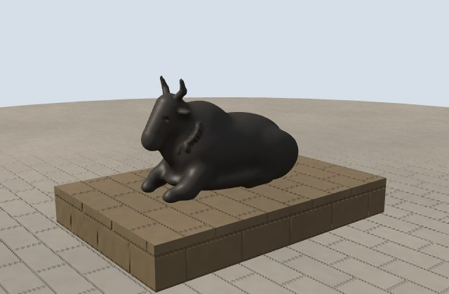 | 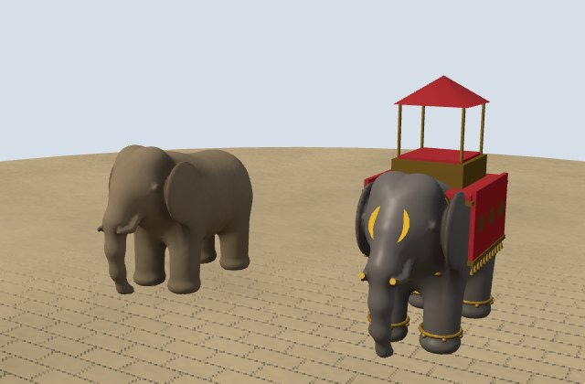 | 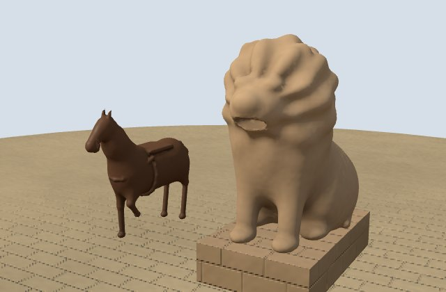 |
| :---: | :---: | :---: |
| Nandi | Elephants, plain and dressed | Horse and lion |
| 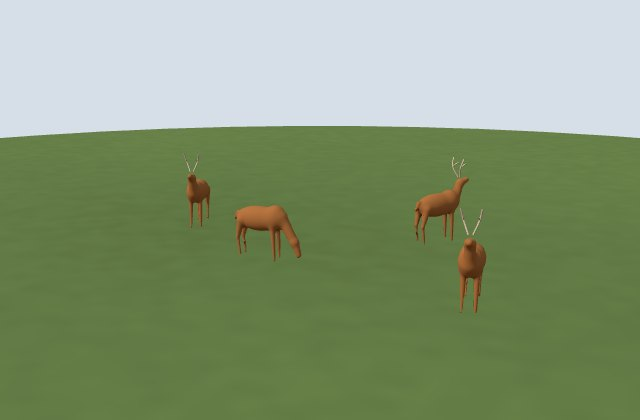 | 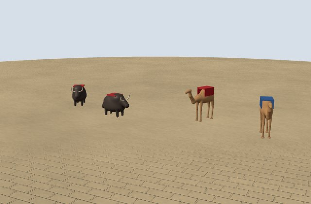 |   |
| Deer | Yaks and camels |   |

From `js/details/animals.js`. The larger animals are sculpted as one continuous skin and meshed in
the browser, so they are heavier than the rest of the kit.

| Part | What it is |
| --- | --- |
| `nandi(material, scale)` | The seated bull before a Shiva temple |
| `elephant(material, scale)` | A standing elephant, in stone or bronze |
| `rideElephant(material, scale, { cloth, trim, howdah })` | A dressed elephant with its cloth and howdah |
| `horse(material)` | A horse; scaled down for the ponies at Kedarnath |
| `lion(scale, material)` | A seated lion: gate guardians and the Lion Capital |
| `deer(spots)` | The deer of Sarnath and Sikandra |
| `yaks(spots)` | Yaks, in the mountains |
| `camels(spots, { cloths })` | Camels in saddle cloths, in the Thar |

## Adding a new part

1. Build the shape once, as a geometry of unit size.
2. Place it with `copies(geometry, material, places)`, where each place is
   `[x, y, z, scale, turn]`.
3. Give it a plain form cheap enough for phones, and keep heavier detail behind `!detail.low`.
4. Run `node check-budgets.mjs <id>` from `tools/` on a monument that uses it.
