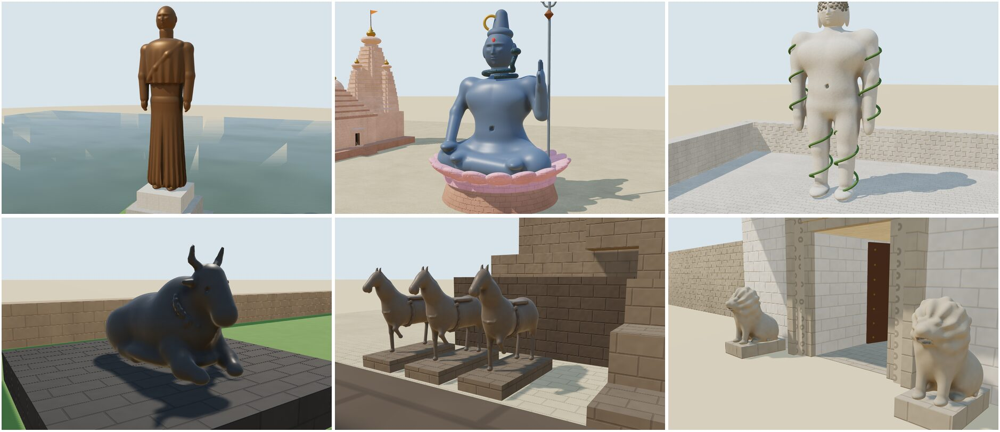
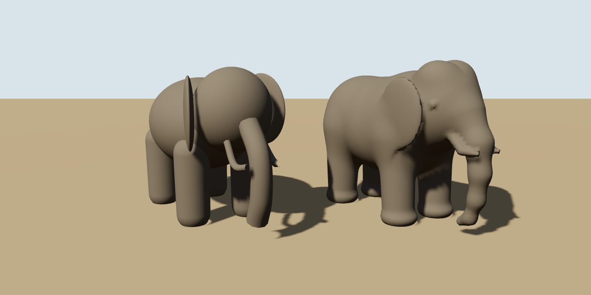
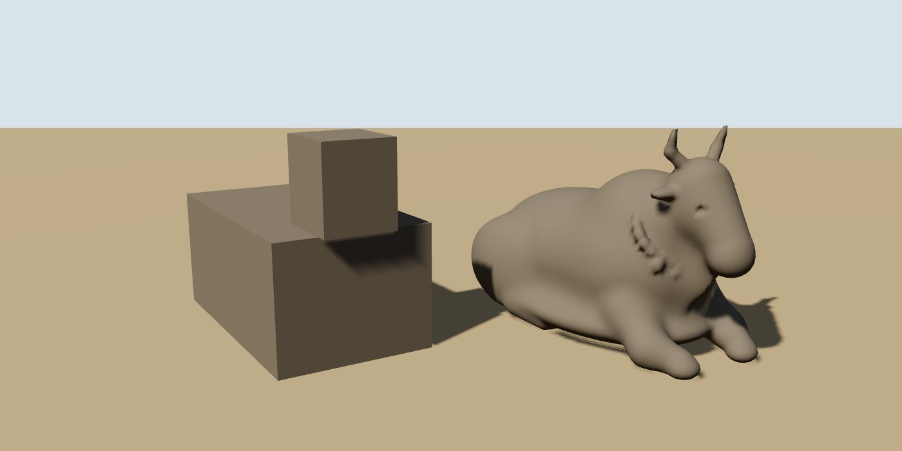
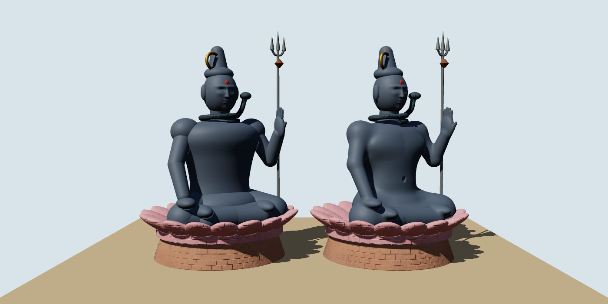

# Research: making the statues and animals realistic

How the site's idols, colossal statues and temple animals could look like sculpture rather than
toys: the Statue of Unity, the seated Shiva at Nageshwar, Gommateshwara, Thiruvalluvar, the Nandis,
the elephants at Kailasa, Hampi and Gwalior, and the Konark horses. This covers what the site has now
and the options that were weighed, among them a working prototype of the recommended technique. It
ends with a recommendation and a plan.

## Status

Phases 1 to 4 of the plan (section 4) are built: every statue and temple animal on the site is now
sculpted as one skin. Phase 5, scanned models, has not been started; it waits on your decision
about model files.

- **`js/sdf.js`** is the kit:
  - ellipsoids, tapered capsules, chains, rounded boxes, tori, and lathes with folds for robes and
    dhotis;
  - smooth union and carving;
  - surface nets that sample finely only near the surface;
  - cavity shading baked as vertex colours, and a per-figure geometry cache;
  - `statueMaterial()`, which gives stone the new `carved` surface (fine grain, no block joints)
    and makes dark stone glossy, as oiled basalt is.
- **`js/details/animals.js`** has:
  - the Nandi, at Brihadeeswara, Ramappa and Kedarnath, where it now faces the shrine, and lining
    the Shore Temple's wall, where it replaces boxes;
  - the elephant, at Kailasa, Vittala and Gwalior;
  - the Konark war horse, in harness with a foreleg raised;
  - the seated lion at temple gates.
- **`js/details/figures.js`** has:
  - the door guardian (dvarapala), used by every temple doorway;
  - the bodies of the Nageshwar Shiva, Sardar Patel, Bahubali and Thiruvalluvar. Their faces,
    fingers, hair, beards and the things they hold stay meshes, set on the skin.

**Checks:**

- **Builds:** all 101 monuments build, and every sculpted mesh is watertight.
- **Triangle budget:** no monument is over 170,000 triangles.
- **First selection:** a monument with figures takes 0.4–0.7 s, the time to mesh them; after that
  they are cached.
- **The meshing tear:** a part that skips work far from itself must switch over further out than
  the fillet it is blended with. Otherwise the switch shows as a crease across the surface, as it
  first did round Bahubali's waist.

## Summary

- **The problem.** Every figure is assembled from separate spheres, capsules and lathes that pass
  through one another. Each part keeps its own outline, so a body reads as a heap of parts: a ball
  for a shoulder, a tube for an arm, a hard crease wherever two parts meet. There are no anatomical
  landmarks. Four of the Nandis are boxes.
- **The recommended fix** keeps the site's rule that everything is built in code. Sculpt each
  figure as one signed-distance field (SDF): the same ellipsoids and capsules, but blended with a
  smooth union, so the body has one continuous skin. Turn that field into a mesh in the browser
  with surface nets. A prototype was built and measured:

  | Figure | Meshing time | Triangles (built from parts today → SDF skin) |
  | --- | --- | --- |
  | Elephant, 8 cm grid | 0.2–0.3 s | 13,000 → 23,000 |
  | Nandi, 8 cm grid | 0.3 s | 24 (two boxes) → 18,000 |
  | Seated Shiva body, 20 cm grid | 0.8 s | about 130,000 → 139,000 for the whole figure (the body skin replaces the separate body parts) |

  Monuments are built only when first chosen, and then cached (`js/main.js:182`). So this cost is
  paid once, not every frame.
- **Scanned museum models** were also weighed. They are free to use (CC0) or need a credit
  (CC-BY). They would look better still for a few pieces, but they mean shipping model files, which
  the README says the site does not do. So that is your decision; see [Option B](#b-scanned-models-cc0-or-cc-by).
  There is no free scan of the Statue of Unity, and none of the Konark horses.
- **AI-generated models** (Meshy, for example) produce model files too, and get iconography wrong:
  mudras, attributes, the number of arms. They are worth considering only for anonymous animals, if
  you accept files.

## 1. What the site has now

| Figure | Where | Built from |
| --- | --- | --- |
| Sardar Patel | `statue-of-unity.js` `patel()` | Ellipsoid feet, a draped lathe dhoti, a lathe torso, a shawl, capsule arms, ellipsoid hands with `fingers()`, `face()`, in `M.bronze` |
| Seated Shiva | `nageshwar-temple.js` `seatedShiva()` | Capsule thighs and shins, an ellipsoid pelvis, a lathe torso squashed to 0.72 deep, ball shoulders, capsule arms, `face()`, a tube serpent, a lotus of 18 ellipsoid petals |
| Bahubali | `gommateshwara.js` `bahubali()` | Capsule limbs, a lathe torso, an ellipsoid head, 140 instanced curls, tube creepers |
| Thiruvalluvar | `vivekananda-rock-memorial.js` `thiruvalluvar()` | A draped robe, capsule arms, `face()`, a draped beard |
| Elephants | `helpers.elephant()`; Kailasa (×2), Vittala (×2), Gwalior (×2) | Seven ellipsoids, a tube trunk and tusks, four capsule legs |
| Horses | `helpers.horse()`; Konark (×7) | Three ellipsoids for the body, capsules for the neck, head and legs |
| Nandi | Brihadeeswara, Ramappa, Kedarnath; Shore Temple (instanced along the wall) | Two or three boxes |
| Lions, dvarapalas | `temples.js` `lion()`, `doorways.js` `guardian()` | A box plinth with ellipsoids and capsules |

**Why they look like toys:**

1. **Parts, not a body.** Two primitives that intersect meet in a sharp crease. Real anatomy
   flows, and a sculptor's surface is continuous from shoulder to wrist. The eye reads the crease
   as a joint in a doll.
2. **No landmarks.** Real figures have a collarbone, the line of the pectorals, a navel, a knee
   cap, the bump of an elbow, a narrow waist and wide shoulders. On an elephant, it is the twin dome
   of the head, the dip behind it, the sag of the belly, the column legs with toenails, and ears
   that hang flat. A sphere has none of these.
3. **One smooth material.** Stone sculpture has chisel texture and darker crevices where grime
   gathers. Bronze has a metallic sheen and a patina. On some figures, the masonry shader also draws
   block joints across them, as the first prototype render showed. Statues should never use the
   masonry surface.
4. **Boxes for Nandis.** The Nandi faces the shrine at almost every Shiva temple, and is one of the
   most recognisable sculptures in India.

**What already works:** the `face()` head, a sphere displaced into brow, eye sockets, nose, lips and
chin, reads well from a distance. The lathe-and-`drape()` dhoti on Patel also works. Both can be
kept.

## 2. Options

### A. Procedural SDF sculpting (recommended)

A signed-distance function gives the distance from any point to the surface: negative inside,
positive outside. Primitives such as an ellipsoid or a tapered capsule each have a simple SDF.
Joining them with the **polynomial smooth minimum** (`smin`) blends one part into the next with a
fillet of chosen radius `k`, instead of leaving a crease. This is the operator Inigo Quilez
describes, and the same one Media Molecule used to sculpt in *Dreams*. A smooth maximum carves
details in: eye sockets, a navel, the gap between the legs.

The field is then sampled on a grid and turned into triangles. **Surface nets** puts one vertex in
each grid cell the surface passes through, at the average of where the cell's edges cross the
surface. It then joins the vertices of neighbouring cells into quads. This produces fewer, better
shaped triangles than marching cubes. The prototype also does two cheap things:

- it moves each vertex onto the surface with one Newton step;
- it takes each normal from the field's gradient, so the shading is smooth even on a coarse grid.

**The prototype** (since moved into `js/sdf.js`, `js/details/animals.js` and
`js/details/figures.js`):

- `sdf.js` has the primitives, `smin`/`smax`, `chain()` for trunks, tails and garlands,
  `mirrorX()` for left/right pairs, and a surface-nets mesher of about 80 lines.
- `figures.js` has three test figures:
  - an Indian elephant, with its twin-domed head, sagging belly, column legs and feet, a trunk to
    the ground, tusks, flat ears and a tail;
  - a recumbent Nandi, with folded forelegs, tucked hind legs, a hump, a dewlap, horns, ears, a
    tail and a garland of bells;
  - the Nageshwar Shiva's body, in the exact pose and coordinates of `seatedShiva()`, with crossed
    shins, a chest, belly and navel, shoulders and a raised hand.

**What the prototype showed:**

- **It reads as sculpture.** The SDF elephant has a continuous back line, a head that grows out of
  the shoulders, and a trunk that tapers out of the face. The Nandi is recognisable from any angle.
  On the Shiva, the arms grow out of the shoulders and the legs out of the hips. The SDF body sits
  well with the existing `face()` head, serpent, lotus and trident.
- **Cost.** Meshing time grows with the cube of the grid resolution:
  - the elephant took 0.67 s at a 5 cm grid (60,000 triangles), but only 0.2–0.3 s at 8 cm
    (23,000), which looks the same at the site's viewing distances;
  - a 25 m Shiva needs only a 20 cm grid.
- **Budget.** The 200,000-triangle budget per monument holds:
  - the heaviest case, Kailasa with two elephants at 1.4 scale, adds about 20,000 triangles over
    today's figures;
  - two copies of the same animal share one geometry, so a figure is meshed once.
- **Limits:**
  - **Thin parts alias.** Anything thinner than about three grid cells gets a jagged edge: the
    elephant's ear rims, petals, the edge of a shawl. Thin parts should stay separate meshes, as
    the lotus petals and the serpent did here, or be made a little thicker.
  - **Fine detail is below the grid.** Fingers on a 25 m statue, Bahubali's curls, jewellery, bells
    and the trident are better as small separate meshes laid on the skin (instanced where they
    repeat), or as shader detail.
  - **Faces stay meshes.** The `face()` head is a displaced sphere at 160×120. That is far finer
    than any practical grid, so the head stays a mesh set on the SDF neck.
  - **Proportions take care.** The first pass at Shiva's chest read as female until the pectorals
    were made broad and flat. Each figure needs a pass against reference photographs, as the
    buildings did.
  - **The polynomial `smin` depends on order.** Joining A to B and then to C differs slightly from
    another order. That doesn't matter for modelling, but blends should be listed with the trunk
    first and small parts last.

**Further improvements this approach allows:**

- **Cavity shading.** The field gives cheap ambient occlusion: sample it a short way along each
  vertex normal, and darken a vertex colour where the surface is close. This puts grime in the
  armpits, between the legs and in the folds of the dhoti, which is what makes stone look carved.
  It costs nothing per frame, because it is baked when the mesh is built.
- **Drapery as displacement.** Fold ripples like today's `drape()` can be added to the field
  (`d += amp·w(y)·cos(n·θ)` around a body axis), so cloth and body stay one surface.
- **Speed.** If a figure ever needs a finer grid, there are two ways to make meshing faster:
  - only evaluate cells near the surface, coarse to fine. `marching-cubes-fast` uses this octree
    idea.
  - move meshing into a Web Worker so the page doesn't pause.

  `isosurface` (MIT) has reference implementations of surface nets and marching cubes. The
  prototype's own mesher is small enough not to need a dependency.

### B. Scanned models (CC0 or CC-BY)

Photogrammetry scans of the real sculptures are the most realistic option there is. What exists:

- **Smithsonian Open Access** publishes 3D models as CC0 in glTF.
- **The Sketchfab cultural-heritage programme.** Since 2020, museums have published more than
  1,700 scans as CC0. The Cleveland Museum of Art alone lists about 460, and they can be used
  commercially without asking.
  - Indian pieces found include a 10th-century Shiva and the Cleveland Museum's *Nataraja, Shiva as
    the Lord of Dance* (1930.331).
  - These are museum bronzes and stone pieces, not the monuments on this site.
- **Scan the World** (MyMiniFactory) is a free archive of scanned sculptures. It has several Nandis:
  - one at the V&A, from Halebidu;
  - one at the Kalimath Temple;
  - one at the Nala Temple;
  - a figure of Nandi in the British Museum.

  It also has an elephant in the Bangalore Museum and two Shivas. **The licences vary per object:**
  some are CC BY-SA, some are non-commercial. Each object's page must be checked, and the credit
  given.

**Gaps:**

- **Statue of Unity.** There is no free model. CGTrader and TurboSquid sell some, under licences
  that don't allow redistributing the file from a public site without care. One "free" listing is of
  unclear origin.
- **Konark horses.** No scan was found. The ASI laser-scanned the Sun Temple in 2012, but the data
  isn't published. The only Konark model on Sketchfab is the whole temple, 900,000 triangles, with
  no stated licence.
- **The specific Nageshwar Shiva, Thiruvalluvar and Gommateshwara.** No free scans were found.

**Cost:**

- **It breaks the README's rule:** "Every model is built in code from simple shapes ... there are
  no model files to download." Each scan is a file. Even a 50,000-triangle figure compressed with
  `gltf-transform` (meshopt or Draco geometry, KTX2 textures) is 0.5–3 MB.
- **It brings in new loaders:** `GLTFLoader` with `DRACOLoader`/`MeshoptDecoder` and
  `KTX2Loader`, which load their decoders from the CDN.
- **It needs credit lines.**
- **It changes the style.** A scanned Nandi with photo textures beside procedural temple walls can
  look pasted in. Its texture would have to be dropped, or re-toned, to match.

### C. AI-generated models (Meshy or similar)

Meshy's documentation says models made on the free plan are CC BY 4.0, so commercial use is allowed
with a credit line. On paid plans they are private and owned by the user. One third-party review
says otherwise, so read the current terms before relying on this. Meshy can work from text or from a
photograph.

- **For** generic animals (a temple elephant, a caparisoned horse), the shape can be good.
- **Against:**
  - the output is a model file, with the same issue as Option B;
  - meshes are dense and need cutting down;
  - iconography goes wrong: the mudra, which hand holds what, Shiva's third eye and crescent, the
    number of arms, the creepers on Bahubali. For a site about real monuments, a plausible but wrong
    idol is worse than a simple, correct one.
  - for the Statue of Unity, a generated likeness of a real person, made from someone else's
    photographs, adds a further question of provenance.

A generated model could still serve as a **visual reference** for proportions while sculpting the
SDF by hand. That uses no file on the site.

### D. Hybrid

SDF figures everywhere, plus scans for two or three heroic pieces where a scan exists and the
licence is clear: a Nandi from Scan the World, say. Only worth doing if you're willing to relax the
no-model-files rule for a short, named list.

## 3. Recommendation

**Adopt Option A for every figure**, and keep the no-model-files rule. It fixes what makes the
figures look like toys: the seams, the lack of landmarks and the boxes. It does so without
changing what the site is. The prototype shows it fits the time and triangle budgets.

Option B is the only way to get beyond "well-sculpted" to "that exact statue". Whether that is worth
shipping files is your decision, not a technical one. If you want it, start with the Nandi. That is
where good scans with a clear licence exist and the gain is largest, and you can judge from there.

**Per figure:**

| Figure | What to do |
| --- | --- |
| Nandi, at Brihadeeswara, Ramappa, Kedarnath and the Shore Temple | Replace the boxes with the SDF Nandi: recumbent, garlanded, facing the shrine. One geometry, scaled per site. Brihadeeswara's is famously large and polished dark; the Shore Temple's small ones can share a lower-resolution mesh, instanced. |
| Elephants, at Kailasa, Vittala and Gwalior | Use the SDF elephant. At Kailasa they are carved from the living rock, so use the rock material with heavy cavity shading. Vittala's flank the stairs of the stone chariot, so give them a caparison band and a howdah outline. |
| Konark horses | An SDF war horse in mid-stride: arched neck, flared nostrils, harness straps as raised bands, a breast-plate, and a rider or a trampled figure where the originals have one. The chariot wheels stay as they are. |
| Nageshwar Shiva | Use the SDF body, as prototyped. Keep `face()`, the hair knot, the serpent, the moon, the trident and the lotus. Use a slate-blue painted-concrete material with cavity shading. |
| Statue of Unity | An SDF body under the dhoti and shawl. Model the shawl's hem, the dhoti pleats and the walking stride as displacement in the field. Give the head a stronger `face()` with a deeper brow, the moustache-less upper lip, and ears. Use a bronze material: metalness about 0.8, roughness about 0.4, a patina tint, and cavity shading so the folds darken. The real cladding is about 550 macro panels with thousands of micro panels. The panel seams could be a faint shader line, but only if they read at a distance. |
| Gommateshwara | A standing SDF body. Keep the 140 instanced curls. Put the creepers on the legs as tubes on the skin. Granite with weathering streaks. |
| Thiruvalluvar | An SDF body under the robe, with the draped beard kept as a mesh. |
| Lions and dvarapalas | Small SDF versions with the same parameters as today, so the gates keep working. They are small enough to share one mesh per kind. |

## 4. Plan

Phases 1 to 4 are done (see Status at the top).

Each phase is like the doorway phases: it is self-contained, checked with renders, and committed
on its own.

1. **SDF kit (`js/sdf.js`).** Move the prototype in:
   - the primitives, `smin`/`smax`, `chain`, `mirrorX`, and surface nets with the Newton step and
     gradient normals;
   - a cache so each figure is meshed once and its geometry shared;
   - baked cavity shading as a vertex colour.
2. **Statue materials.** Add a `carved` surface kind for stone sculpture: fine chisel noise, no
   joints, and the cavity colour. Add a bronze material for Patel. Check that no figure uses
   masonry.
3. **Animals (`js/details/animals.js`).**
   - the Nandi, replacing the boxes at four temples;
   - the elephant, replacing `helpers.elephant`, with its `(m, s)` signature kept;
   - the horse, replacing `helpers.horse`;
   - small lions.
4. **Human figures (`js/details/figures.js`).** A body builder with pose parameters: seated in
   padmasana or standing, and arm angles. Then rebuild Shiva, Bahubali, Thiruvalluvar and Patel on
   it, with `face()` kept for heads, and the dvarapalas.
5. **Optional, needs your decision:** scanned glTF for a named list of pieces, with
   `gltf-transform` compression, the loaders and a credits section in the README.

**Budgets and checks for every phase:**

- the 101-monument build passes;
- each changed monument stays under 200,000 triangles;
- meshing stays under 0.5 s per monument on first selection;
- renders are compared before and after from the home view and close up, by day and by night;
- figures are checked against reference photographs for proportion and iconography.

## Sources

**Technique:**

- [Inigo Quilez, smooth minimum](https://iquilezles.org/articles/smin)
- [glsl-smooth-min](https://github.com/glslify/glsl-smooth-min)
- [Polynomial smooth minimum](https://ianstranathan.github.io/html/Graphics/polynomial-smin)
- [SDFs in C](https://ptfl.pages.dev/blog/signed-distance-fields-c/)
- [Marching cubes in the browser](https://app.cinevva.com/blog/2026-02-25-open-world-browser-part-07-marching-cubes)
- [Terrain sculpting brushes](https://app.cinevva.com/guides/terrain-sculpting-brushes)
- [saft](https://docs.rs/saft)
- [Raymarched sculpture](https://open-design.ai/showcase/raymarched-sculpture-shader-design/)
- [isosurface (surface nets, marching cubes) on GitHub](https://github.com/mikolalysenko/isosurface)
- [isosurface on npm](https://npmjs.com/package/isosurface)
- [marching-cubes-fast](https://www.pkgstats.com/pkg:marching-cubes-fast)
- [Triplanar MeshPhysicalMaterial (three.js forum)](https://discourse.threejs.org/t/how-can-i-create-a-triplanar-material-from-an-existing-meshphysicalmaterial-using-triplanartexture/60654)
- [threejs-materials](https://pypi.org/project/threejs-materials/1.0.0/)

**Scans and licences:**

- [Smithsonian 3D Open Access](https://3d.si.edu/collections/openaccesshighlights)
- [Sketchfab public-domain programme](https://sketchfab.com/blogs/community/sketchfab-launches-public-domain-dedication-for-3d-cultural-heritage)
- [Hyperallergic on 1,700 CC0 models](https://hyperallergic.com/544854/1700-3d-models-of-cultural-heritage-objects-now-available-in-public-domain/)
- [Cleveland Museum of Art on Sketchfab](https://sketchfab.com/clevelandart/models)
- [Shiva, late 10th c.](https://sketchfab.com/3d-models/shiva-late-10th-c-ce-010fea0fb44442bc8d0c6888b9d03f18)
- [Nataraja 1930.331](https://www.sketchfab.com/3d-models/1930331-nataraja-shiva-as-the-lord-of-dance-6862a3c673d4434a8dc39ced2a5b5720)
- Scan the World:
  - [Nandi, V&A](https://www.myminifactory.com/object/73657)
  - [Nandi, Kalimath](https://www.myminifactory.com/object/77223)
  - [Nandi, Nala Temple](https://www.myminifactory.com/object/3d-print-76674)
  - [Nandi, British Museum](https://www.myminifactory.com/es/object/3d-print-figure-of-nandi-97470)
  - [Nandi](https://www.myminifactory.com/object/3d-print-86480)
  - [Elephant, Bangalore Museum](https://www.myminifactory.com/object/3d-print-51064)
  - [Shiva bust](https://www.myminifactory.com/object/3d-print-135393)
  - [Shiva](https://www.myminifactory.com/object/3d-print-73650)
- [Scan the World Venus de Milo licence (Wikimedia)](https://meta.wikimedia.org/wiki/File:Scan_the_World_-_Venus_de_Milo.stl)
- [MyMiniFactory IP policy](https://creator.myminifactory.com/ip-policy)
- [3D model licensing guide](https://stlrepo.com/guides/3d-model-licensing)
- [Sun Temple Konark on Sketchfab](https://sketchfab.com/3d-models/sun-temple-konark-6cc905be2ae34e8091eb1eaa84a17738)
- [Laser scanning the Sun Temple](https://lidarnews.com/laser-scanning-the-sun-temple-at-konark/)
- [War stallion, Konark (reference photo)](https://www.worldhistory.org/image/11647/war-stallion-konarak-sun-temple/)
- [Konark wheel (CGTrader)](https://www.cgtrader.com/3d-print-models/art/sculptures/konark-wheel-ready-to-print)

**Statue of Unity:**

- Paid or unclear models:
  - [CGTrader](https://www.cgtrader.com/3d-models/exterior/historic-exterior/statue-of-unity-556ec7ed-3d34-457f-9c9a-ddaf02ac49d1)
  - [CGTrader (print)](https://www.cgtrader.com/3d-print-models/art/sculpture/statue-of-unity-or-sardar-patel-high-poly-3d-model)
  - [TurboSquid](https://www.turbosquid.com/3d-models/statue-of-unity-760080)
  - [free3d](https://free3d.com/3d-model/statue-of-unity-8483.html)
- Facts:
  - [Wikipedia](https://en.wikipedia.org/wiki/Statue_of_Unity)
  - [Arup](https://www.arup.com/projects/statue-of-unity/)
  - [Dezeen](https://www.dezeen.com/?p=1280423)
  - [Kerala Kaumudi](https://keralakaumudi.com/web-news/en/2018/10/NMAN0006858/1.html)
  - [Business Standard](https://www.business-standard.com/article/current-affairs/statue-of-unity-also-a-tribute-to-indian-engineering-skills-says-l-t-118102800127_1.html)

**Compression and loading:**

- [Draco and KTX2 example](https://discourse.threejs.org/t/compression-draco-ktx2-example/31382)
- [Draco, meshopt and KTX2 in three.js](https://jvinhit.github.io/blog/threejs-16-gltf-compression-draco-meshopt-ktx2/)
- [glTF compression sample](https://github.com/klich3/threejs-gltf-with-compressions-sample)
- [Sketchfab and glTF](https://sketchfab.com/blogs/community/sketchfab-now-largest-online-repository-gltf-files)

**AI generation:**

- [Meshy pricing and licences](https://docs.meshy.ai/en/webapp/pricing)
- [Meshy: commercial use](https://help.meshy.ai/en/articles/9992001-can-i-use-my-generated-assets-for-commercial-projects)
- [Meshy: ownership](https://help.meshy.ai/en/articles/10137554-what-is-the-ownership-of-the-generated-models)
- [A third-party review (disputes the free-plan terms)](https://sorceress.games/blog/best-free-ai-3d-model-generator-honest-2026-picks)
