# States and monuments

201 monuments in 35 states and union territories. Each entry gives the place, the dates, the
architectural style and the main material, as shown on the monument's plaque and used by the
filters (all from `js/data.js`), then the home view of the model.

This page is generated by `tools/update-gallery.mjs`. [A GitHub Action](.github/workflows/screenshots.yml)
redraws a monument's picture when that monument's own code changes. The pictures are the plain
studio views from `tools/shoot-views.mjs`; the site adds shadows, photo textures and haze.

[Back to the README](README.md) · [Architecture](architecture.md) · [The setting](realism.md) · [Components](components.md)

## Contents

- [Andaman and Nicobar](#andaman-and-nicobar) (1)
- [Andhra Pradesh](#andhra-pradesh) (4)
- [Arunachal Pradesh](#arunachal-pradesh) (1)
- [Assam](#assam) (3)
- [Bihar](#bihar) (7)
- [Chandigarh](#chandigarh) (1)
- [Chhattisgarh](#chhattisgarh) (2)
- [Dadra and Nagar Haveli and Daman and Diu](#dadra-and-nagar-haveli-and-daman-and-diu) (1)
- [Delhi](#delhi) (17)
- [Goa](#goa) (4)
- [Gujarat](#gujarat) (14)
- [Haryana](#haryana) (1)
- [Himachal Pradesh](#himachal-pradesh) (6)
- [Jammu and Kashmir](#jammu-and-kashmir) (3)
- [Jharkhand](#jharkhand) (2)
- [Karnataka](#karnataka) (17)
- [Kerala](#kerala) (7)
- [Ladakh](#ladakh) (3)
- [Madhya Pradesh](#madhya-pradesh) (12)
- [Maharashtra](#maharashtra) (18)
- [Manipur](#manipur) (1)
- [Meghalaya](#meghalaya) (1)
- [Mizoram](#mizoram) (1)
- [Nagaland](#nagaland) (1)
- [Odisha](#odisha) (4)
- [Puducherry](#puducherry) (1)
- [Punjab](#punjab) (3)
- [Rajasthan](#rajasthan) (14)
- [Sikkim](#sikkim) (1)
- [Tamil Nadu](#tamil-nadu) (14)
- [Telangana](#telangana) (8)
- [Tripura](#tripura) (1)
- [Uttar Pradesh](#uttar-pradesh) (14)
- [Uttarakhand](#uttarakhand) (4)
- [West Bengal](#west-bengal) (9)

## Andaman and Nicobar

### Cellular Jail

Port Blair, Andaman Islands · 1896–1906 · Colonial prison · Brick · [view in 3D](https://monuments-of-india-nu.vercel.app/#cellular-jail)

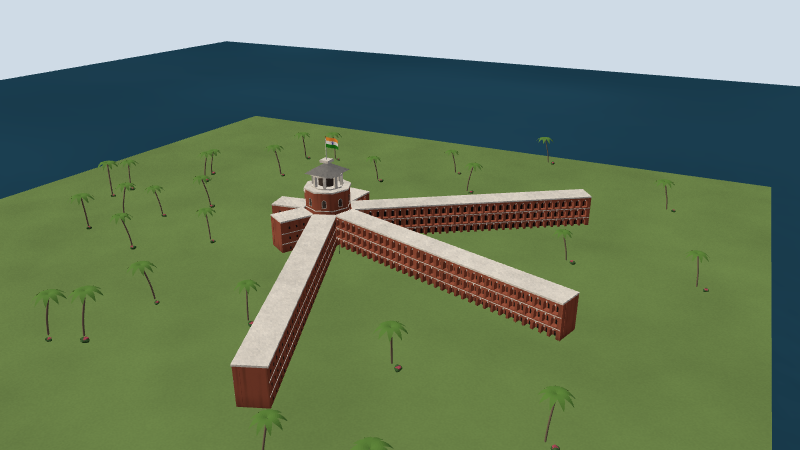

## Andhra Pradesh

### Lepakshi Temple

Lepakshi, Sri Sathya Sai, Andhra Pradesh · 1530s · Vijayanagara · Granite · [view in 3D](https://monuments-of-india-nu.vercel.app/#lepakshi-temple)

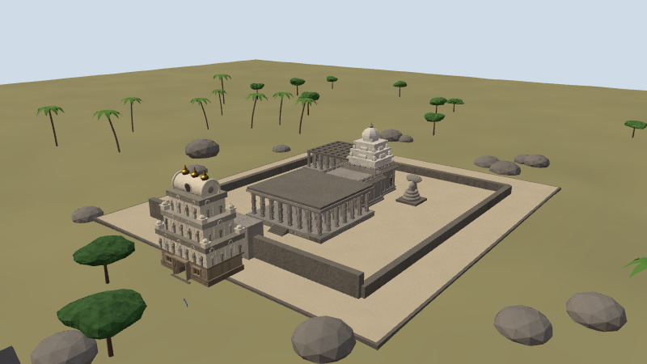

### Mallikarjuna Temple

Srisailam, Andhra Pradesh · Expanded 14th–16th c. · Dravidian · Stone · [view in 3D](https://monuments-of-india-nu.vercel.app/#mallikarjuna-temple)

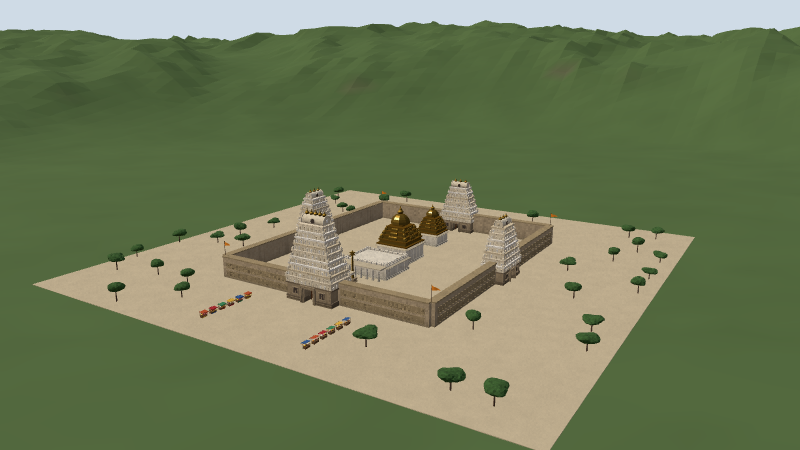

### Satish Dhawan Space Centre

Sriharikota, Andhra Pradesh · 1971; second pad 2005 · Contemporary · Steel and concrete · [view in 3D](https://monuments-of-india-nu.vercel.app/#satish-dhawan-space-centre)

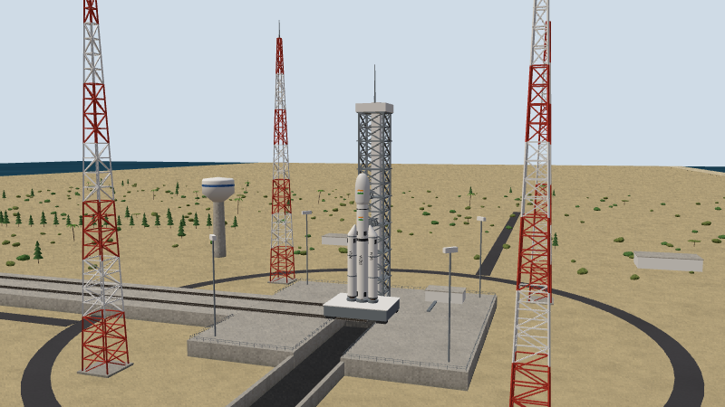

### Tirumala Venkateswara Temple

Tirumala, Andhra Pradesh · Expanded 9th–16th c. · Dravidian · Granite with gilded copper · [view in 3D](https://monuments-of-india-nu.vercel.app/#tirumala-venkateswara-temple)

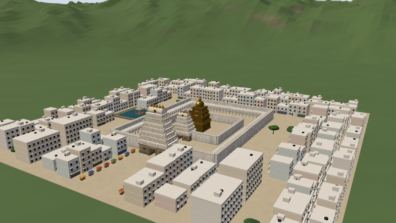

## Arunachal Pradesh

### Tawang Monastery

Tawang, Arunachal Pradesh · 1680–1681 · Tibetan Buddhist · Stone, timber and lime · [view in 3D](https://monuments-of-india-nu.vercel.app/#tawang-monastery)

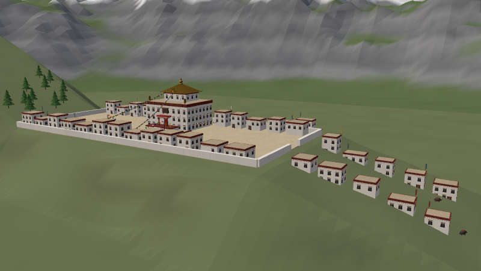

## Assam

### Kamakhya Temple

Nilachal Hill, Guwahati · Rebuilt 1565 · Nilachal · Stone · [view in 3D](https://monuments-of-india-nu.vercel.app/#kamakhya-temple)

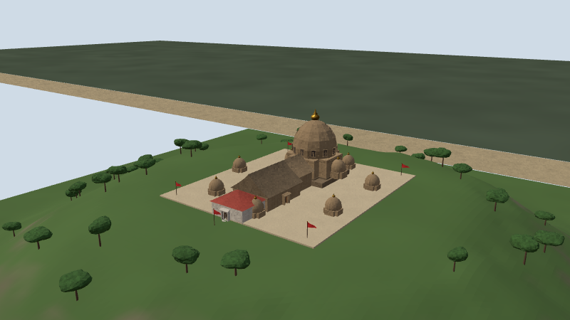

### Rang Ghar

Sivasagar, Assam · 1744–1750 · Ahom · Brick and lime · [view in 3D](https://monuments-of-india-nu.vercel.app/#rang-ghar)

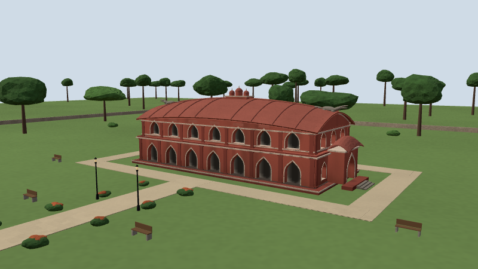

### Talatal Ghar

Sivasagar, Assam · 1751–1769 · Ahom · Brick and lime · [view in 3D](https://monuments-of-india-nu.vercel.app/#talatal-ghar)

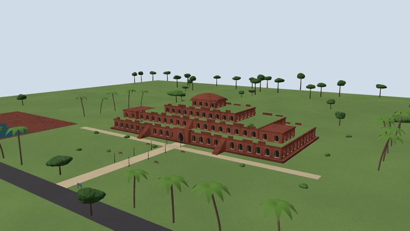

## Bihar

### Ashokan Pillar, Vaishali

Kolhua, Vaishali, Bihar · c. 250 BCE · Buddhist (Mauryan) · Polished sandstone and brick · [view in 3D](https://monuments-of-india-nu.vercel.app/#ashokan-pillar-vaishali)

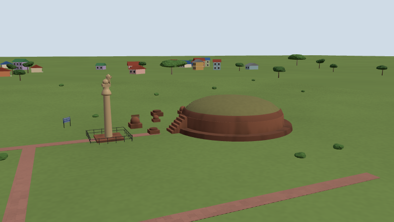

### Barabar Caves

Jehanabad, Bihar · 3rd century BCE · Rock-cut (Mauryan) · Granite · [view in 3D](https://monuments-of-india-nu.vercel.app/#barabar-caves)

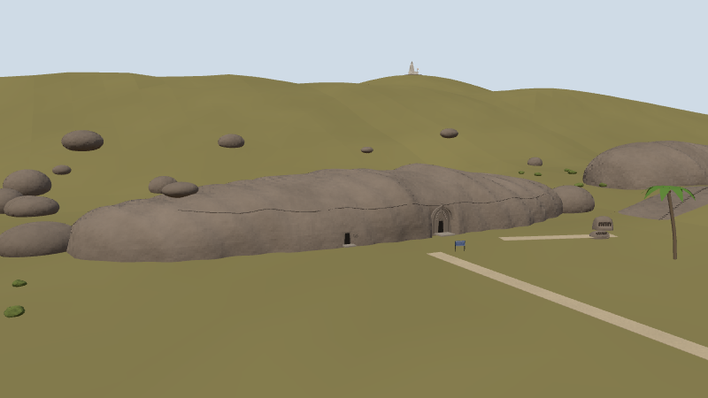

### Mahabodhi Temple

Bodh Gaya, Bihar · 5th–6th c. CE · Gupta-era brick · Brick with stucco · [view in 3D](https://monuments-of-india-nu.vercel.app/#mahabodhi-temple)

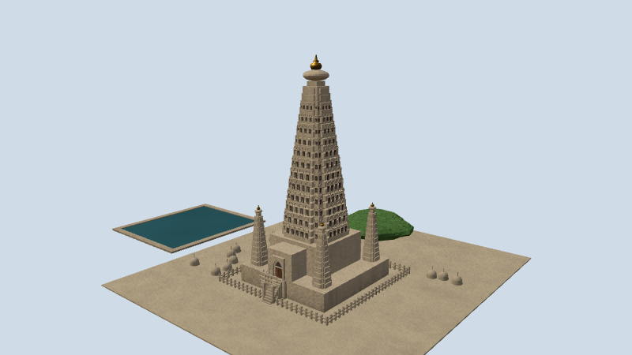

### Nalanda Mahavihara

Nalanda, Bihar · 5th–12th c. · Gupta and Pala brick · Brick · [view in 3D](https://monuments-of-india-nu.vercel.app/#nalanda-mahavihara)

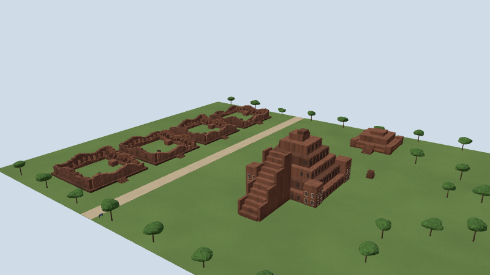

### Sher Shah Suri’s Tomb

Sasaram, Bihar · 1540–1545 · Indo-Afghan (Sur) · Red sandstone · [view in 3D](https://monuments-of-india-nu.vercel.app/#sher-shah-suri-tomb)

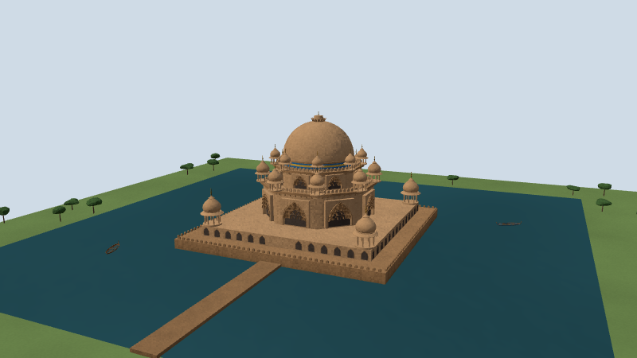

### Takht Sri Patna Sahib

Patna City, Bihar · Rebuilt 1954–1957 · Sikh · White marble · [view in 3D](https://monuments-of-india-nu.vercel.app/#takht-sri-patna-sahib)

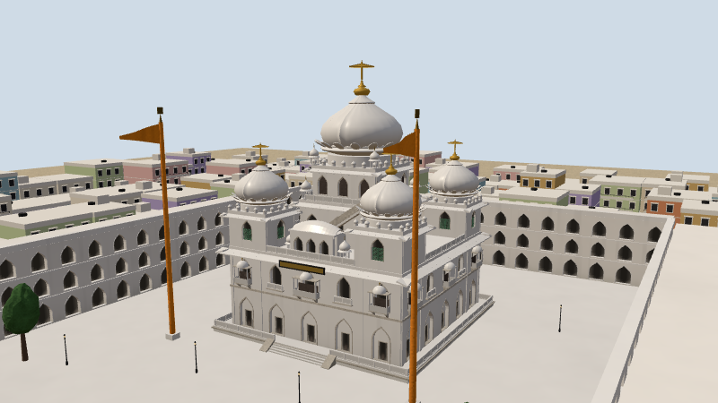

### Vikramshila Mahavihara

Antichak, Bhagalpur, Bihar · Late 8th–9th centuries · Buddhist (Pala) · Brick with terracotta plaques · [view in 3D](https://monuments-of-india-nu.vercel.app/#vikramshila-mahavihara)

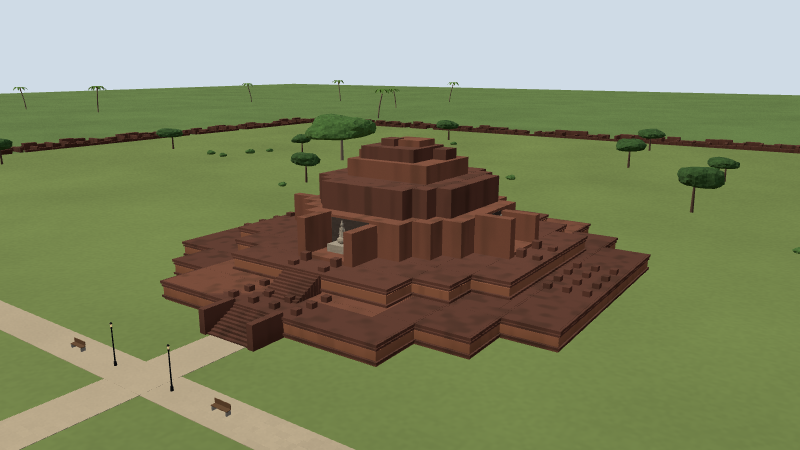

## Chandigarh

### Capitol Complex, Chandigarh

Sector 1, Chandigarh · 1951–1965 · Modernist · Raw concrete · [view in 3D](https://monuments-of-india-nu.vercel.app/#capitol-complex)

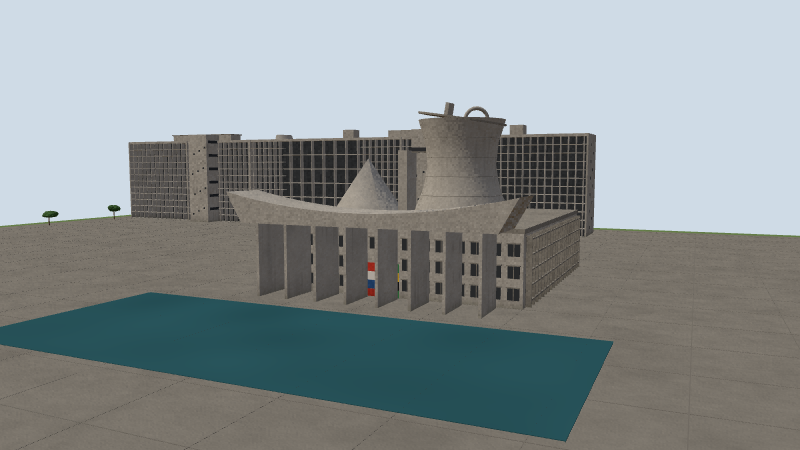

## Chhattisgarh

### Bhoramdeo Temple

Kabirdham, Chhattisgarh · c. 1089 CE · Nagara · Carved stone · [view in 3D](https://monuments-of-india-nu.vercel.app/#bhoramdeo-temple)

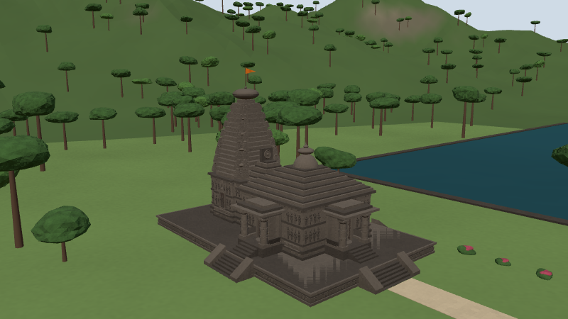

### Laxman Temple, Sirpur

Sirpur, Mahasamund, Chhattisgarh · 7th century · Nagara (Panduvamshi brick) · Brick on a stone platform · [view in 3D](https://monuments-of-india-nu.vercel.app/#laxman-temple-sirpur)

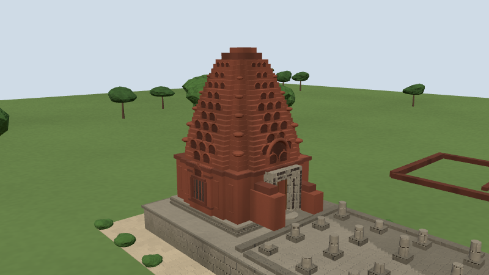

## Dadra and Nagar Haveli and Daman and Diu

### Moti Daman Fort

Moti Daman, Daman · 1559–1581 · Portuguese · Stone and laterite · [view in 3D](https://monuments-of-india-nu.vercel.app/#moti-daman-fort)

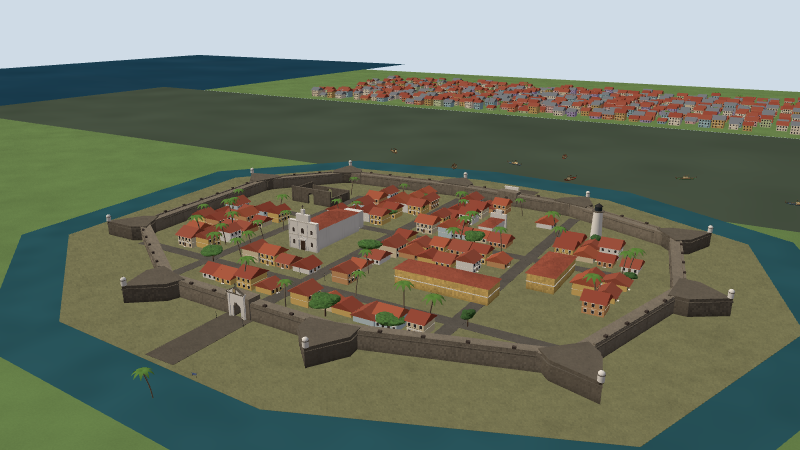

## Delhi

### Agrasen ki Baoli

Hailey Road, New Delhi · 14th century · Indo-Islamic (Tughlaq) · Rubble stone · [view in 3D](https://monuments-of-india-nu.vercel.app/#agrasen-ki-baoli)

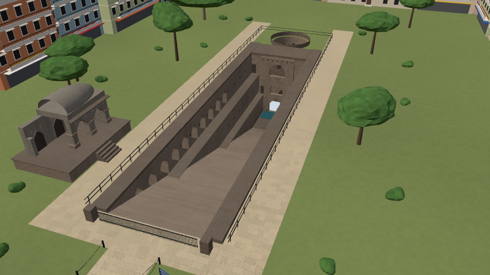

### Bara Gumbad

Lodhi Gardens, New Delhi · 1490 · Indo-Islamic (Lodi) · Grey quartzite and red sandstone · [view in 3D](https://monuments-of-india-nu.vercel.app/#bara-gumbad)

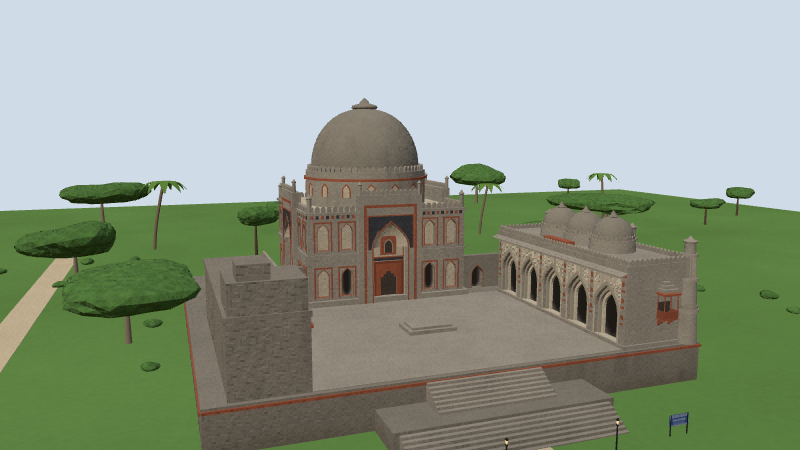

### Gurudwara Bangla Sahib

Connaught Place, New Delhi · Shrine from 1783; rebuilt 20th century · Sikh · White marble with a gilded dome · [view in 3D](https://monuments-of-india-nu.vercel.app/#gurudwara-bangla-sahib)

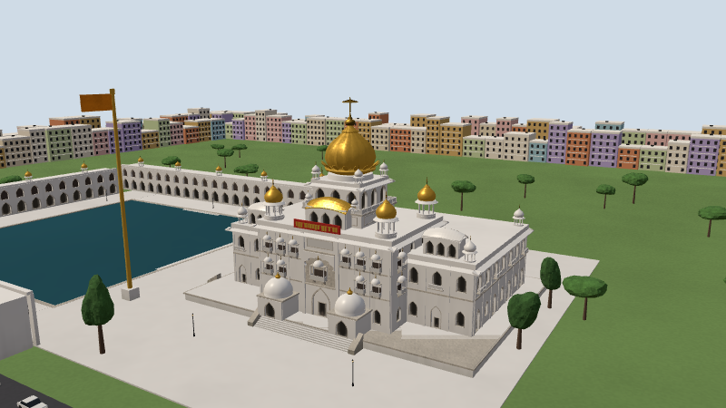

### Humayun’s Tomb

Nizamuddin, New Delhi · 1565–1572 · Mughal · Red sandstone and white marble · [view in 3D](https://monuments-of-india-nu.vercel.app/#humayuns-tomb)

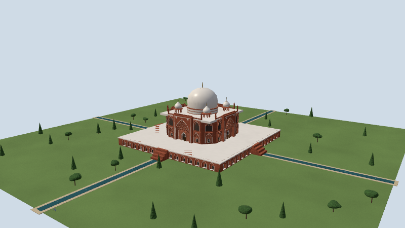

### India Gate

Kartavya Path, New Delhi · 1921–1931 · Memorial arch · Red and buff Bharatpur sandstone · [view in 3D](https://monuments-of-india-nu.vercel.app/#india-gate)

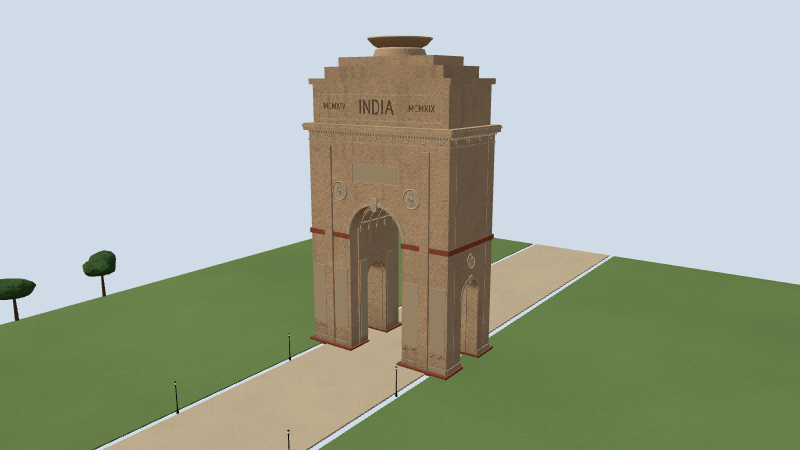

### Jama Masjid

Chandni Chowk, Old Delhi · 1650–1656 · Mughal · Red sandstone and white marble · [view in 3D](https://monuments-of-india-nu.vercel.app/#jama-masjid)

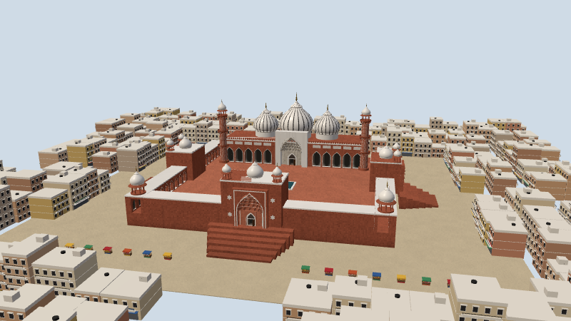

### Lotus Temple

Kalkaji, New Delhi · 1980–1986 · Expressionist · Greek Pentelic marble on concrete · [view in 3D](https://monuments-of-india-nu.vercel.app/#lotus-temple)

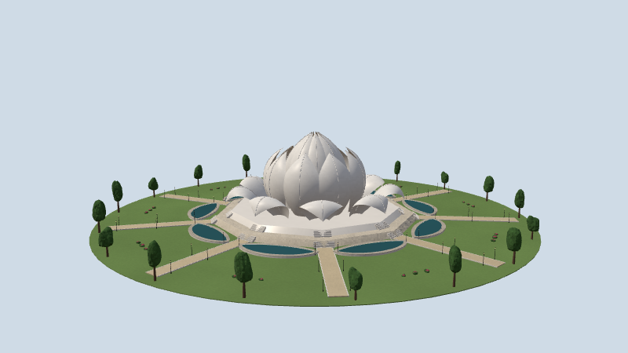

### National War Memorial

Kartavya Path, New Delhi · 2019 · Modern memorial · Granite · [view in 3D](https://monuments-of-india-nu.vercel.app/#national-war-memorial)

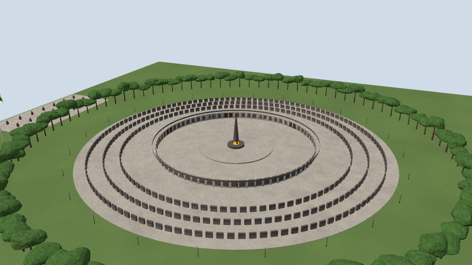

### New Parliament House

Sansad Marg, New Delhi · 2020–2023 · Contemporary · Red and buff sandstone · [view in 3D](https://monuments-of-india-nu.vercel.app/#new-parliament-house)

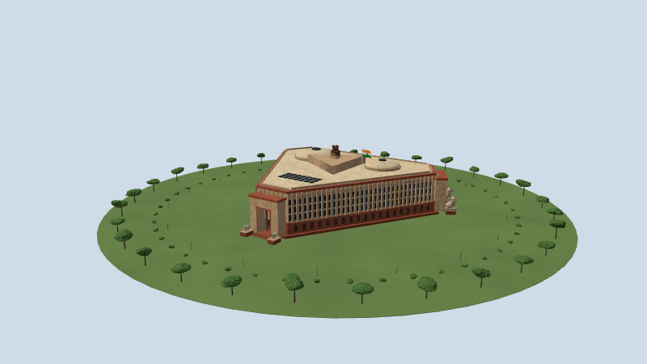

### Old Parliament House

Sansad Marg, New Delhi · 1921–1927 · Lutyens’ Delhi · Red and buff sandstone · [view in 3D](https://monuments-of-india-nu.vercel.app/#old-parliament-house)

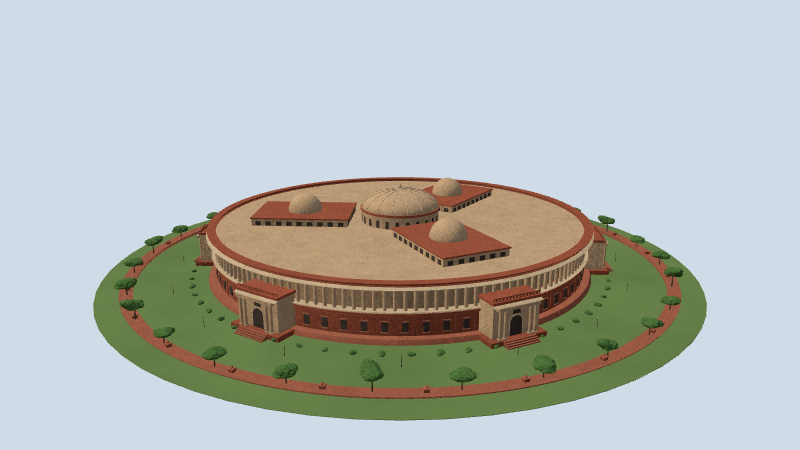

### Purana Qila

Mathura Road, New Delhi · 1538–1545 · Indo-Afghan (Sur) · Red sandstone, quartzite and marble · [view in 3D](https://monuments-of-india-nu.vercel.app/#purana-qila)

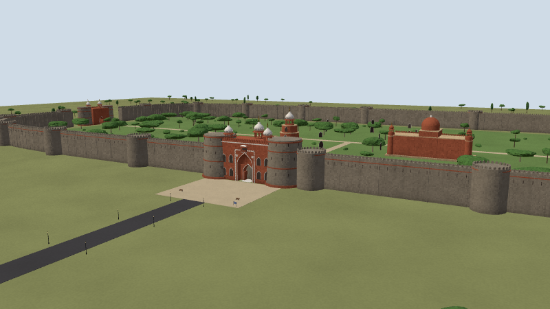

### Qutub Minar

Mehrauli, Delhi · 1199–1220 · Indo-Islamic · Red sandstone and marble · [view in 3D](https://monuments-of-india-nu.vercel.app/#qutub-minar)

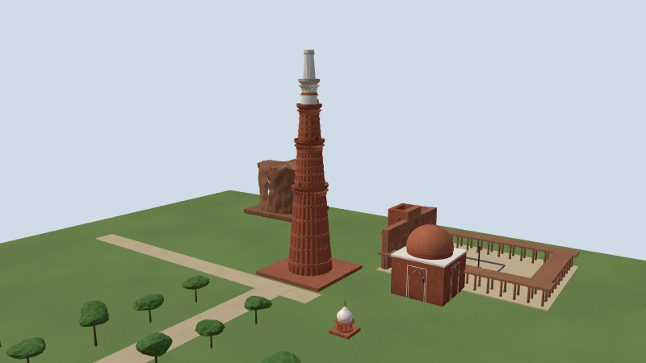

### Rashtrapati Bhavan

Raisina Hill, New Delhi · 1912–1929 · Lutyens’ Delhi · Cream and red Dholpur sandstone · [view in 3D](https://monuments-of-india-nu.vercel.app/#rashtrapati-bhavan)

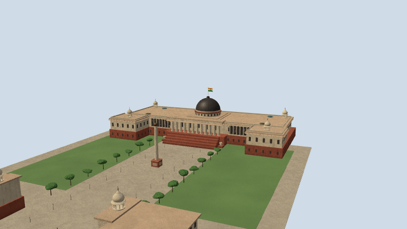

### Red Fort

Old Delhi · 1639–1648 · Mughal · Red sandstone · [view in 3D](https://monuments-of-india-nu.vercel.app/#red-fort)

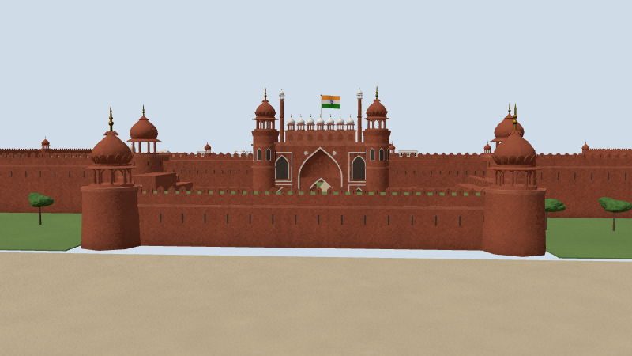

### Safdarjung’s Tomb

Lodhi Road, New Delhi · 1754 · Late Mughal · Red and buff sandstone, marble · [view in 3D](https://monuments-of-india-nu.vercel.app/#safdarjung-tomb)

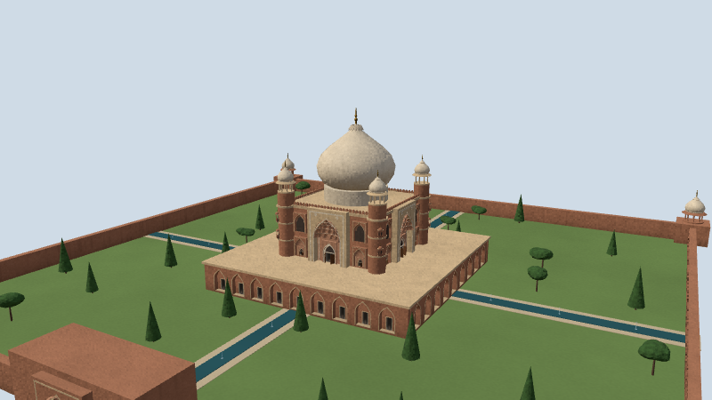

### Swaminarayan Akshardham

New Delhi · 2000–2005 · Maru-Gurjara · Pink sandstone and Italian marble · [view in 3D](https://monuments-of-india-nu.vercel.app/#akshardham)

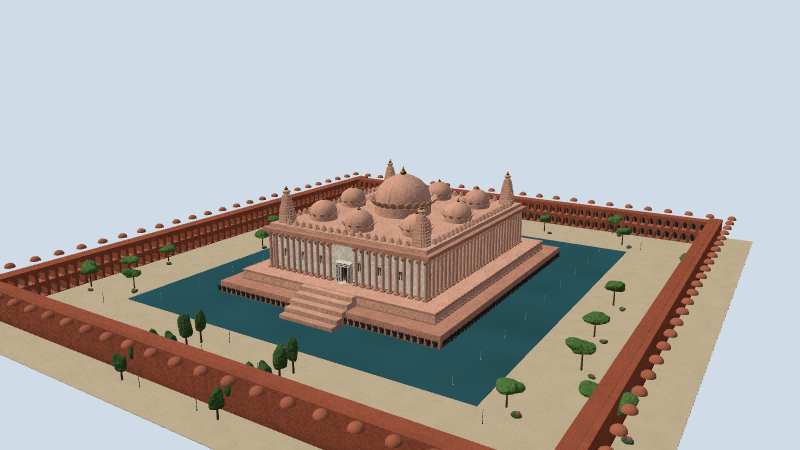

### Tughlaqabad Fort

Tughlaqabad, New Delhi · 1321–1325 · Indo-Islamic (Tughlaq) · Rubble stone · [view in 3D](https://monuments-of-india-nu.vercel.app/#tughlaqabad-fort)

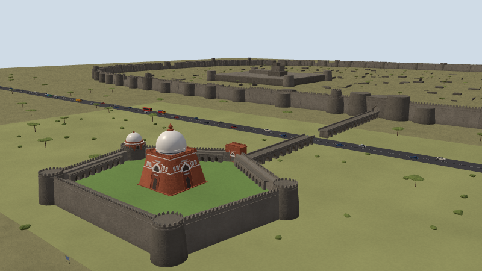

## Goa

### Basilica of Bom Jesus

Old Goa, Goa · 1594–1605 · Baroque · Laterite and basalt · [view in 3D](https://monuments-of-india-nu.vercel.app/#basilica-of-bom-jesus)

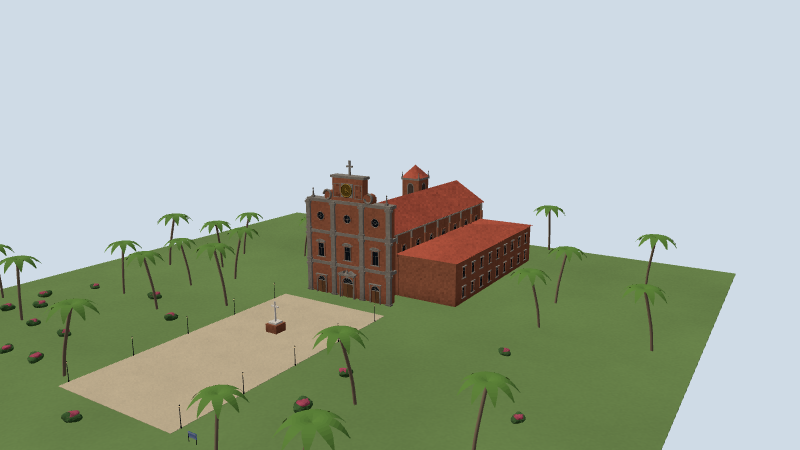

### Church of Our Lady of the Immaculate Conception

Panaji, Goa · 1541; rebuilt 1619 · Portuguese Baroque · Laterite and lime plaster · [view in 3D](https://monuments-of-india-nu.vercel.app/#immaculate-conception-panaji)

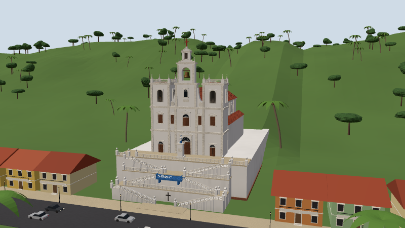

### Fort Aguada

Candolim, Goa · 1612 · Portuguese · Laterite · [view in 3D](https://monuments-of-india-nu.vercel.app/#fort-aguada)

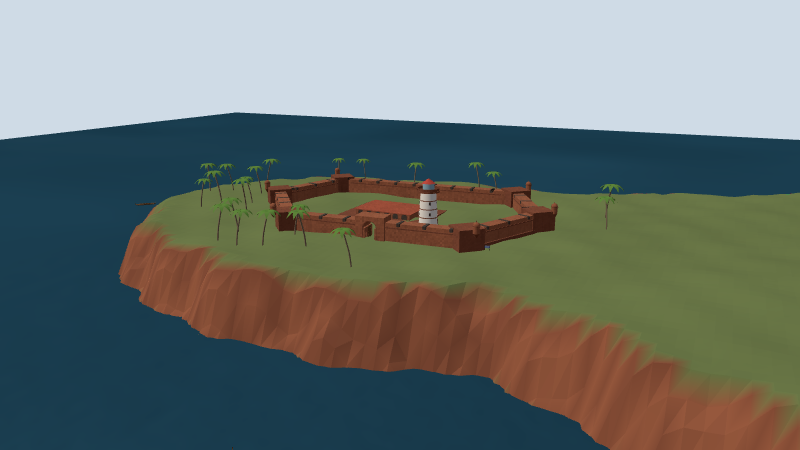

### Sé Cathedral

Old Goa, Goa · 1562–1619 · Portuguese Manueline, Tuscan outside · Laterite and lime plaster · [view in 3D](https://monuments-of-india-nu.vercel.app/#se-cathedral)

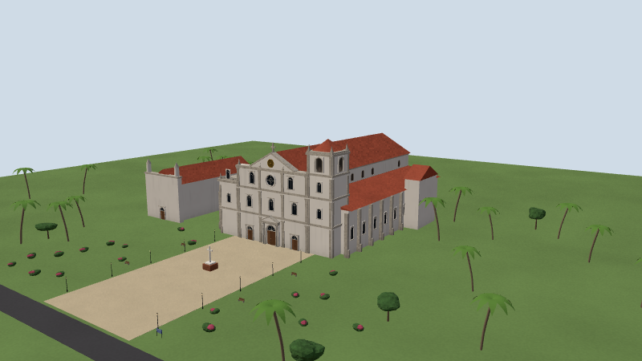

## Gujarat

### Adalaj Stepwell

Adalaj, Gandhinagar, Gujarat · 1498–1499 · Indo-Islamic and Solanki · Sandstone · [view in 3D](https://monuments-of-india-nu.vercel.app/#adalaj-stepwell)

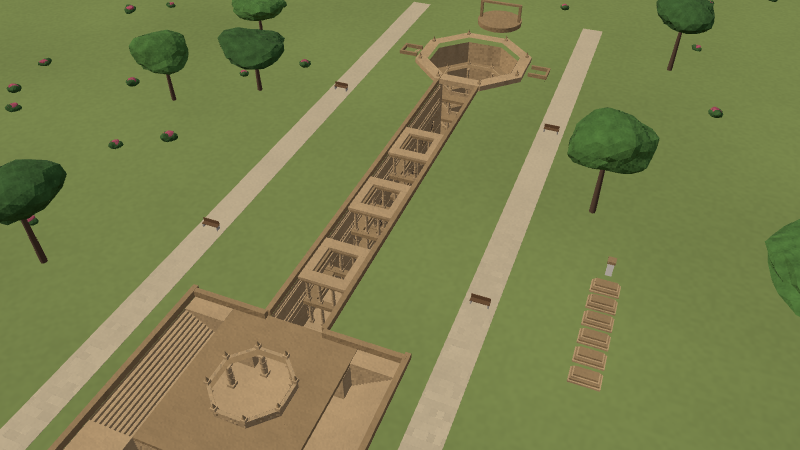

### Dholavira

Khadir Bet, Kutch, Gujarat · c. 3000–1500 BCE · Harappan · Sandstone and limestone · [view in 3D](https://monuments-of-india-nu.vercel.app/#dholavira)

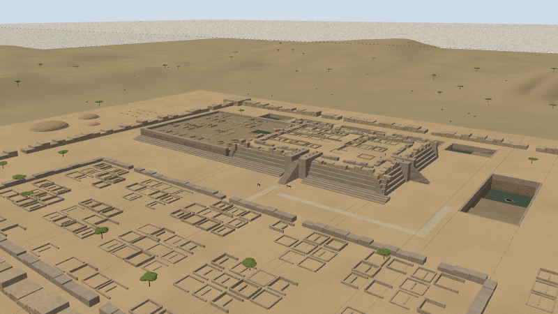

### Dwarkadhish Temple

Dwarka, Gujarat · 15th–16th c. · Maru-Gurjara · Limestone · [view in 3D](https://monuments-of-india-nu.vercel.app/#dwarkadhish-temple)

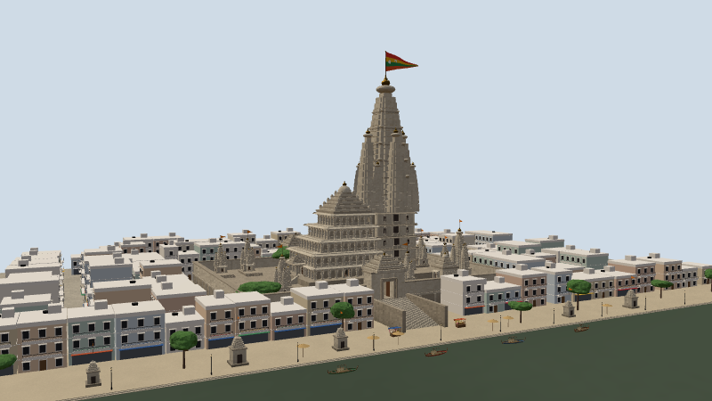

### IIM Ahmedabad

Vastrapur, Ahmedabad · 1962–1974 · Modernist · Brick and concrete · [view in 3D](https://monuments-of-india-nu.vercel.app/#iim-ahmedabad)

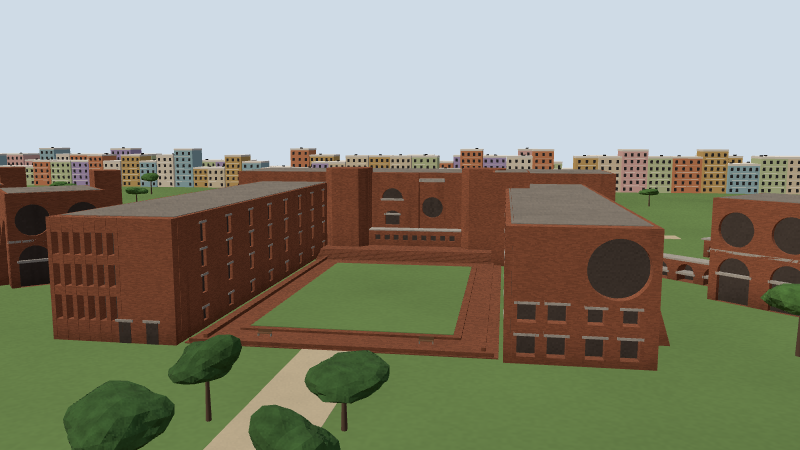

### Kirti Mandir

Porbandar, Gujarat · 1947–1950 · Mixed · Stone · [view in 3D](https://monuments-of-india-nu.vercel.app/#kirti-mandir)

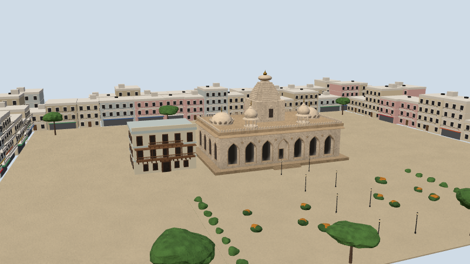

### Laxmi Vilas Palace

Vadodara, Gujarat · 1878–1890 · Indo-Saracenic · Sandstone and marble · [view in 3D](https://monuments-of-india-nu.vercel.app/#laxmi-vilas-palace)

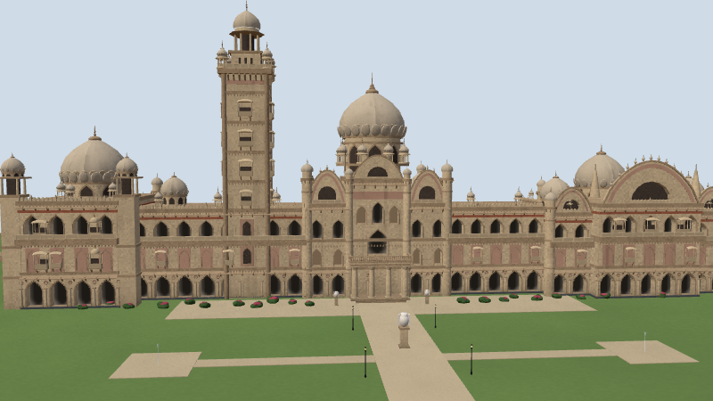

### Lothal

Saragwala, Ahmedabad, Gujarat · c. 2400–1900 BCE · Harappan · Mud brick and fired brick · [view in 3D](https://monuments-of-india-nu.vercel.app/#lothal)

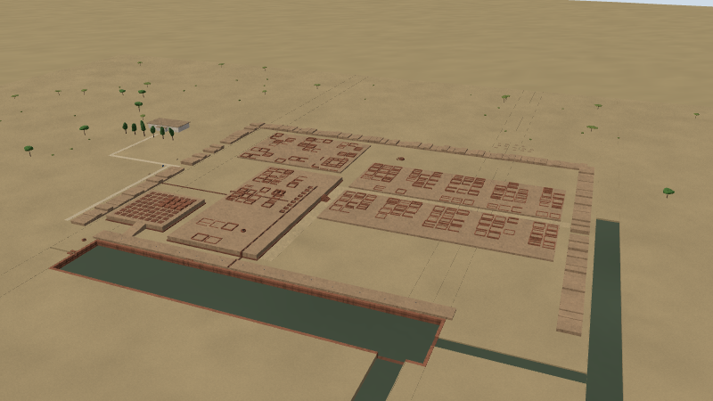

### Nageshwar Temple

Dwarka, Gujarat · Rebuilt 1990s · Nagara · Pink stone · [view in 3D](https://monuments-of-india-nu.vercel.app/#nageshwar-temple)

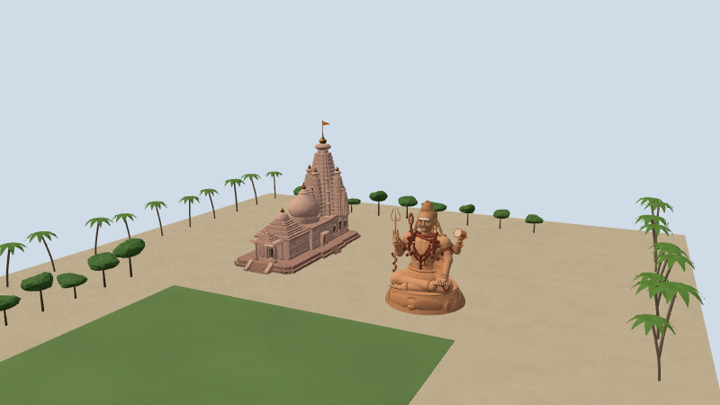

### Palitana Temples

Shatrunjaya hill, Gujarat · 11th–20th c. · Maru-Gurjara · Marble · [view in 3D](https://monuments-of-india-nu.vercel.app/#palitana-temples)

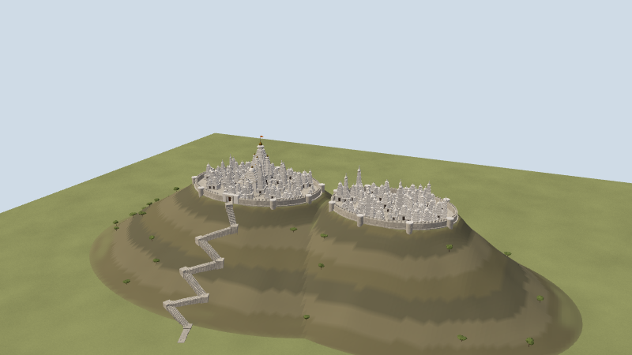

### Rani ki Vav

Patan, Gujarat · 11th century · Maru-Gurjara · Sandstone · [view in 3D](https://monuments-of-india-nu.vercel.app/#rani-ki-vav)

### Sidi Saiyyed Mosque

Lal Darwaja, Ahmedabad · 1572–1573 · Indo-Islamic (Gujarat Sultanate) · Yellow sandstone · [view in 3D](https://monuments-of-india-nu.vercel.app/#sidi-saiyyed-mosque)

### Somnath Temple

Prabhas Patan, Gujarat · Rebuilt 1951 · Maru-Gurjara (Chalukya) · Sandstone · [view in 3D](https://monuments-of-india-nu.vercel.app/#somnath-temple)

### Statue of Unity

Ekta Nagar, Gujarat · 2013–2018 · Monumental statue · Bronze cladding over steel and concrete · [view in 3D](https://monuments-of-india-nu.vercel.app/#statue-of-unity)

### Sun Temple, Modhera

Modhera, Gujarat · 1026–1027 CE · Maru-Gurjara · Sandstone · [view in 3D](https://monuments-of-india-nu.vercel.app/#modhera-sun-temple)

## Haryana

### Sheikh Chilli’s Tomb

Thanesar, Kurukshetra, Haryana · c. 1650 · Mughal · White marble and red sandstone · [view in 3D](https://monuments-of-india-nu.vercel.app/#sheikh-chilli-tomb)

## Himachal Pradesh

### Christ Church, Shimla

The Ridge, Shimla · 1846–1857 · Neo-Gothic · Stone and lime plaster · [view in 3D](https://monuments-of-india-nu.vercel.app/#christ-church-shimla)

### Hidimba Devi Temple

Manali, Himachal Pradesh · 1553 · Himalayan pagoda · Stone and deodar wood · [view in 3D](https://monuments-of-india-nu.vercel.app/#hidimba-devi-temple)

### Kangra Fort

Kangra, Himachal Pradesh · Recorded by 1009 CE · Rajput (Katoch) · Stone · [view in 3D](https://monuments-of-india-nu.vercel.app/#kangra-fort)

### Key Monastery

Spiti Valley, Himachal Pradesh · Founded c. 11th c. · Tibetan Buddhist · Stone and mud brick · [view in 3D](https://monuments-of-india-nu.vercel.app/#key-monastery)

### Masrur Rock-cut Temples

Masrur, Kangra, Himachal Pradesh · 8th century · Nagara (rock-cut monolith) · Sandstone · [view in 3D](https://monuments-of-india-nu.vercel.app/#masrur-temples)

### Viceregal Lodge

Observatory Hill, Shimla · 1880–1888 · Colonial (Jacobethan) · Grey stone · [view in 3D](https://monuments-of-india-nu.vercel.app/#viceregal-lodge-shimla)

## Jammu and Kashmir

### Chenab Rail Bridge

Reasi, Jammu and Kashmir · 2004–2022 · Steel arch bridge · Steel and concrete · [view in 3D](https://monuments-of-india-nu.vercel.app/#chenab-rail-bridge)

### Hazratbal Shrine

Srinagar, Jammu and Kashmir · 1968–1979 · Mughal-inspired · White marble · [view in 3D](https://monuments-of-india-nu.vercel.app/#hazratbal-shrine)

### Martand Sun Temple

Mattan, Anantnag, Jammu and Kashmir · 8th century · Kashmiri (Karkota) · Grey limestone · [view in 3D](https://monuments-of-india-nu.vercel.app/#martand-sun-temple)

## Jharkhand

### Baidyanath Temple

Deoghar, Jharkhand · 16th c. (present form) · Nagara · Stone and lime plaster · [view in 3D](https://monuments-of-india-nu.vercel.app/#baidyanath-temple)

### Shikharji

Parasnath Hill, Jharkhand · 18th c. onward · Jain · Marble and stone · [view in 3D](https://monuments-of-india-nu.vercel.app/#shikharji)

## Karnataka

### Bengaluru Airport Terminal 2

Devanahalli, Bengaluru · 2018–2022 · Contemporary · Steel, glass and engineered bamboo · [view in 3D](https://monuments-of-india-nu.vercel.app/#bengaluru-airport-t2)

### Chennakesava Temple

Somanathapura, Karnataka · 1258 · Hoysala · Soapstone · [view in 3D](https://monuments-of-india-nu.vercel.app/#chennakesava-temple)

### Durga Temple, Aihole

Aihole, Bagalkot, Karnataka · 7th–8th centuries · Dravidian and Nagara (early Chalukya) · Sandstone · [view in 3D](https://monuments-of-india-nu.vercel.app/#durga-temple-aihole)

### Gol Gumbaz

Vijayapura, Karnataka · 1626–1656 · Deccan (Adil Shahi) · Dark basalt with lime plaster · [view in 3D](https://monuments-of-india-nu.vercel.app/#gol-gumbaz)

### Gommateshwara Statue

Shravanabelagola, Karnataka · c. 983 CE · Monolithic statue · Granite · [view in 3D](https://monuments-of-india-nu.vercel.app/#gommateshwara)

### Hoysaleswara Temple

Halebidu, Karnataka · 1121–1160 · Hoysala · Soapstone · [view in 3D](https://monuments-of-india-nu.vercel.app/#hoysaleswara-temple)

### Ibrahim Rauza

Vijayapura, Karnataka · 1626–1627 · Deccan (Adil Shahi) · Basalt · [view in 3D](https://monuments-of-india-nu.vercel.app/#ibrahim-rauza)

### ISKCON Temple Bangalore

Hare Krishna Hill, Rajajinagar, Bengaluru · 1997 · Contemporary, with a Dravidian gopuram · Granite and concrete, with gilded towers and glass · [view in 3D](https://monuments-of-india-nu.vercel.app/#iskcon-temple-bangalore)

### Lotus Mahal

Zenana Enclosure, Hampi, Karnataka · 16th century · Vijayanagara and Indo-Islamic · Brick, stucco and granite · [view in 3D](https://monuments-of-india-nu.vercel.app/#lotus-mahal-hampi)

### Mahmud Gawan Madrasa

Bidar, Karnataka · 1472 · Deccan (Bahmani) · Stone with glazed tiles · [view in 3D](https://monuments-of-india-nu.vercel.app/#mahmud-gawan-madrasa)

### Mysore Palace

Mysuru, Karnataka · 1897–1912 · Indo-Saracenic · Grey granite with pink marble domes · [view in 3D](https://monuments-of-india-nu.vercel.app/#mysore-palace)

### Namdroling Monastery

Bylakuppe, Karnataka · 1963; Golden Temple 1999 · Tibetan Buddhist · Concrete with gilded roofs · [view in 3D](https://monuments-of-india-nu.vercel.app/#namdroling-monastery)

### Pattadakal Temples

Pattadakal, Bagalkot, Karnataka · 7th–8th centuries · Dravidian and Nagara (Chalukya) · Sandstone · [view in 3D](https://monuments-of-india-nu.vercel.app/#pattadakal-temples)

### Tipu Sultan’s Gumbaz

Srirangapatna, Karnataka · 1782–1784 · Indo-Islamic · Lime plaster and granite · [view in 3D](https://monuments-of-india-nu.vercel.app/#tipu-sultan-gumbaz)

### Vidhana Soudha

Bengaluru, Karnataka · 1951–1956 · Neo-Dravidian · Granite · [view in 3D](https://monuments-of-india-nu.vercel.app/#vidhana-soudha)

### Virupaksha Temple, Hampi

Hampi, Karnataka · 7th c.; enlarged 15th–16th c. · Dravidian (Vijayanagara) · Granite, brick and stucco · [view in 3D](https://monuments-of-india-nu.vercel.app/#virupaksha-temple-hampi)

### Vittala Temple, Hampi

Hampi, Karnataka · 15th–16th c. · Vijayanagara · Granite · [view in 3D](https://monuments-of-india-nu.vercel.app/#vittala-temple-hampi)

## Kerala

### Bekal Fort

Kasaragod, Kerala · c. 1650 · Keladi · Laterite · [view in 3D](https://monuments-of-india-nu.vercel.app/#bekal-fort)

### Cheraman Juma Masjid

Methala, Kodungallur, Kerala · Traditionally 629; restored 2022 · Mixed (Kerala Islamic) · Laterite and timber · [view in 3D](https://monuments-of-india-nu.vercel.app/#cheraman-juma-masjid)

### Mattancherry Palace

Mattancherry, Kochi, Kerala · c. 1555; rebuilt 1663 · Mixed (Kerala and Portuguese) · Laterite, lime plaster and timber · [view in 3D](https://monuments-of-india-nu.vercel.app/#mattancherry-palace)

### Padmanabhaswamy Temple

Thiruvananthapuram, Kerala · 16th–18th c. · Dravidian and Kerala · Granite · [view in 3D](https://monuments-of-india-nu.vercel.app/#padmanabhaswamy-temple)

### Paradesi Synagogue

Jew Town, Mattancherry, Kochi · 1568 · Mixed (Kerala Jewish) · Laterite, lime plaster and timber · [view in 3D](https://monuments-of-india-nu.vercel.app/#paradesi-synagogue)

### St Francis Church, Kochi

Fort Kochi, Kerala · 1503; rebuilt in stone c. 1516 · Portuguese · Laterite and lime plaster · [view in 3D](https://monuments-of-india-nu.vercel.app/#st-francis-church-kochi)

### Vadakkunnathan Temple

Thrissur, Kerala · Rebuilt 12th–16th centuries · Kerala (Dravidian) · Laterite, timber and copper · [view in 3D](https://monuments-of-india-nu.vercel.app/#vadakkunnathan-temple)

## Ladakh

### Kargil War Memorial

Dras, Ladakh · Opened 2004 · Modern memorial · Pink sandstone and brass · [view in 3D](https://monuments-of-india-nu.vercel.app/#kargil-war-memorial)

### Leh Palace

Leh, Ladakh · c. 1600 · Ladakhi (Tibetan) · Stone, mud brick and poplar timber · [view in 3D](https://monuments-of-india-nu.vercel.app/#leh-palace)

### Thiksey Monastery

Near Leh, Ladakh · 15th century · Tibetan Buddhist (Gelug) · Stone, mud brick and timber · [view in 3D](https://monuments-of-india-nu.vercel.app/#thiksey-monastery)

## Madhya Pradesh

### Bateshwar Temples

Padavali, Morena, Madhya Pradesh · 8th–10th centuries · Nagara (Gurjara-Pratihara) · Sandstone · [view in 3D](https://monuments-of-india-nu.vercel.app/#bateshwar-temples)

### Bhojeshwar Temple

Bhojpur, Raisen, Madhya Pradesh · 11th century (unfinished) · Bhumija (Paramara, unfinished) · Sandstone · [view in 3D](https://monuments-of-india-nu.vercel.app/#bhojeshwar-temple)

### Gwalior Fort

Gwalior, Madhya Pradesh · 8th–16th c. · Rajput (Tomar) · Sandstone with glazed tiles · [view in 3D](https://monuments-of-india-nu.vercel.app/#gwalior-fort)

### Jahangir Mahal

Orchha, Niwari, Madhya Pradesh · Early 17th century · Rajput and Mughal (Bundela) · Stone and lime plaster with glazed tiles · [view in 3D](https://monuments-of-india-nu.vercel.app/#jahangir-mahal-orchha)

### Jahaz Mahal

Mandu, Dhar, Madhya Pradesh · Late 15th century · Indo-Islamic (Malwa Sultanate) · Local stone and lime plaster · [view in 3D](https://monuments-of-india-nu.vercel.app/#jahaz-mahal)

### Kandariya Mahadeva Temple

Khajuraho, Madhya Pradesh · c. 1030 CE · Nagara (Chandela) · Sandstone · [view in 3D](https://monuments-of-india-nu.vercel.app/#kandariya-mahadeva)

### Mahakaleshwar Temple

Ujjain, Madhya Pradesh · Rebuilt 18th c. · Bhumija and Maratha · Stone · [view in 3D](https://monuments-of-india-nu.vercel.app/#mahakaleshwar-temple)

### Omkareshwar Temple

Mandhata island, Madhya Pradesh · Rebuilt 18th c. · Nagara · Stone · [view in 3D](https://monuments-of-india-nu.vercel.app/#omkareshwar-temple)

### Parshvanath Temple, Khajuraho

Khajuraho, Madhya Pradesh · c. 950–970 CE · Nagara (Chandela) · Sandstone · [view in 3D](https://monuments-of-india-nu.vercel.app/#parshvanath-temple-khajuraho)

### Sanchi Stupa

Sanchi, Madhya Pradesh · 3rd c. BCE · Buddhist (Mauryan) · Sandstone · [view in 3D](https://monuments-of-india-nu.vercel.app/#sanchi-stupa)

### Taj-ul-Masajid

Bhopal, Madhya Pradesh · 1877–1985 · Mughal · Pink sandstone with white marble domes · [view in 3D](https://monuments-of-india-nu.vercel.app/#taj-ul-masajid)

### Teli ka Mandir

Gwalior Fort, Madhya Pradesh · 8th–9th centuries · Nagara (Pratihara, wagon-vault roof) · Sandstone · [view in 3D](https://monuments-of-india-nu.vercel.app/#teli-ka-mandir)

## Maharashtra

### Ajanta Caves

Ajanta, Maharashtra · 2nd c. BCE–c. 480 CE · Rock-cut Buddhist · Basalt · [view in 3D](https://monuments-of-india-nu.vercel.app/#ajanta-caves)

### Bandra–Worli Sea Link

Mumbai, Maharashtra · 2000–2009 · Cable-stayed bridge · Steel and concrete · [view in 3D](https://monuments-of-india-nu.vercel.app/#bandra-worli-sea-link)

### Bhimashankar Temple

Sahyadri hills, Maharashtra · 13th–18th c. · Nagara · Black basalt · [view in 3D](https://monuments-of-india-nu.vercel.app/#bhimashankar-temple)

### Bibi Ka Maqbara

Chhatrapati Sambhajinagar, Maharashtra · 1660s · Mughal · Marble, basalt and lime plaster · [view in 3D](https://monuments-of-india-nu.vercel.app/#bibi-ka-maqbara)

### Chhatrapati Shivaji Maharaj Terminus

Fort, Mumbai · 1878–1888 · Victorian Gothic · Sandstone and limestone · [view in 3D](https://monuments-of-india-nu.vercel.app/#csmt)

### Daulatabad Fort

Near Chhatrapati Sambhajinagar, Maharashtra · 12th–15th c. · Deccan · Stone · [view in 3D](https://monuments-of-india-nu.vercel.app/#daulatabad-fort)

### Elephanta Caves

Elephanta Island, Mumbai Harbour · 5th–6th centuries · Rock-cut Shaiva (Kalachuri) · Basalt · [view in 3D](https://monuments-of-india-nu.vercel.app/#elephanta-caves)

### Eros Cinema

Churchgate, Mumbai · 1935–1938 · Art Deco · Concrete and red Agra sandstone · [view in 3D](https://monuments-of-india-nu.vercel.app/#eros-cinema)

### Gateway of India

Apollo Bunder, Mumbai · 1913–1924 · Indo-Saracenic · Yellow basalt and concrete · [view in 3D](https://monuments-of-india-nu.vercel.app/#gateway-of-india)

### Grishneshwar Temple

Verul, near Ellora · 18th century · Nagara (Maratha) · Red basalt · [view in 3D](https://monuments-of-india-nu.vercel.app/#grishneshwar-temple)

### Kailasa Temple, Ellora

Ellora, Maharashtra · 8th century · Dravidian (Rashtrakuta) · Basalt, carved from one rock · [view in 3D](https://monuments-of-india-nu.vercel.app/#kailasa-temple)

### Karla Caves

Karla, Pune, Maharashtra · 1st century BCE–2nd century CE · Rock-cut Buddhist (Satavahana) · Basalt · [view in 3D](https://monuments-of-india-nu.vercel.app/#karla-caves)

### Knesseth Eliyahoo Synagogue

Kala Ghoda, Mumbai · 1884 · Colonial (Victorian) · Brick and lime plaster, painted blue · [view in 3D](https://monuments-of-india-nu.vercel.app/#knesseth-eliyahoo-synagogue)

### Mumbai Airport Terminal 2

Sahar, Mumbai · 2007–2014 · Contemporary · Steel, glass and concrete · [view in 3D](https://monuments-of-india-nu.vercel.app/#mumbai-airport-t2)

### Shaniwar Wada

Pune, Maharashtra · 1730–1732 · Maratha wada · Stone and brick · [view in 3D](https://monuments-of-india-nu.vercel.app/#shaniwar-wada)

### Takht Sri Hazur Sahib

Nanded, Maharashtra · 1832–1837 · Sikh · White marble and gilded copper · [view in 3D](https://monuments-of-india-nu.vercel.app/#takht-sri-hazur-sahib)

### Trimbakeshwar Temple

Trimbak, Nashik · 1755–1786 · Nagara · Black basalt · [view in 3D](https://monuments-of-india-nu.vercel.app/#trimbakeshwar-temple)

### Wadiaji Atash Behram

Princess Street, Dhobi Talao, Mumbai · 1830 · Persian and Assyrian Revival (Parsi) · Stone · [view in 3D](https://monuments-of-india-nu.vercel.app/#wadiaji-atash-behram)

## Manipur

### Kangla Fort

Imphal, Manipur · Seat of the Meitei kings; Kangla Sha rebuilt 2006 · Meitei · Brick and lime · [view in 3D](https://monuments-of-india-nu.vercel.app/#kangla-fort)

## Meghalaya

### Double-Decker Living Root Bridge

Nongriat, East Khasi Hills, Meghalaya · Grown over about 200 years · Khasi living root bridge · Living roots of rubber fig trees · [view in 3D](https://monuments-of-india-nu.vercel.app/#living-root-bridge-nongriat)

## Mizoram

### Solomon’s Temple, Aizawl

Kidron Valley, Aizawl, Mizoram · 1996–2017 · Contemporary · White marble and concrete · [view in 3D](https://monuments-of-india-nu.vercel.app/#solomons-temple-aizawl)

## Nagaland

### Kohima War Cemetery

Garrison Hill, Kohima, Nagaland · 1944 onwards · Modern memorial · Stone with bronze plaques · [view in 3D](https://monuments-of-india-nu.vercel.app/#kohima-war-cemetery)

## Odisha

### Jagannath Puri Temple

Puri, Odisha · 12th century · Kalinga · Khondalite stone · [view in 3D](https://monuments-of-india-nu.vercel.app/#jagannath-puri-temple)

### Konark Sun Temple

Konark, Odisha · c. 1250 CE · Kalinga · Khondalite stone · [view in 3D](https://monuments-of-india-nu.vercel.app/#konark-sun-temple)

### Lingaraja Temple

Bhubaneswar, Odisha · 11th century · Kalinga · Sandstone and laterite · [view in 3D](https://monuments-of-india-nu.vercel.app/#lingaraja-temple)

### Mukteswara Temple

Bhubaneswar, Odisha · c. 950 CE · Kalinga · Red sandstone · [view in 3D](https://monuments-of-india-nu.vercel.app/#mukteswara-temple)

## Puducherry

### Aayi Mandapam

Bharathi Park, Puducherry · c. 1854 · Colonial (French Greco-Roman) · Brick and lime plaster, painted white · [view in 3D](https://monuments-of-india-nu.vercel.app/#aayi-mandapam)

## Punjab

### Golden Temple

Amritsar, Punjab · 1581–1604 · Sikh · Marble and gilded copper · [view in 3D](https://monuments-of-india-nu.vercel.app/#golden-temple)

### Jallianwala Bagh

Amritsar, Punjab · Memorial 1961 · Modern memorial · Red sandstone · [view in 3D](https://monuments-of-india-nu.vercel.app/#jallianwala-bagh)

### Takht Sri Keshgarh Sahib

Anandpur Sahib, Punjab · Rebuilt 1936–1944 · Sikh · White marble and lime plaster · [view in 3D](https://monuments-of-india-nu.vercel.app/#takht-sri-keshgarh-sahib)

## Rajasthan

### Adhai Din Ka Jhonpra

Ajmer, Rajasthan · 1192–1199; screen 1229 · Indo-Islamic (early Sultanate) · Yellow limestone · [view in 3D](https://monuments-of-india-nu.vercel.app/#adhai-din-ka-jhonpra)

### Amber Fort

Amer, Jaipur · 16th–18th c. · Rajput and Mughal · Sandstone and marble · [view in 3D](https://monuments-of-india-nu.vercel.app/#amber-fort)

### Chand Baori

Abhaneri, Rajasthan · 8th–9th c. · Rajput (Gurjara-Pratihara) stepwell · Local stone · [view in 3D](https://monuments-of-india-nu.vercel.app/#chand-baori)

### Chittorgarh Fort

Chittorgarh, Rajasthan · 7th–16th c. · Rajput · Stone · [view in 3D](https://monuments-of-india-nu.vercel.app/#chittorgarh-fort)

### City Palace, Udaipur

Udaipur, Rajasthan · From 1559 · Rajput · Granite and marble · [view in 3D](https://monuments-of-india-nu.vercel.app/#city-palace-udaipur)

### Dilwara Temples

Mount Abu, Rajasthan · 11th–13th c. · Jain (Maru-Gurjara) · White marble · [view in 3D](https://monuments-of-india-nu.vercel.app/#dilwara-temples)

### Hawa Mahal

Jaipur, Rajasthan · 1799 · Rajput · Red and pink sandstone · [view in 3D](https://monuments-of-india-nu.vercel.app/#hawa-mahal)

### Jaisalmer Fort

Jaisalmer, Rajasthan · From 1156 · Rajput · Yellow sandstone · [view in 3D](https://monuments-of-india-nu.vercel.app/#jaisalmer-fort)

### Jantar Mantar, Jaipur

Jaipur, Rajasthan · 1728–1734 · Rajput observatory · Local stone, marble and lime plaster · [view in 3D](https://monuments-of-india-nu.vercel.app/#jantar-mantar-jaipur)

### Kumbhalgarh Fort

Rajsamand, Rajasthan · 15th century · Rajput · Stone and lime · [view in 3D](https://monuments-of-india-nu.vercel.app/#kumbhalgarh-fort)

### Mehrangarh Fort

Jodhpur, Rajasthan · From 1459 · Rajput · Red sandstone · [view in 3D](https://monuments-of-india-nu.vercel.app/#mehrangarh-fort)

### Ranakpur Jain Temple

Ranakpur, Rajasthan · 15th century · Jain (Maru-Gurjara) · Light marble · [view in 3D](https://monuments-of-india-nu.vercel.app/#ranakpur-jain-temple)

### Soniji Ki Nasiyan

Ajmer, Rajasthan · 1864–1895 · Jain · Red sandstone and gilded wood · [view in 3D](https://monuments-of-india-nu.vercel.app/#soniji-ki-nasiyan)

### Umaid Bhawan Palace

Jodhpur, Rajasthan · 1929–1943 · Indo-Deco · Chittar sandstone · [view in 3D](https://monuments-of-india-nu.vercel.app/#umaid-bhawan-palace)

## Sikkim

### Rumtek Monastery

Near Gangtok, Sikkim · 1960s · Tibetan Buddhist · Stone, timber and gilt · [view in 3D](https://monuments-of-india-nu.vercel.app/#rumtek-monastery)

## Tamil Nadu

### Adiyogi Shiva Statue

Isha Yoga Centre, Coimbatore, Tamil Nadu · 2017 · Monumental statue · Steel · [view in 3D](https://monuments-of-india-nu.vercel.app/#adiyogi)

### Airavatesvara Temple

Darasuram, Kumbakonam, Tamil Nadu · 12th century · Dravidian (Chola) · Granite · [view in 3D](https://monuments-of-india-nu.vercel.app/#airavatesvara-temple)

### Brihadeeswara Temple

Thanjavur, Tamil Nadu · 1003–1010 CE · Dravidian (Chola) · Granite · [view in 3D](https://monuments-of-india-nu.vercel.app/#brihadeeswara-temple)

### Chennai Central

Park Town, Chennai · 1873 · Gothic Revival · Red brick · [view in 3D](https://monuments-of-india-nu.vercel.app/#chennai-central)

### Gangaikonda Cholapuram

Ariyalur, Tamil Nadu · c. 1035 · Dravidian (Chola) · Granite · [view in 3D](https://monuments-of-india-nu.vercel.app/#gangaikonda-cholapuram)

### Kailasanathar Temple

Kanchipuram, Tamil Nadu · c. 700 · Dravidian (Pallava) · Sandstone on granite · [view in 3D](https://monuments-of-india-nu.vercel.app/#kailasanathar-temple)

### Matrimandir

Auroville, Tamil Nadu · 1971–2008 · Modernist · Concrete and steel with gilded discs · [view in 3D](https://monuments-of-india-nu.vercel.app/#matrimandir)

### Meenakshi Temple

Madurai, Tamil Nadu · 16th–17th c. · Dravidian (Nayak) · Granite and painted stucco · [view in 3D](https://monuments-of-india-nu.vercel.app/#meenakshi-temple)

### New Pamban Bridge

Rameswaram, Tamil Nadu · 2019–2025 · Vertical-lift bridge · Steel and concrete · [view in 3D](https://monuments-of-india-nu.vercel.app/#new-pamban-bridge)

### Pancha Rathas

Mamallapuram, Tamil Nadu · 7th century · Dravidian (Pallava) · Granite, carved from one outcrop · [view in 3D](https://monuments-of-india-nu.vercel.app/#pancha-rathas)

### Ramanathaswamy Temple

Rameswaram, Tamil Nadu · 12th–17th c. · Dravidian · Granite · [view in 3D](https://monuments-of-india-nu.vercel.app/#ramanathaswamy-temple)

### San Thome Basilica

Mylapore, Chennai · 1893–1896 · Neo-Gothic · Brick and lime plaster · [view in 3D](https://monuments-of-india-nu.vercel.app/#san-thome-basilica)

### Shore Temple

Mahabalipuram, Tamil Nadu · c. 700–728 CE · Dravidian (Pallava) · Granite · [view in 3D](https://monuments-of-india-nu.vercel.app/#shore-temple)

### Vivekananda Rock Memorial

Kanyakumari, Tamil Nadu · 1970 · Mixed Indian temple styles · Stone · [view in 3D](https://monuments-of-india-nu.vercel.app/#vivekananda-rock-memorial)

## Telangana

### Charminar

Hyderabad, Telangana · 1591 · Qutb Shahi · Granite, limestone and lime mortar · [view in 3D](https://monuments-of-india-nu.vercel.app/#charminar)

### Falaknuma Palace

Falaknuma, Hyderabad · 1884–1893 · Colonial (Italian Palladian) · Italian marble · [view in 3D](https://monuments-of-india-nu.vercel.app/#falaknuma-palace)

### Golconda Fort

Hyderabad, Telangana · 13th–17th c. · Deccan · Granite · [view in 3D](https://monuments-of-india-nu.vercel.app/#golconda-fort)

### Mecca Masjid

Old City, Hyderabad · 1617–1694 · Qutb Shahi · Granite · [view in 3D](https://monuments-of-india-nu.vercel.app/#mecca-masjid-hyderabad)

### Qutb Shahi Tombs

Hyderabad, Telangana · 16th–17th c. · Qutb Shahi · Granite and lime plaster · [view in 3D](https://monuments-of-india-nu.vercel.app/#qutb-shahi-tombs)

### Ramappa Temple

Palampet, Telangana · 1213 CE · Kakatiya · Sandstone, dolerite and light brick · [view in 3D](https://monuments-of-india-nu.vercel.app/#ramappa-temple)

### Statue of Equality

Muchintal, Hyderabad · 2014–2022 · Monumental statue · Panchaloha (five-metal alloy) on a concrete base · [view in 3D](https://monuments-of-india-nu.vercel.app/#statue-of-equality)

### Warangal Fort

Warangal, Telangana · 13th century · Kakatiya · Granite · [view in 3D](https://monuments-of-india-nu.vercel.app/#warangal-fort)

## Tripura

### Ujjayanta Palace

Agartala, Tripura · 1899–1901 · Indo-Saracenic · Brick and lime plaster · [view in 3D](https://monuments-of-india-nu.vercel.app/#ujjayanta-palace)

## Uttar Pradesh

### Agra Fort

Agra, Uttar Pradesh · 1565–1573 · Mughal · Red sandstone and white marble · [view in 3D](https://monuments-of-india-nu.vercel.app/#agra-fort)

### Akbar’s Tomb

Sikandra, Agra · 1605–1613 · Mughal · Red sandstone and white marble · [view in 3D](https://monuments-of-india-nu.vercel.app/#akbars-tomb)

### Bara Imambara

Lucknow, Uttar Pradesh · 1784–1791 · Nawabi (Awadhi) · Lakhauri brick and lime plaster · [view in 3D](https://monuments-of-india-nu.vercel.app/#bara-imambara)

### Buland Darwaza

Fatehpur Sikri, Uttar Pradesh · c. 1575–1601 · Mughal · Red sandstone and white marble · [view in 3D](https://monuments-of-india-nu.vercel.app/#buland-darwaza)

### Charbagh Station

Lucknow, Uttar Pradesh · 1914–1926 · Indo-Saracenic · Brick and lime plaster, painted red and white · [view in 3D](https://monuments-of-india-nu.vercel.app/#charbagh-station)

### Chota Imambara

Lucknow, Uttar Pradesh · 1837–1838 · Nawabi (Awadhi) · Brick and lime plaster · [view in 3D](https://monuments-of-india-nu.vercel.app/#chota-imambara)

### Dhamek Stupa

Sarnath, Uttar Pradesh · c. 500 CE · Gupta · Stone and brick · [view in 3D](https://monuments-of-india-nu.vercel.app/#dhamek-stupa)

### Itmad-ud-Daulah’s Tomb

Agra, Uttar Pradesh · 1622–1628 · Mughal · White marble with pietra dura · [view in 3D](https://monuments-of-india-nu.vercel.app/#itmad-ud-daulah)

### Kashi Vishwanath Temple

Varanasi, Uttar Pradesh · 1780 · Nagara · Stone with gold plating · [view in 3D](https://monuments-of-india-nu.vercel.app/#kashi-vishwanath-temple)

### Panch Mahal

Fatehpur Sikri, Uttar Pradesh · 1570s · Mughal · Red sandstone · [view in 3D](https://monuments-of-india-nu.vercel.app/#panch-mahal)

### Prem Mandir

Vrindavan, Mathura, Uttar Pradesh · 2001–2012 · Contemporary Nagara · White Italian marble · [view in 3D](https://monuments-of-india-nu.vercel.app/#prem-mandir)

### Ram Mandir

Ayodhya, Uttar Pradesh · 2020–2024 · Nagara · Pink Bansi Paharpur sandstone · [view in 3D](https://monuments-of-india-nu.vercel.app/#ram-mandir)

### Rumi Darwaza

Lucknow, Uttar Pradesh · 1784 · Nawabi (Awadhi) · Brick and lime plaster · [view in 3D](https://monuments-of-india-nu.vercel.app/#rumi-darwaza)

### Taj Mahal

Agra, Uttar Pradesh · 1632–1653 · Mughal · White Makrana marble · [view in 3D](https://monuments-of-india-nu.vercel.app/#taj-mahal)

## Uttarakhand

### Badrinath Temple

Badrinath, Uttarakhand · 9th century, rebuilt often · Nagara (Garhwali) · Stone with a painted façade · [view in 3D](https://monuments-of-india-nu.vercel.app/#badrinath-temple)

### Hemkund Sahib

Chamoli, Uttarakhand · Mid-1960s · Sikh, modern · Concrete and stone · [view in 3D](https://monuments-of-india-nu.vercel.app/#hemkund-sahib)

### Jageshwar Temples

Jageshwar, Almora, Uttarakhand · 7th–12th centuries · Nagara (Katyuri) · Local stone · [view in 3D](https://monuments-of-india-nu.vercel.app/#jageshwar-temples)

### Kedarnath Temple

Kedarnath, Uttarakhand · 8th c. (by tradition) · Himalayan Nagara · Grey stone slabs · [view in 3D](https://monuments-of-india-nu.vercel.app/#kedarnath-temple)

## West Bengal

### Bishnupur Temples

Bishnupur, West Bengal · 1600–1694 · Bengal temple (chala and ratna) · Brick and terracotta on laterite · [view in 3D](https://monuments-of-india-nu.vercel.app/#bishnupur-temples)

### Cooch Behar Palace

Cooch Behar, West Bengal · 1887 · Italian Renaissance · Brick · [view in 3D](https://monuments-of-india-nu.vercel.app/#cooch-behar-palace)

### Dakshineswar Kali Temple

Dakshineswar, Kolkata · 1847–1855 · Bengal navaratna · Brick and lime plaster · [view in 3D](https://monuments-of-india-nu.vercel.app/#dakshineswar-kali-temple)

### Hazarduari Palace

Murshidabad, West Bengal · 1829–1837 · Colonial (Greek Revival) · Brick and lime plaster · [view in 3D](https://monuments-of-india-nu.vercel.app/#hazarduari-palace)

### Howrah Bridge

Kolkata, West Bengal · 1936–1943 · Cantilever truss · Riveted high-tensile steel · [view in 3D](https://monuments-of-india-nu.vercel.app/#howrah-bridge)

### Howrah Station

Howrah, West Bengal · 1901–1905 · Colonial (Romanesque Revival) · Red brick · [view in 3D](https://monuments-of-india-nu.vercel.app/#howrah-station)

### Shaheed Minar

Maidan, Kolkata · 1828 · Mixed (Egyptian, Syrian, Turkish) · Stone · [view in 3D](https://monuments-of-india-nu.vercel.app/#shaheed-minar)

### St Paul’s Cathedral, Kolkata

Cathedral Road, Kolkata · 1839–1847 · Gothic Revival · Brick and stucco · [view in 3D](https://monuments-of-india-nu.vercel.app/#st-pauls-cathedral-kolkata)

### Victoria Memorial

Maidan, Kolkata · 1906–1921 · Indo-Saracenic · White Makrana marble · [view in 3D](https://monuments-of-india-nu.vercel.app/#victoria-memorial)

