# States and monuments

101 monuments in 26 states and union territories. Each entry gives the place, the dates, the
architectural style and the main material, as shown on the monument's plaque and used by the
filters (all from `js/data.js`), then the home view of the model.

This page is generated by `tools/update-gallery.mjs`. [A GitHub Action](.github/workflows/screenshots.yml)
redraws a monument's picture when that monument's own code changes. The pictures are the plain
studio views from `tools/shoot-views.mjs`; the site adds shadows, photo textures and haze.

[Back to the README](README.md) · [Architecture](architecture.md) · [The setting](realism.md) · [Components](components.md)

## Contents

- [Andaman and Nicobar](#andaman-and-nicobar) (1)
- [Andhra Pradesh](#andhra-pradesh) (2)
- [Arunachal Pradesh](#arunachal-pradesh) (1)
- [Assam](#assam) (1)
- [Bihar](#bihar) (3)
- [Chandigarh](#chandigarh) (1)
- [Delhi](#delhi) (12)
- [Goa](#goa) (2)
- [Gujarat](#gujarat) (7)
- [Himachal Pradesh](#himachal-pradesh) (2)
- [Jammu and Kashmir](#jammu-and-kashmir) (1)
- [Jharkhand](#jharkhand) (2)
- [Karnataka](#karnataka) (6)
- [Kerala](#kerala) (2)
- [Ladakh](#ladakh) (2)
- [Madhya Pradesh](#madhya-pradesh) (6)
- [Maharashtra](#maharashtra) (10)
- [Odisha](#odisha) (2)
- [Punjab](#punjab) (2)
- [Rajasthan](#rajasthan) (9)
- [Sikkim](#sikkim) (1)
- [Tamil Nadu](#tamil-nadu) (5)
- [Telangana](#telangana) (4)
- [Uttar Pradesh](#uttar-pradesh) (12)
- [Uttarakhand](#uttarakhand) (1)
- [West Bengal](#west-bengal) (4)

## Andaman and Nicobar

### Cellular Jail

Port Blair, Andaman Islands · 1896–1906 · Colonial prison · Brick · [view in 3D](https://monuments-of-india-nu.vercel.app/#cellular-jail)

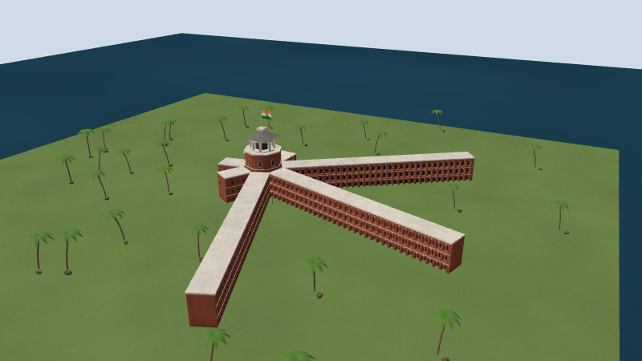

## Andhra Pradesh

### Mallikarjuna Temple

Srisailam, Andhra Pradesh · Expanded 14th–16th c. · Dravidian · Stone · [view in 3D](https://monuments-of-india-nu.vercel.app/#mallikarjuna-temple)

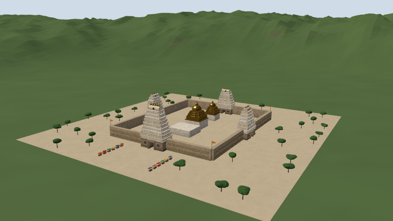

### Tirumala Venkateswara Temple

Tirumala, Andhra Pradesh · Expanded 9th–16th c. · Dravidian · Granite with gilded copper · [view in 3D](https://monuments-of-india-nu.vercel.app/#tirumala-venkateswara-temple)

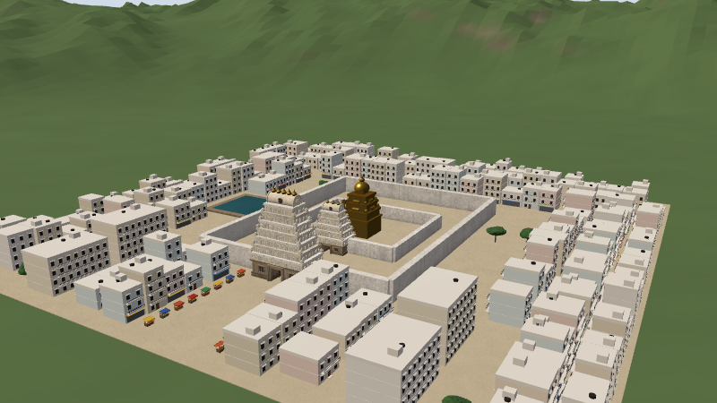

## Arunachal Pradesh

### Tawang Monastery

Tawang, Arunachal Pradesh · 1680–1681 · Tibetan Buddhist · Stone, timber and lime · [view in 3D](https://monuments-of-india-nu.vercel.app/#tawang-monastery)

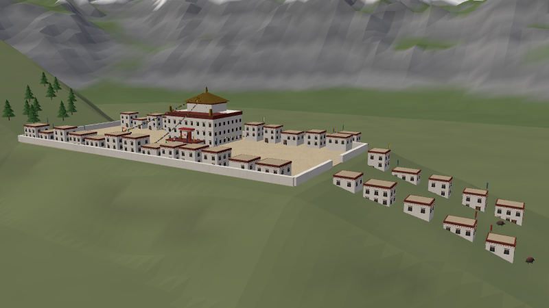

## Assam

### Kamakhya Temple

Nilachal Hill, Guwahati · Rebuilt 1565 · Nilachal · Stone · [view in 3D](https://monuments-of-india-nu.vercel.app/#kamakhya-temple)

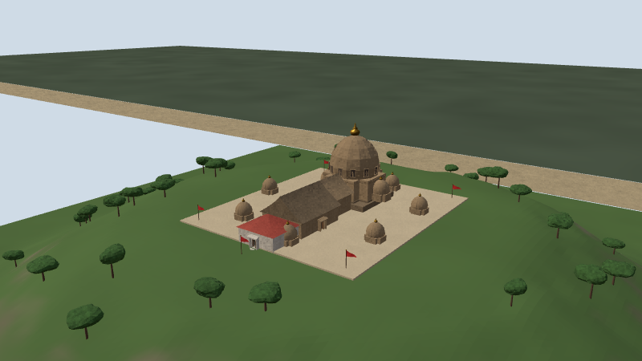

## Bihar

### Mahabodhi Temple

Bodh Gaya, Bihar · 5th–6th c. CE · Gupta-era brick · Brick with stucco · [view in 3D](https://monuments-of-india-nu.vercel.app/#mahabodhi-temple)

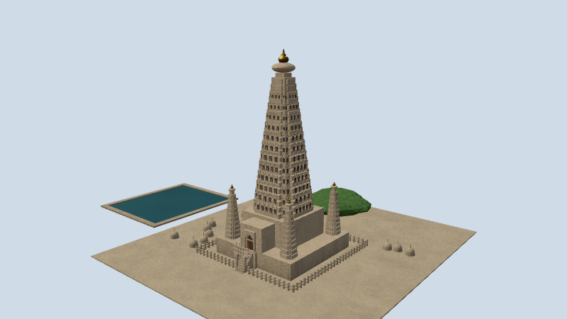

### Nalanda Mahavihara

Nalanda, Bihar · 5th–12th c. · Gupta and Pala brick · Brick · [view in 3D](https://monuments-of-india-nu.vercel.app/#nalanda-mahavihara)

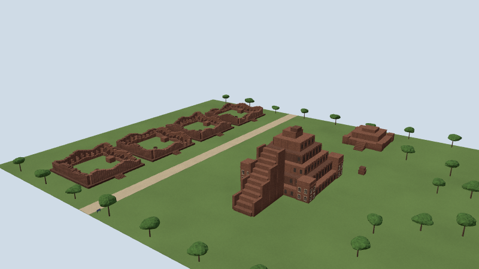

### Sher Shah Suri’s Tomb

Sasaram, Bihar · 1540–1545 · Indo-Afghan (Sur) · Red sandstone · [view in 3D](https://monuments-of-india-nu.vercel.app/#sher-shah-suri-tomb)

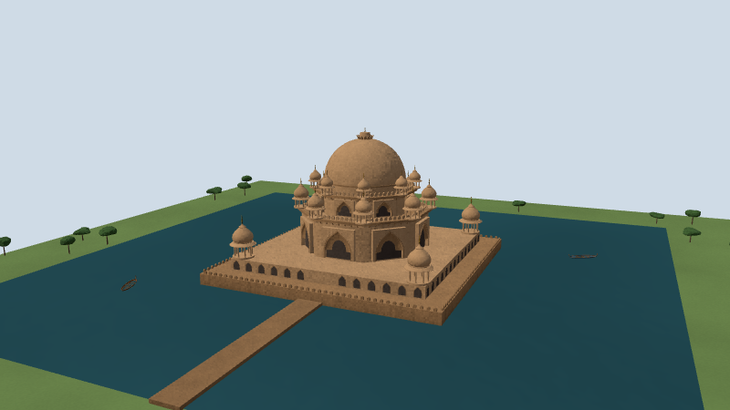

## Chandigarh

### Capitol Complex, Chandigarh

Sector 1, Chandigarh · 1951–1965 · Modernist · Raw concrete · [view in 3D](https://monuments-of-india-nu.vercel.app/#capitol-complex)

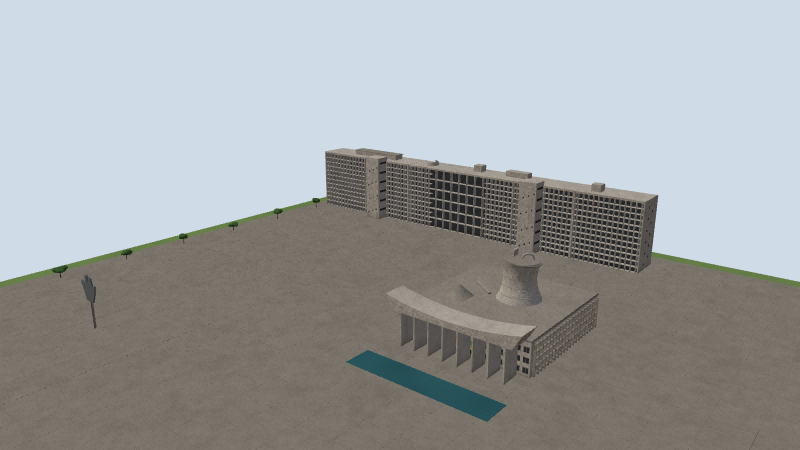

## Delhi

### Humayun’s Tomb

Nizamuddin, New Delhi · 1565–1572 · Mughal · Red sandstone and white marble · [view in 3D](https://monuments-of-india-nu.vercel.app/#humayuns-tomb)

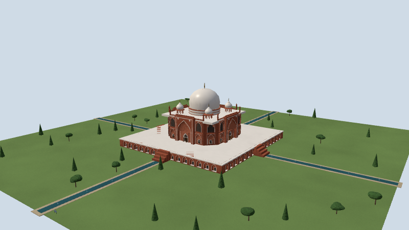

### India Gate

Kartavya Path, New Delhi · 1921–1931 · Memorial arch · Red and buff Bharatpur sandstone · [view in 3D](https://monuments-of-india-nu.vercel.app/#india-gate)

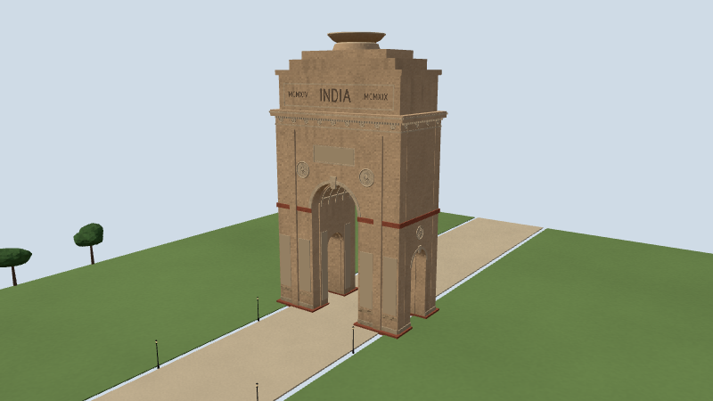

### Jama Masjid

Chandni Chowk, Old Delhi · 1650–1656 · Mughal · Red sandstone and white marble · [view in 3D](https://monuments-of-india-nu.vercel.app/#jama-masjid)

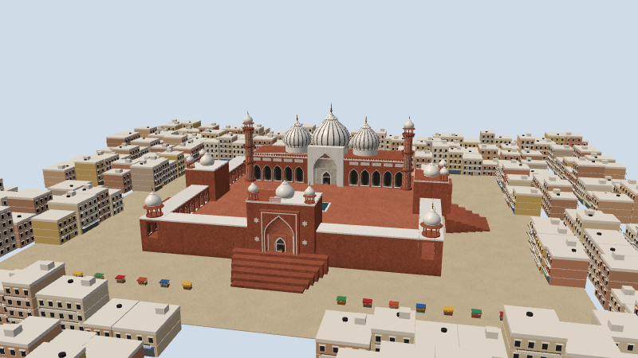

### Lotus Temple

Kalkaji, New Delhi · 1980–1986 · Expressionist · Greek Pentelic marble on concrete · [view in 3D](https://monuments-of-india-nu.vercel.app/#lotus-temple)

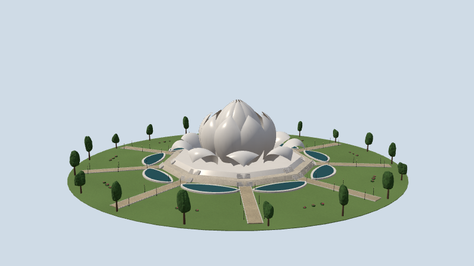

### National War Memorial

Kartavya Path, New Delhi · 2019 · Modern memorial · Granite · [view in 3D](https://monuments-of-india-nu.vercel.app/#national-war-memorial)

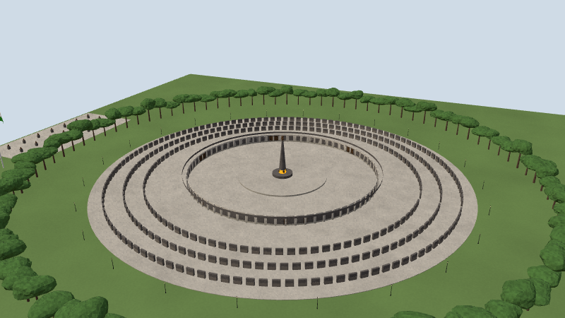

### New Parliament House

Sansad Marg, New Delhi · 2020–2023 · Contemporary · Red and buff sandstone · [view in 3D](https://monuments-of-india-nu.vercel.app/#new-parliament-house)

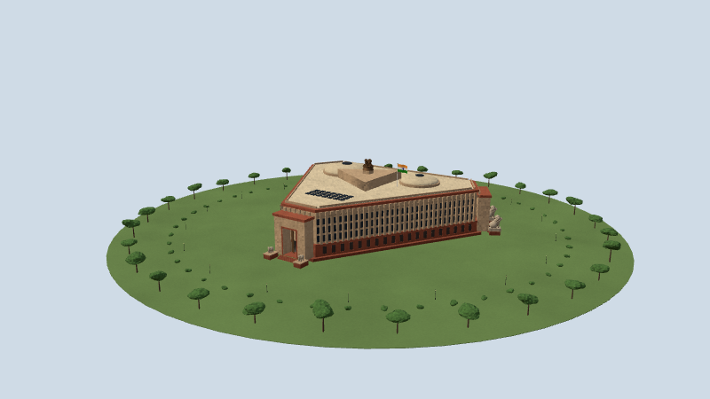

### Old Parliament House

Sansad Marg, New Delhi · 1921–1927 · Lutyens’ Delhi · Red and buff sandstone · [view in 3D](https://monuments-of-india-nu.vercel.app/#old-parliament-house)

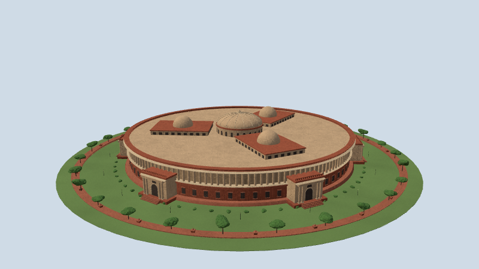

### Qutub Minar

Mehrauli, Delhi · 1199–1220 · Indo-Islamic · Red sandstone and marble · [view in 3D](https://monuments-of-india-nu.vercel.app/#qutub-minar)

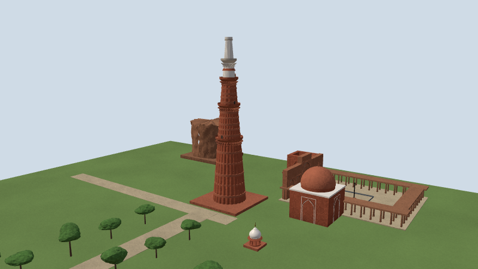

### Rashtrapati Bhavan

Raisina Hill, New Delhi · 1912–1929 · Lutyens’ Delhi · Cream and red Dholpur sandstone · [view in 3D](https://monuments-of-india-nu.vercel.app/#rashtrapati-bhavan)

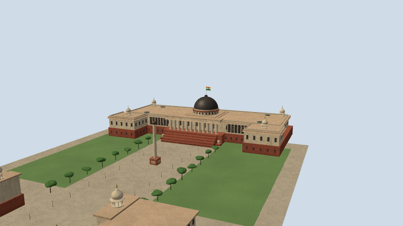

### Red Fort

Old Delhi · 1639–1648 · Mughal · Red sandstone · [view in 3D](https://monuments-of-india-nu.vercel.app/#red-fort)

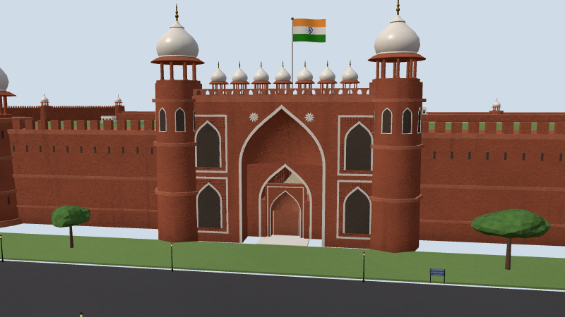

### Safdarjung’s Tomb

Lodhi Road, New Delhi · 1754 · Late Mughal · Red and buff sandstone, marble · [view in 3D](https://monuments-of-india-nu.vercel.app/#safdarjung-tomb)

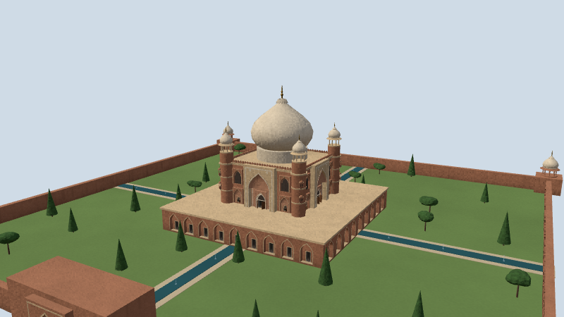

### Swaminarayan Akshardham

New Delhi · 2000–2005 · Maru-Gurjara · Pink sandstone and Italian marble · [view in 3D](https://monuments-of-india-nu.vercel.app/#akshardham)

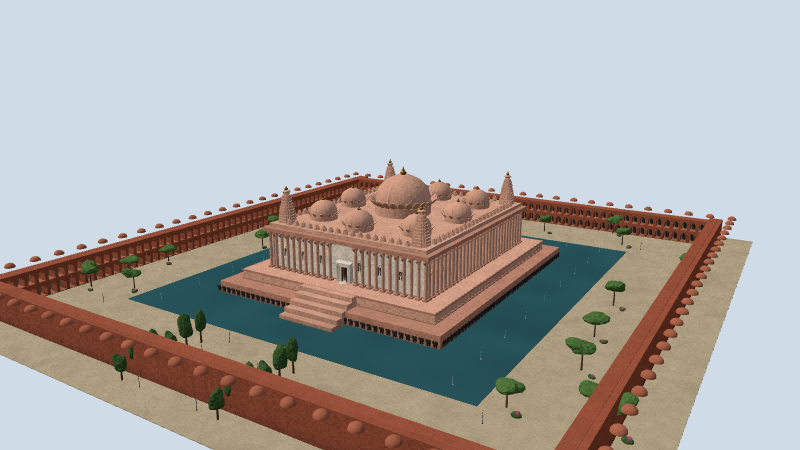

## Goa

### Basilica of Bom Jesus

Old Goa, Goa · 1594–1605 · Baroque · Laterite and basalt · [view in 3D](https://monuments-of-india-nu.vercel.app/#basilica-of-bom-jesus)

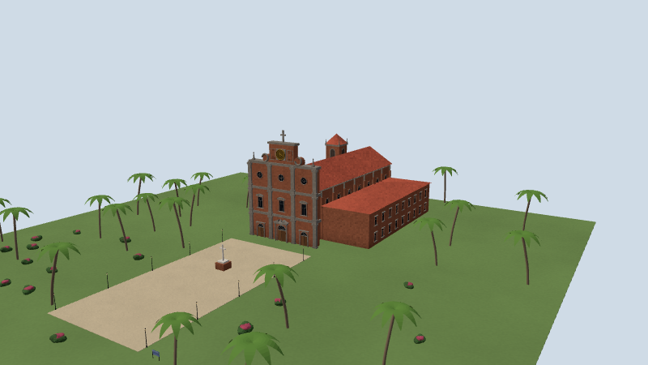

### Fort Aguada

Candolim, Goa · 1612 · Portuguese · Laterite · [view in 3D](https://monuments-of-india-nu.vercel.app/#fort-aguada)

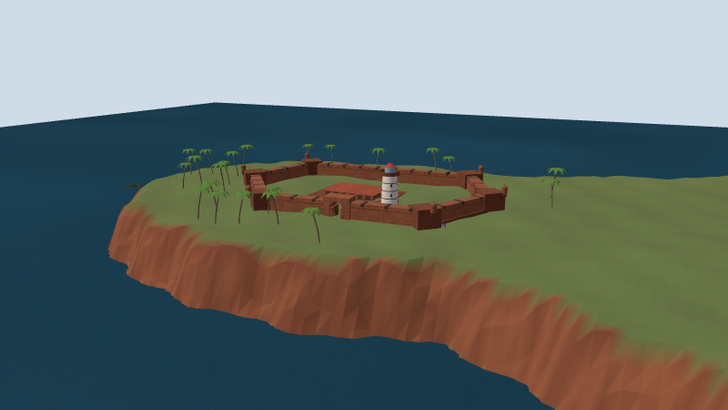

## Gujarat

### Kirti Mandir

Porbandar, Gujarat · 1947–1950 · Mixed · Stone · [view in 3D](https://monuments-of-india-nu.vercel.app/#kirti-mandir)

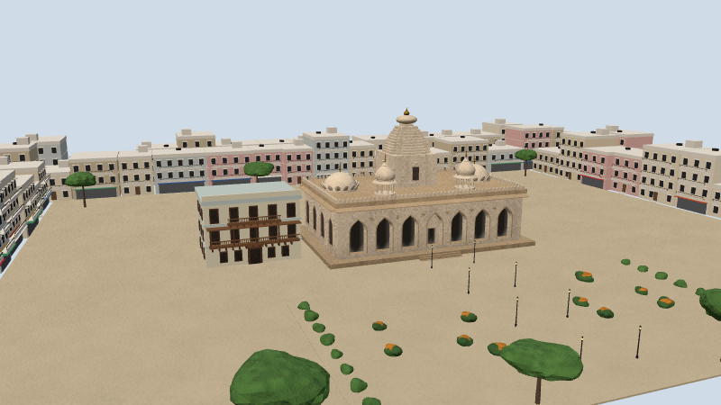

### Laxmi Vilas Palace

Vadodara, Gujarat · 1878–1890 · Indo-Saracenic · Sandstone and marble · [view in 3D](https://monuments-of-india-nu.vercel.app/#laxmi-vilas-palace)

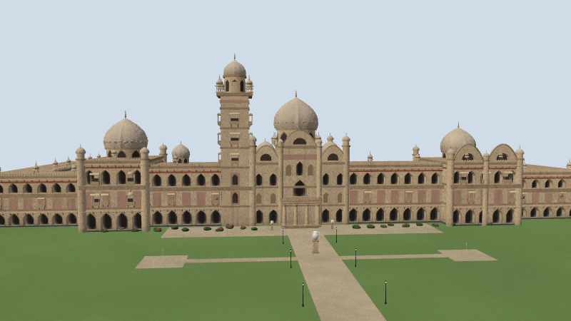

### Nageshwar Temple

Dwarka, Gujarat · Rebuilt 1990s · Nagara · Pink stone · [view in 3D](https://monuments-of-india-nu.vercel.app/#nageshwar-temple)

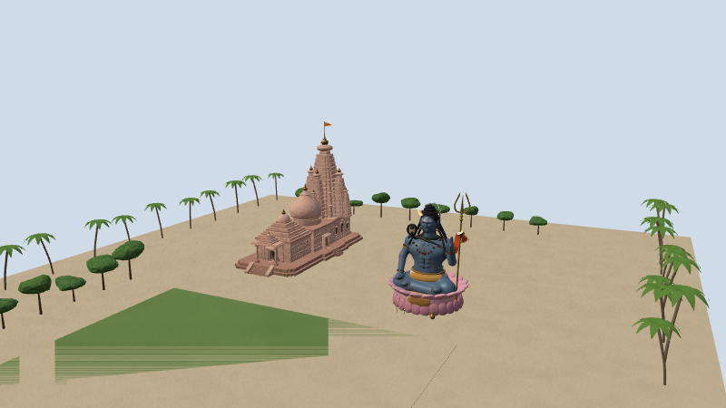

### Palitana Temples

Shatrunjaya hill, Gujarat · 11th–20th c. · Maru-Gurjara · Marble · [view in 3D](https://monuments-of-india-nu.vercel.app/#palitana-temples)

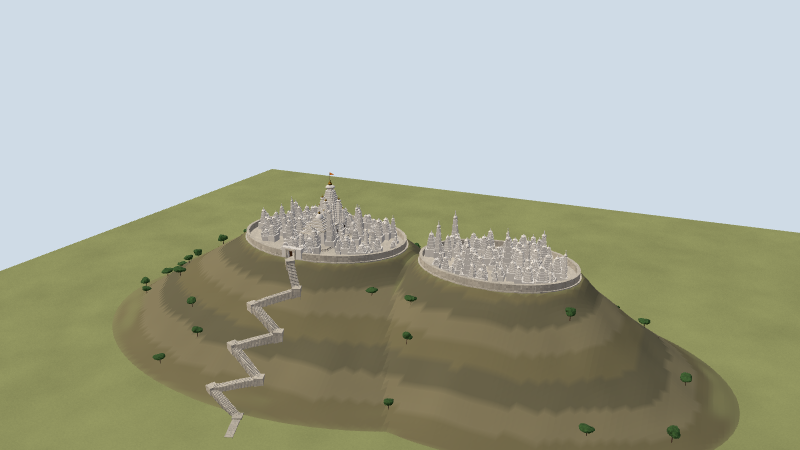

### Rani ki Vav

Patan, Gujarat · 11th century · Maru-Gurjara · Sandstone · [view in 3D](https://monuments-of-india-nu.vercel.app/#rani-ki-vav)

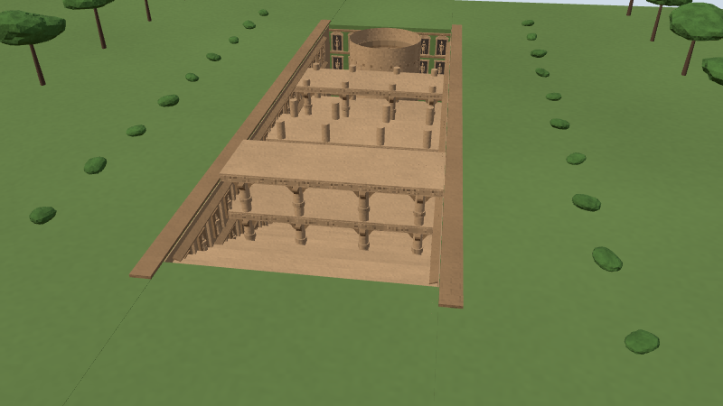

### Somnath Temple

Prabhas Patan, Gujarat · Rebuilt 1951 · Maru-Gurjara (Chalukya) · Sandstone · [view in 3D](https://monuments-of-india-nu.vercel.app/#somnath-temple)

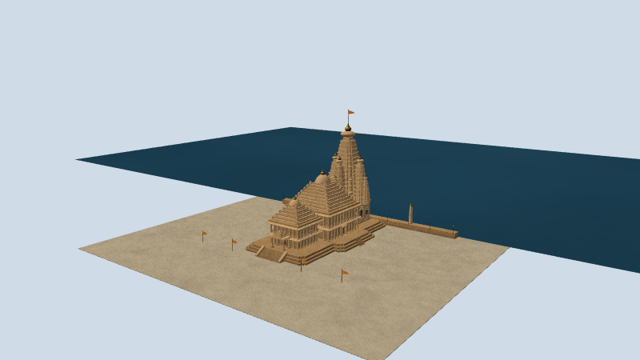

### Statue of Unity

Ekta Nagar, Gujarat · 2013–2018 · Monumental statue · Bronze cladding over steel and concrete · [view in 3D](https://monuments-of-india-nu.vercel.app/#statue-of-unity)

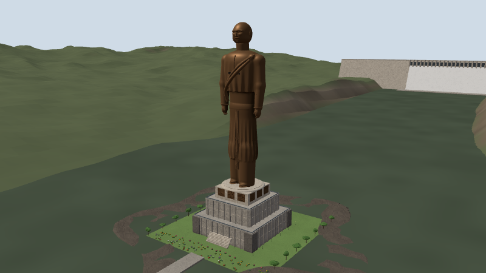

## Himachal Pradesh

### Hidimba Devi Temple

Manali, Himachal Pradesh · 1553 · Himalayan pagoda · Stone and deodar wood · [view in 3D](https://monuments-of-india-nu.vercel.app/#hidimba-devi-temple)

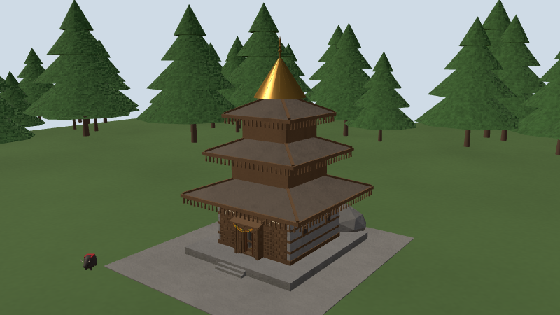

### Key Monastery

Spiti Valley, Himachal Pradesh · Founded c. 11th c. · Tibetan Buddhist · Stone and mud brick · [view in 3D](https://monuments-of-india-nu.vercel.app/#key-monastery)

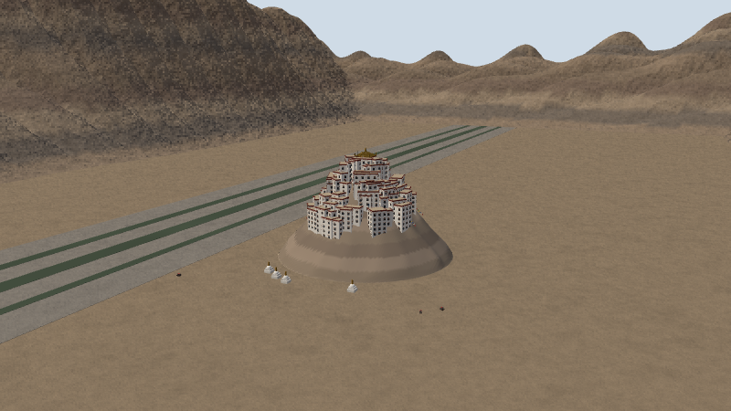

## Jammu and Kashmir

### Hazratbal Shrine

Srinagar, Jammu and Kashmir · 1968–1979 · Mughal-inspired · White marble · [view in 3D](https://monuments-of-india-nu.vercel.app/#hazratbal-shrine)

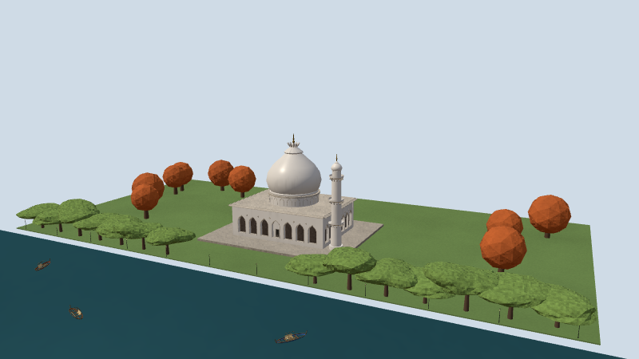

## Jharkhand

### Baidyanath Temple

Deoghar, Jharkhand · 16th c. (present form) · Nagara · Stone and lime plaster · [view in 3D](https://monuments-of-india-nu.vercel.app/#baidyanath-temple)

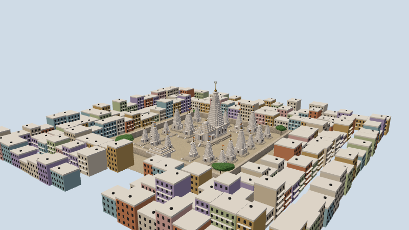

### Shikharji

Parasnath Hill, Jharkhand · 18th c. onward · Jain · Marble and stone · [view in 3D](https://monuments-of-india-nu.vercel.app/#shikharji)

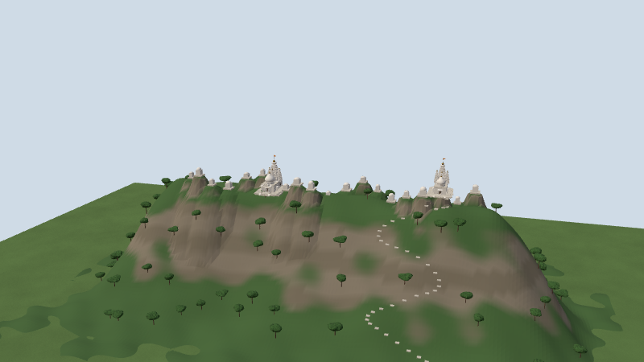

## Karnataka

### Chennakesava Temple

Somanathapura, Karnataka · 1258 · Hoysala · Soapstone · [view in 3D](https://monuments-of-india-nu.vercel.app/#chennakesava-temple)

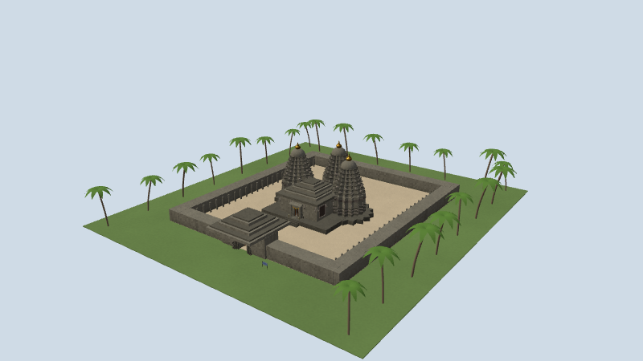

### Gol Gumbaz

Vijayapura, Karnataka · 1626–1656 · Deccan (Adil Shahi) · Dark basalt with lime plaster · [view in 3D](https://monuments-of-india-nu.vercel.app/#gol-gumbaz)

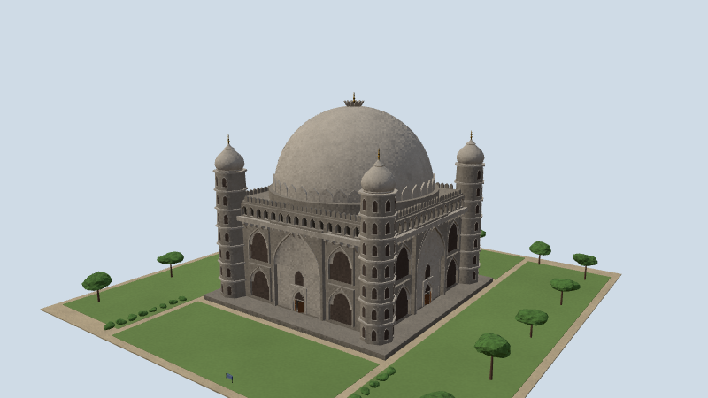

### Gommateshwara Statue

Shravanabelagola, Karnataka · c. 983 CE · Monolithic statue · Granite · [view in 3D](https://monuments-of-india-nu.vercel.app/#gommateshwara)

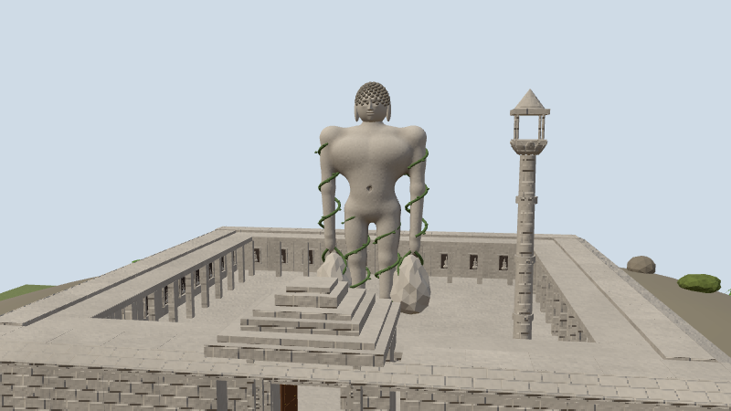

### Mysore Palace

Mysuru, Karnataka · 1897–1912 · Indo-Saracenic · Grey granite with pink marble domes · [view in 3D](https://monuments-of-india-nu.vercel.app/#mysore-palace)

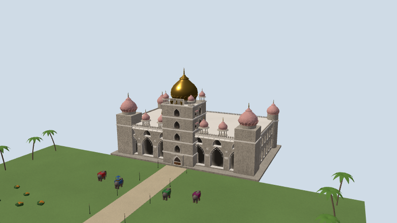

### Tipu Sultan’s Gumbaz

Srirangapatna, Karnataka · 1782–1784 · Indo-Islamic · Lime plaster and granite · [view in 3D](https://monuments-of-india-nu.vercel.app/#tipu-sultan-gumbaz)

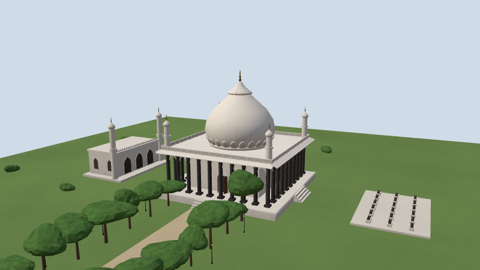

### Vittala Temple, Hampi

Hampi, Karnataka · 15th–16th c. · Vijayanagara · Granite · [view in 3D](https://monuments-of-india-nu.vercel.app/#vittala-temple-hampi)

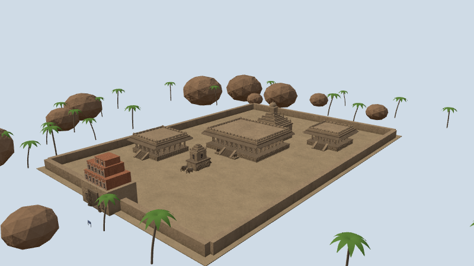

## Kerala

### Bekal Fort

Kasaragod, Kerala · c. 1650 · Keladi · Laterite · [view in 3D](https://monuments-of-india-nu.vercel.app/#bekal-fort)

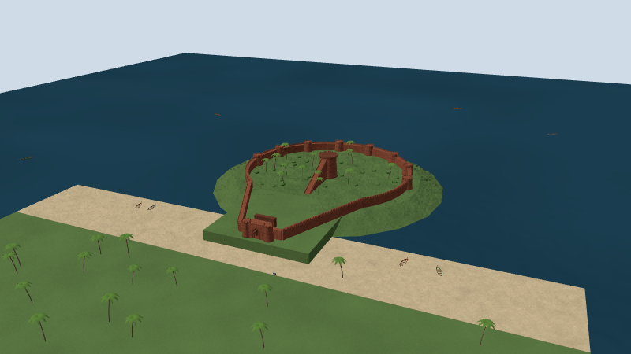

### Padmanabhaswamy Temple

Thiruvananthapuram, Kerala · 16th–18th c. · Dravidian and Kerala · Granite · [view in 3D](https://monuments-of-india-nu.vercel.app/#padmanabhaswamy-temple)

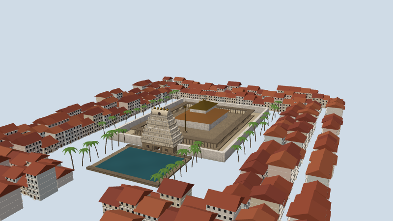

## Ladakh

### Kargil War Memorial

Dras, Ladakh · Opened 2004 · Modern memorial · Pink sandstone · [view in 3D](https://monuments-of-india-nu.vercel.app/#kargil-war-memorial)

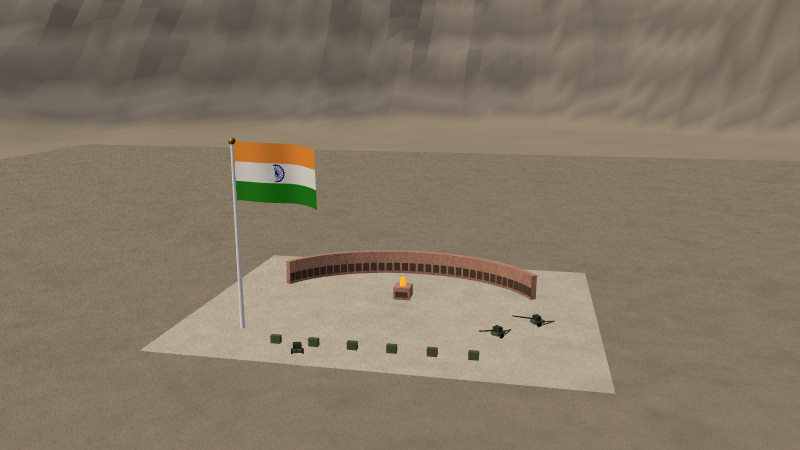

### Thiksey Monastery

Near Leh, Ladakh · 15th century · Tibetan Buddhist (Gelug) · Stone, mud brick and timber · [view in 3D](https://monuments-of-india-nu.vercel.app/#thiksey-monastery)

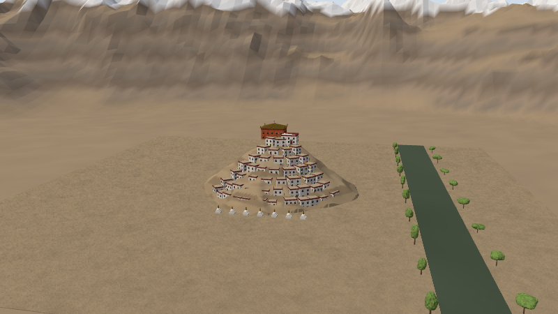

## Madhya Pradesh

### Gwalior Fort

Gwalior, Madhya Pradesh · 8th–16th c. · Rajput (Tomar) · Sandstone with glazed tiles · [view in 3D](https://monuments-of-india-nu.vercel.app/#gwalior-fort)

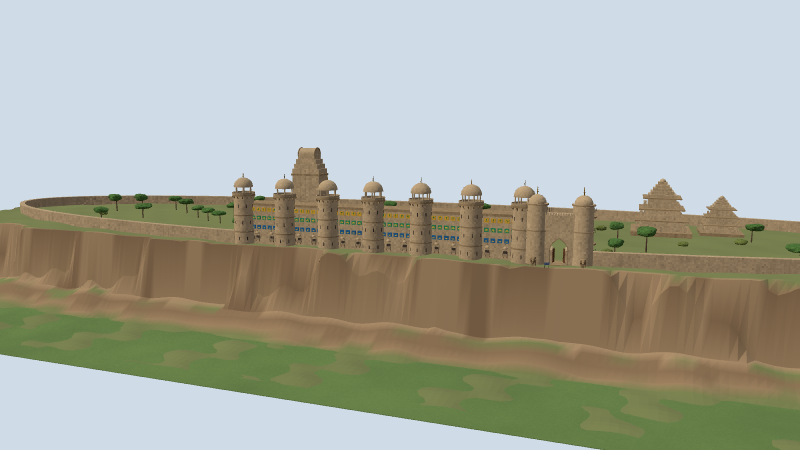

### Kandariya Mahadeva Temple

Khajuraho, Madhya Pradesh · c. 1030 CE · Nagara (Chandela) · Sandstone · [view in 3D](https://monuments-of-india-nu.vercel.app/#kandariya-mahadeva)

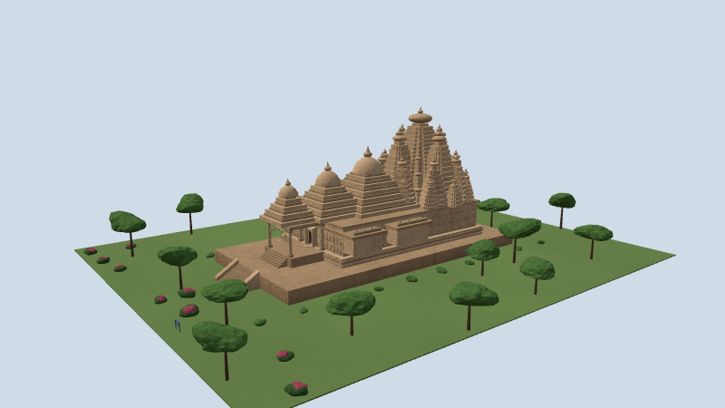

### Mahakaleshwar Temple

Ujjain, Madhya Pradesh · Rebuilt 18th c. · Bhumija and Maratha · Stone · [view in 3D](https://monuments-of-india-nu.vercel.app/#mahakaleshwar-temple)

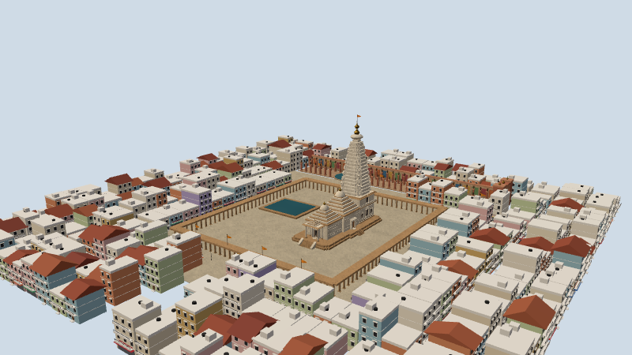

### Omkareshwar Temple

Mandhata island, Madhya Pradesh · Rebuilt 18th c. · Nagara · Stone · [view in 3D](https://monuments-of-india-nu.vercel.app/#omkareshwar-temple)

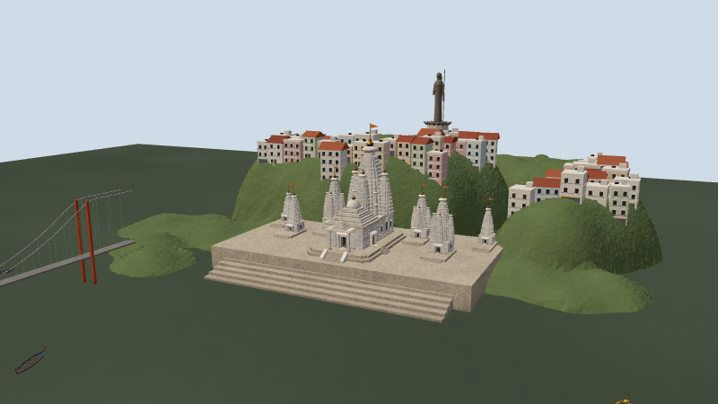

### Parshvanath Temple, Khajuraho

Khajuraho, Madhya Pradesh · c. 950–970 CE · Nagara (Chandela) · Sandstone · [view in 3D](https://monuments-of-india-nu.vercel.app/#parshvanath-temple-khajuraho)

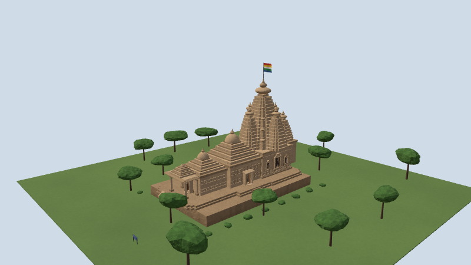

### Sanchi Stupa

Sanchi, Madhya Pradesh · 3rd c. BCE · Buddhist (Mauryan) · Sandstone · [view in 3D](https://monuments-of-india-nu.vercel.app/#sanchi-stupa)

## Maharashtra

### Ajanta Caves

Ajanta, Maharashtra · 2nd c. BCE–c. 480 CE · Rock-cut Buddhist · Basalt · [view in 3D](https://monuments-of-india-nu.vercel.app/#ajanta-caves)

### Bandra–Worli Sea Link

Mumbai, Maharashtra · 2000–2009 · Cable-stayed bridge · Steel and concrete · [view in 3D](https://monuments-of-india-nu.vercel.app/#bandra-worli-sea-link)

### Bhimashankar Temple

Sahyadri hills, Maharashtra · 13th–18th c. · Nagara · Black basalt · [view in 3D](https://monuments-of-india-nu.vercel.app/#bhimashankar-temple)

### Bibi Ka Maqbara

Chhatrapati Sambhajinagar, Maharashtra · 1660s · Mughal · Marble, basalt and lime plaster · [view in 3D](https://monuments-of-india-nu.vercel.app/#bibi-ka-maqbara)

### Chhatrapati Shivaji Maharaj Terminus

Fort, Mumbai · 1878–1888 · Victorian Gothic · Sandstone and limestone · [view in 3D](https://monuments-of-india-nu.vercel.app/#csmt)

### Daulatabad Fort

Near Chhatrapati Sambhajinagar, Maharashtra · 12th–15th c. · Deccan · Stone · [view in 3D](https://monuments-of-india-nu.vercel.app/#daulatabad-fort)

### Gateway of India

Apollo Bunder, Mumbai · 1913–1924 · Indo-Saracenic · Yellow basalt and concrete · [view in 3D](https://monuments-of-india-nu.vercel.app/#gateway-of-india)

### Grishneshwar Temple

Verul, near Ellora · 18th century · Nagara (Maratha) · Red basalt · [view in 3D](https://monuments-of-india-nu.vercel.app/#grishneshwar-temple)

### Kailasa Temple, Ellora

Ellora, Maharashtra · 8th century · Dravidian (Rashtrakuta) · Basalt, carved from one rock · [view in 3D](https://monuments-of-india-nu.vercel.app/#kailasa-temple)

### Trimbakeshwar Temple

Trimbak, Nashik · 1755–1786 · Nagara · Black basalt · [view in 3D](https://monuments-of-india-nu.vercel.app/#trimbakeshwar-temple)

## Odisha

### Jagannath Puri Temple

Puri, Odisha · 12th century · Kalinga · Khondalite stone · [view in 3D](https://monuments-of-india-nu.vercel.app/#jagannath-puri-temple)

### Konark Sun Temple

Konark, Odisha · c. 1250 CE · Kalinga · Khondalite stone · [view in 3D](https://monuments-of-india-nu.vercel.app/#konark-sun-temple)

## Punjab

### Golden Temple

Amritsar, Punjab · 1581–1604 · Sikh · Marble and gilded copper · [view in 3D](https://monuments-of-india-nu.vercel.app/#golden-temple)

### Jallianwala Bagh

Amritsar, Punjab · Memorial 1961 · Modern memorial · Red sandstone · [view in 3D](https://monuments-of-india-nu.vercel.app/#jallianwala-bagh)

## Rajasthan

### Amber Fort

Amer, Jaipur · 16th–18th c. · Rajput and Mughal · Sandstone and marble · [view in 3D](https://monuments-of-india-nu.vercel.app/#amber-fort)

### Chittorgarh Fort

Chittorgarh, Rajasthan · 7th–16th c. · Rajput · Stone · [view in 3D](https://monuments-of-india-nu.vercel.app/#chittorgarh-fort)

### City Palace, Udaipur

Udaipur, Rajasthan · From 1559 · Rajput · Granite and marble · [view in 3D](https://monuments-of-india-nu.vercel.app/#city-palace-udaipur)

### Dilwara Temples

Mount Abu, Rajasthan · 11th–13th c. · Jain (Maru-Gurjara) · White marble · [view in 3D](https://monuments-of-india-nu.vercel.app/#dilwara-temples)

### Hawa Mahal

Jaipur, Rajasthan · 1799 · Rajput · Red and pink sandstone · [view in 3D](https://monuments-of-india-nu.vercel.app/#hawa-mahal)

### Jaisalmer Fort

Jaisalmer, Rajasthan · From 1156 · Rajput · Yellow sandstone · [view in 3D](https://monuments-of-india-nu.vercel.app/#jaisalmer-fort)

### Mehrangarh Fort

Jodhpur, Rajasthan · From 1459 · Rajput · Red sandstone · [view in 3D](https://monuments-of-india-nu.vercel.app/#mehrangarh-fort)

### Ranakpur Jain Temple

Ranakpur, Rajasthan · 15th century · Jain (Maru-Gurjara) · Light marble · [view in 3D](https://monuments-of-india-nu.vercel.app/#ranakpur-jain-temple)

### Soniji Ki Nasiyan

Ajmer, Rajasthan · 1864–1895 · Jain · Red sandstone and gilded wood · [view in 3D](https://monuments-of-india-nu.vercel.app/#soniji-ki-nasiyan)

## Sikkim

### Rumtek Monastery

Near Gangtok, Sikkim · 1960s · Tibetan Buddhist · Stone, timber and gilt · [view in 3D](https://monuments-of-india-nu.vercel.app/#rumtek-monastery)

## Tamil Nadu

### Brihadeeswara Temple

Thanjavur, Tamil Nadu · 1003–1010 CE · Dravidian (Chola) · Granite · [view in 3D](https://monuments-of-india-nu.vercel.app/#brihadeeswara-temple)

### Meenakshi Temple

Madurai, Tamil Nadu · 16th–17th c. · Dravidian (Nayak) · Granite and painted stucco · [view in 3D](https://monuments-of-india-nu.vercel.app/#meenakshi-temple)

### Ramanathaswamy Temple

Rameswaram, Tamil Nadu · 12th–17th c. · Dravidian · Granite · [view in 3D](https://monuments-of-india-nu.vercel.app/#ramanathaswamy-temple)

### Shore Temple

Mahabalipuram, Tamil Nadu · c. 700–728 CE · Dravidian (Pallava) · Granite · [view in 3D](https://monuments-of-india-nu.vercel.app/#shore-temple)

### Vivekananda Rock Memorial

Kanyakumari, Tamil Nadu · 1970 · Mixed Indian temple styles · Stone · [view in 3D](https://monuments-of-india-nu.vercel.app/#vivekananda-rock-memorial)

## Telangana

### Charminar

Hyderabad, Telangana · 1591 · Qutb Shahi · Granite, limestone and lime mortar · [view in 3D](https://monuments-of-india-nu.vercel.app/#charminar)

### Golconda Fort

Hyderabad, Telangana · 13th–17th c. · Deccan · Granite · [view in 3D](https://monuments-of-india-nu.vercel.app/#golconda-fort)

### Qutb Shahi Tombs

Hyderabad, Telangana · 16th–17th c. · Qutb Shahi · Granite and lime plaster · [view in 3D](https://monuments-of-india-nu.vercel.app/#qutb-shahi-tombs)

### Ramappa Temple

Palampet, Telangana · 1213 CE · Kakatiya · Sandstone, dolerite and light brick · [view in 3D](https://monuments-of-india-nu.vercel.app/#ramappa-temple)

## Uttar Pradesh

### Agra Fort

Agra, Uttar Pradesh · 1565–1573 · Mughal · Red sandstone and white marble · [view in 3D](https://monuments-of-india-nu.vercel.app/#agra-fort)

### Akbar’s Tomb

Sikandra, Agra · 1605–1613 · Mughal · Red sandstone and white marble · [view in 3D](https://monuments-of-india-nu.vercel.app/#akbars-tomb)

### Bara Imambara

Lucknow, Uttar Pradesh · 1784–1791 · Nawabi (Awadhi) · Lakhauri brick and lime plaster · [view in 3D](https://monuments-of-india-nu.vercel.app/#bara-imambara)

### Buland Darwaza

Fatehpur Sikri, Uttar Pradesh · c. 1575–1601 · Mughal · Red sandstone and white marble · [view in 3D](https://monuments-of-india-nu.vercel.app/#buland-darwaza)

### Chota Imambara

Lucknow, Uttar Pradesh · 1837–1838 · Nawabi (Awadhi) · Brick and lime plaster · [view in 3D](https://monuments-of-india-nu.vercel.app/#chota-imambara)

### Dhamek Stupa

Sarnath, Uttar Pradesh · c. 500 CE · Gupta · Stone and brick · [view in 3D](https://monuments-of-india-nu.vercel.app/#dhamek-stupa)

### Itmad-ud-Daulah’s Tomb

Agra, Uttar Pradesh · 1622–1628 · Mughal · White marble with pietra dura · [view in 3D](https://monuments-of-india-nu.vercel.app/#itmad-ud-daulah)

### Kashi Vishwanath Temple

Varanasi, Uttar Pradesh · 1780 · Nagara · Stone with gold plating · [view in 3D](https://monuments-of-india-nu.vercel.app/#kashi-vishwanath-temple)

### Panch Mahal

Fatehpur Sikri, Uttar Pradesh · 1570s · Mughal · Red sandstone · [view in 3D](https://monuments-of-india-nu.vercel.app/#panch-mahal)

### Ram Mandir

Ayodhya, Uttar Pradesh · 2020–2024 · Nagara · Pink Bansi Paharpur sandstone · [view in 3D](https://monuments-of-india-nu.vercel.app/#ram-mandir)

### Rumi Darwaza

Lucknow, Uttar Pradesh · 1784 · Nawabi (Awadhi) · Brick and lime plaster · [view in 3D](https://monuments-of-india-nu.vercel.app/#rumi-darwaza)

### Taj Mahal

Agra, Uttar Pradesh · 1632–1653 · Mughal · White Makrana marble · [view in 3D](https://monuments-of-india-nu.vercel.app/#taj-mahal)

## Uttarakhand

### Kedarnath Temple

Kedarnath, Uttarakhand · 8th c. (by tradition) · Himalayan Nagara · Grey stone slabs · [view in 3D](https://monuments-of-india-nu.vercel.app/#kedarnath-temple)

## West Bengal

### Cooch Behar Palace

Cooch Behar, West Bengal · 1887 · Italian Renaissance · Brick · [view in 3D](https://monuments-of-india-nu.vercel.app/#cooch-behar-palace)

### Howrah Bridge

Kolkata, West Bengal · 1936–1943 · Cantilever truss · Riveted high-tensile steel · [view in 3D](https://monuments-of-india-nu.vercel.app/#howrah-bridge)

### Shaheed Minar

Maidan, Kolkata · 1828 · Mixed (Egyptian, Syrian, Turkish) · Stone · [view in 3D](https://monuments-of-india-nu.vercel.app/#shaheed-minar)

### Victoria Memorial

Maidan, Kolkata · 1906–1921 · Indo-Saracenic · White Makrana marble · [view in 3D](https://monuments-of-india-nu.vercel.app/#victoria-memorial)

